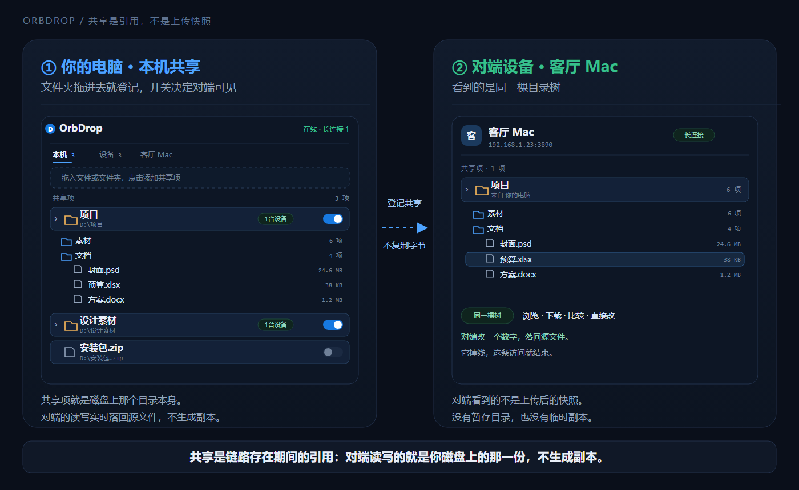
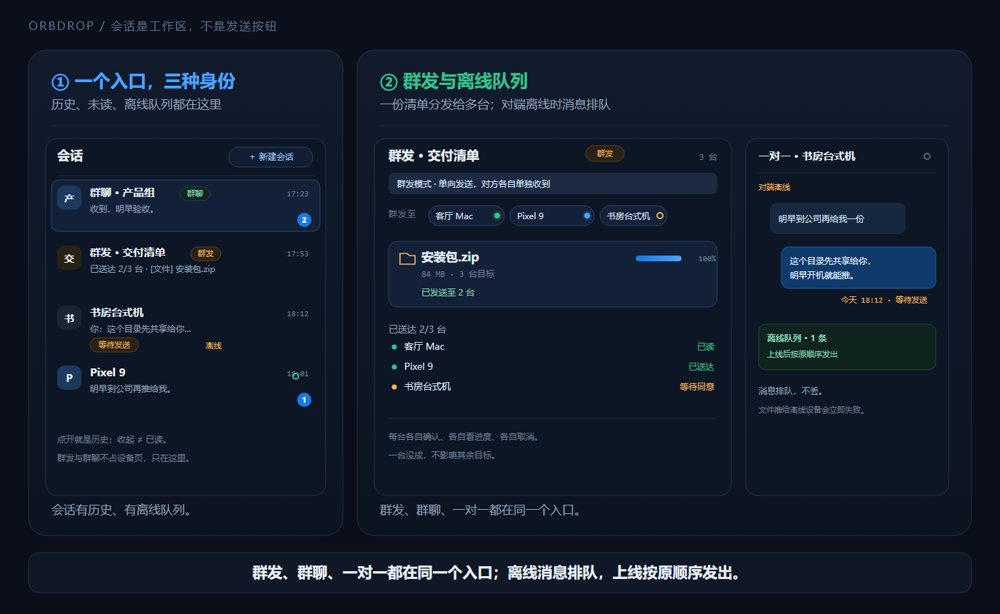
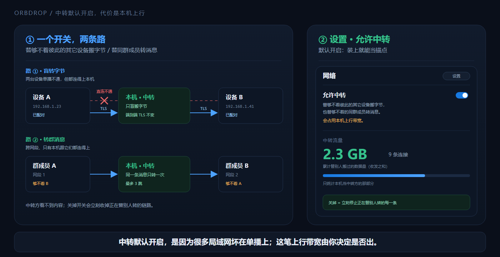
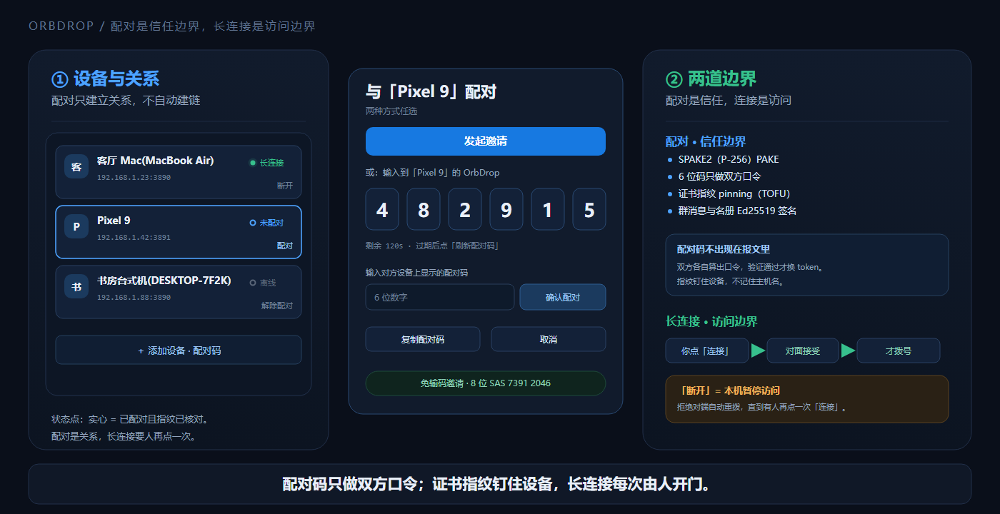

<div align="center">


<h1>OrbDrop</h1>

<p><b>局域网文件中转</b> —— 悬浮球拖入即可见，推送即落盘</p>

<p>
  <a href="./LICENSE"></a>
  <a href="https://github.com/x177plus/OrbDrop/releases/latest"></a>
  
  
  
</p>

<p><a href="./README.md">English</a> | <b>简体中文</b></p>

</div>

## 这是什么

OrbDrop 是一个局域网文件工具，界面主体是一个始终置顶的悬浮球。两台已经互认的设备之间有两**条互相独立的文件通路**：

- **拖入可见（零拷贝）** —— 把目录/文件拖进悬浮球，就地登记，随即对已建立长连接的设备可见。对端浏览你**真实磁盘**上的内容、下载、用 Beyond Compare 比较、修改/新建/删除 —— 改动直接写回源文件。整个过程不复制文件，数据始终留在拥有它的那台机器上；对方一掉线，访问也就没了。
- **推送（真传输）** —— 在会话里选中文件/目录推过去。已配对的设备**不用问**直接收，未配对的会收到一张同意气泡。这条路才是真的把文件写进对端磁盘。

只在局域网内使用：不做公网穿透、不做中继服务器、不依赖云、不需要账号。



## 下载

先选平台，再按“应该下载”那一列拿文件；`<版本>` 是 Release 的版本号（例如 `0.2.0`）。
GitHub / Gitee 的下载页：[GitHub 最新版](https://github.com/x177plus/OrbDrop/releases/latest) ·
[Gitee 最新版](https://gitee.com/x177plus/OrbDrop/releases)。

| 平台 | 应该下载 | 说明 |
| --- | --- | --- |
| Windows 桌面端（x86_64） | `OrbDrop_<版本>_windows_x64.exe` | 单文件绿色版，无需安装 |
| macOS 11+（通用包） | `OrbDrop_<版本>_macos_universal.dmg` | **首次安装用这个**；未签名包首次运行需右键「打开」 |
| 安卓（arm64） | `OrbDrop_<版本>_android_arm64.apk` | 绝大多数手机，体积更小、更省内存 |
| 安卓（通用包） | `OrbDrop_<版本>_android_universal.apk` | 老机型/模拟器；拿不准就选这个 |

`OrbDrop_<版本>_macos_universal.app.zip` 与 `update.json` 是**应用内自动更新**用的，
不需要手动下载；应用检查到新版本会自己取。Windows 桌面端是单文件绿色版（不带安装器）。
macOS 是通用 `.app`（Apple Silicon + Intel）；自更新要求应用放在可写位置（通常是 `/Applications`）。
平台差异与真机验证清单见 [`docs/macos.md`](./docs/macos.md)。

APK 装不上时按机型选包：手机上绝大多数是 arm64（`OrbDrop_<版本>_android_arm64.apk` 更小、更省内存），
拿不准就用通用包。

### 更新清单与校验

清单地址是客户端的**编译期常量**，所以本仓承担两个固定位置：

- GitHub：Release 附件 `update.json` —— `https://github.com/x177plus/OrbDrop/releases/latest/download/update.json`
- Gitee：仓库根目录 `update.json` —— `https://gitee.com/x177plus/OrbDrop/raw/master/update.json`

清单里的下载地址都钉了 tag（`releases/download/vX.Y.Z/...`），老版本客户端不会因为新版本发布而下错包。每个产物都带 `size` 与 `sha256`（Windows / macOS 版另有 Tauri 更新签名 `sig`），下载后可以自己核对：`sha256sum OrbDrop_<版本>_windows_x64.exe` 或 `shasum -a 256 OrbDrop_<版本>_macos_universal.app.zip`。

## 功能亮点

### 1. 悬浮窗：拖入即共享，拖出即落地

- 始终置顶、无边框，两种形态可选 —— 圆球，或带设备分页的圆角矩形卡片。可贴边（只留一小条，指针移入自动滑回），拖文件过来时高亮预告，有事等你时托盘图标整帧闪动并盖红点；再次启动会唤起已在运行的实例，不会开出第二份。
- 把目录拖进球 → 登记为一个共享项（按路径幂等去重），**当场对每一台长连接设备可见**。每个共享项有自己的广播开关，并有递归文件监听把变更推给对端，对面的目录树自己刷新。
- 把树里的任意文件/目录**直接拖进资源管理器 / 访达，或拖进任意其他应用**。Windows 上对端的东西在本地先建一个云文件（CFAPI）占位符（实测每项 **0.22 ms、占 0 字节磁盘**），字节等目标进程真去读的时候才从对端拉；macOS 没有公开的等价机制，对端项在起拖前整份暂存到镜像目录（见 [`docs/macos.md`](./docs/macos.md)）。只认真实路径的程序（微信这类）两边都收得到 —— Windows 起拖不用等、不预下载，macOS 只多出这一段暂存等待。
- 把文件拖到正开着的会话浮层上，直接发到那条会话。

### 2. BeyondCompare 直连比较

- 右键任意本机/对端共享项 → 用 Beyond Compare 打开（Windows；macOS 接的是 `.app` 内的 `bcomp`（也认 `bcompare`）与应用内左侧槽，profile 注入/写回尚未在真机 BC 上验证，见 [`docs/macos.md`](./docs/macos.md) §4）。
- OrbDrop 自己往 Beyond Compare 的 `BCProfiles.xml` 写入一条 WebDAV profile：地址指向**本机回环代理**，用户名 `OrbDrop`，密码是该设备的 token，并且完全按 BC 自己的格式加密（`BCmp|1|` 信封里的 AES-256-GCM）。用户不用配 profile、也不用填密码。
- BC 连的是 `http://127.0.0.1:<端口>/proxy/<设备id>/`，OrbDrop 再把它经 TLS（带指纹校验）转发到对端的 `/dav/` 端点 —— BC 永远不接触证书，也不直接碰网络。
- BC 保存时的 `PUT` / `DELETE` / `MKCOL` / `MOVE` / `COPY` **实时写回发送方的源文件**，没有暂存目录，也不留临时副本。
- profile 在启动时与每次配对成功后**预写**（Beyond Compare 只认它启动那一刻就存在的 `BCProfiles.xml`），解除配对时清理 —— 只删用户名为 `OrbDrop` 的那些条目，用户自己建的 profile 一个都不动。

### 3. 会话、群发与群聊

聊天是内置的，而且是推送的宿主，不是一个附加功能。



- **三档会话**：一对一、单向群发（每个收件人看到的是一条普通私聊，**成员互相看不见**）、共享群聊。
- **推送的入口就在会话里**：输入框旁那颗「＋」打开应用内选择框，文件与文件夹**在同一个框里混选**、选中的项**跨目录累积**，底部购物车可逐项摘掉。清单只建一次，分头发给每一台：每台各自邀请、各自同意、各自进度、各自取消，一张汇总卡逐行显示每台的状态。**一台送不到不影响其余几台。**
- **对端离线时消息会排队**，它一上线就按原顺序自动发出。有已读回执、设备行上的未读/待处理角标，以及收到消息的通知。**只要还有记录，会话那一行就一直在**（解除配对又离线的也在）：记录是用户数据，不是"这条链路此刻通不通"的附属品。
- **群聊在对的地方对等**：名册是共享的、按 LWW 收敛（任何成员都能改名、加减人），成员**不需要配对**，漏掉的消息由接收方主动补拉，成员间还能互相转发群消息（最多 3 跳），所以跨网段的群照样能说话。
- **在输入框里粘一张图**（桌面端 `Ctrl+V`，安卓走输入法剪贴板），图文按你输入的顺序落成消息；会话里的文件消息点一下就能打开。

### 4. AP 隔离中转 + 跨网段互相发现

- **AP 隔离**（同网段、mDNS 看得见、单播被掐死）：直连拨不通时，OrbDrop 向一台"自报允许中转"的设备（**默认开** —— 首次启动就是开的，不想出这笔上行带宽在设置里关掉）请一条端点。中转方**只盲搬字节** —— 端到端 TLS 不变，它看不到内容 —— 单跳、并发上限 8 条。中转**不上界面**：设备行只按在线 / 离线画，走的是直连还是借来的端点由 OrbDrop 自己决定。
- **中转记忆**：一条目标**真的经中转到达过**之后，OrbDrop 把「那一段要经这一段」记进地址簿。这条记忆**跨重启保留**、按网段泛化（同段的其他设备共用一条决策）、锚点掉线时自动换池内的另一台，并且会顺着已经建立的链路**反向告知**被中转的那一侧。直连恒优先，直连一恢复中转立刻收起。
- **跨网段互相发现**：mDNS 跨不过路由，所以已配对的设备每 5 秒用单播互换**各自完整的 mDNS 视野**。每个网段只需要手动添加并配对**一台锚点**，它看得见的东西就都会出现 —— 多网卡主机会把它每块网卡上看到的都报出来。发现本身只走单跳；跨段的群消息另有成员间转发那条路。
- **手动添加**（填 IP，或 `IP:端口`；端口留空自动扫 3890–3899）、多网卡地址上报与同网段优先选路，以及一个只读的"本机替别人中转了多少"计数。



## 其他能力



| 方面 | 行为 |
|---|---|
| 信任模型 | 配对就是信任边界：已配对的设备推送免同意直接收，没配对的会收到一张不点就一直留着的同意气泡。配对有 6 位码（2 分钟有效、按来源限流）和**免输码邀请**两条路，后者由对端在通知里点「接收」。 |
| 长连接 | 用户发起且需对方同意：点「连接」先发一条请求，对面「接受」之后才拨号。「断开」会断链并在本机暂停 —— 这个暂停跨重启保留，并拒绝对端的自动重拨，直到有人再点一次「连接」。 |
| 离线隐身 | 切到「离线」即注销 mDNS 广播、断开全部长连接、对一切入站请求回 503。配对关系、token 与共享项一律不动，切回在线会自动恢复。 |
| 传输加密 | 首启生成一次自签身份，加上对端证书**指纹 pinning**（TOFU —— 记住的是指纹，不是主机名）。明文只存在于回环。token 与指纹存在数据目录里同一份凭据文件；App 内「清空全部凭据」同时清掉 Beyond Compare 里的 profile。 |
| 传输内核 | 按文件身份记的**块级续传**（传失败重推是接着传；接收端重启后还会自己接着收）、每块 SHA-256 校验、先写 `<名字>.orbdrop-part` 再原子改名，并发数（1–8）与分块大小（1–32 MB）可配。本机回环 TLS、热缓存实测：3000 个 4 KB 小文件 1.72 s，单个 128 MB 文件 101 MB/s。 |
| 设备管理 | 设备备注**只存在本机**（不随任何报文发出去）、按名字或 IP 搜索、待处理角标、随时解除配对（不需要对方在线）。 |
| 设置 | 下载目录与下载模式、推送按发送方分目录、本机名称、端口、开机自启、中转开关、传输并发与分块、**可选的 LocalSend v2.2 兼容**（文字和图片批次自动接收，图片静默落盘有小时预算），以及**界面语言**（首次启动直接采用系统语言，不支持时回退英语；之后可随时在 English / 简体中文之间手动切换）。选中即刻生效，并同步切换托盘菜单与安卓通知。日志按天轮转，落在数据目录。 |
| LocalSend 兼容 | 默认关闭。开启且本机在线时加入 LocalSend 的 UDP 组播（`224.0.0.167:53317`）、应答 `register`，能与同一局域网的 LocalSend 设备互发消息与文件/文件夹；文本消息和整批图片自动接收并显示在会话里（图片静默落盘有小时预算，超出后那一批改为确认），普通文件仍要你确认。LocalSend 设备在列表里带 `LocalSend` 徽标，点开是一对一会话，不参与配对、长连接、群聊、共享浏览与中转。切到「离线」时两套协议一起停。开关立即生效，不等「保存设置」；53317 被占用时回落主端口并在设置里显示状态，端口空出后自动接管。WebRTC / `web.localsend.org` 不在这一版里。 |
| 安卓端 | 前台服务保活（后台仍在线、仍能收到推送），消息通知与保活通知是**两个渠道**（能单独关掉提醒而保住在线），可以在会话里发文件、也可以把一个已安装应用的安装包发过去（落盘名带应用名、版本与包名），收件点一下用系统程序打开（`.apk` 直接进系统安装器），手机也能当中转方。 |
| 自更新 | 清单里的产物同时带 `sha256` 与 minisign 签名；桌面端单文件 exe 用刚下好的新 exe 当 helper 覆盖自己（失败回滚回旧版）；下载按 GitHub → Gitee 顺序测速切换，并记住 24 小时内的优选镜像。 |

## 明确不做

不做公网穿透与中继服务器 —— 中转严格发生在局域网内、盲转、且双方身份可核实。不做跨 VLAN 自动发现、不做虚拟盘符挂载、不做云存储与账号体系、不做目录镜像同步。**文件**推给离线设备就是当场失败（消息才排队）。

## 技术栈

Rust 核心，Windows / macOS / 安卓共用同一份：单端口上的 axum HTTP/WebSocket 服务（监听口按首字节区分 TLS 与明文）、rustls/rcgen 的自签身份与指纹 pinning、`mdns-sd` 做发现、tokio-tungstenite 做长连接信令，另有手写的 WebDAV 面、用于拖出的 Windows 云文件（CFAPI）provider，以及 macOS 的 `NSDraggingSession` 拖出与暂存下载。外壳是 Tauri 2，界面是 Svelte 5 + Vite。

## 文档

深度文档在 [`docs/`](./docs/README.md)（简体中文）：需求文档、悬浮球形态提案、实现主记录（38 节），以及 CFAPI 拖拽镜像、Beyond Compare 集成、局域网中转、自更新与发行链路四份专题。[`docs/README.md`](./docs/README.md) 是地图 —— 每份文档是什么、什么状态、对应哪些代码。

## 从源码构建

需要 Node.js、Rust 工具链；安卓端另需 Android SDK/NDK；macOS 端需在 Mac 上并装好 Xcode Command Line Tools。

```bash
npm install          # 安装依赖
npm run tauri dev    # 桌面端开发（vite + tauri）
npm run mac:build    # macOS 通用 .app + .dmg（在 Mac 上）
npm run mac:artifact # macOS .app + DMG + 自更新 zip（在 Mac 上）
npm run android:dev  # 安卓端开发
npm run check        # svelte-check 类型检查
npm run android:build:arm64  # 只编 arm64 的安卓 release 包
```

`npm run android:build` 会把 Rust crate 按四个 ABI **串行**编一遍（每个 ABI 一次全量重链接），所以它慢；改功能期间用 `android:build:arm64`（只编一个 ABI，工作量约四分之一），通用包留到发布时再出。注意 `--target aarch64` 只是限制 Rust 编哪个 ABI，Gradle 的 flavor 仍是 `universal` —— 这个单 ABI 包落在 `apk/universal/release/`，并会**覆盖**那里的通用包。

打包：`npm run tauri build`（Windows 桌面端）、`npm run mac:build`（macOS .app/.dmg）、`npm run android:release`（arm64 APK 并安装到设备）、`npm run release`（构建 + 发布到两个发行仓；版本号先用 `npm run bump -- 0.2.0` 升，加 `--macos-zip` 把 Mac 上打好的包一起发）。`npm run mirror` 启动本机镜像演练台，用来测更新链路。

在一台机器上开多份（拿自己当两台设备测）需要每份各自的数据目录与端口：设 `ORBDROP_ALLOW_MULTI=1` 与对应的 `ORBDROP_DATA_DIR`。这个模式下 mDNS 默认只走回环：局域网上其他机器（包括本机那份正式版）都看不见这些实例。确实需要让调试实例出现在局域网里时，单独给它设 `ORBDROP_MDNS_SCOPE=lan`；完全不广播则设 `off`（手动添加仍然可用）。

发行版产物与更新清单见本仓的[发行版](https://github.com/x177plus/OrbDrop/releases/latest)。

## 社区与致谢

- [LINUX DO](https://linux.do) —— 新的理想型社区，Where possible begins。

## 许可证

**GNU General Public License v3.0 或更高版本**（`GPL-3.0-or-later`），全文见 [LICENSE](./LICENSE)。

Copyright (C) 2026 x177plus

This program is free software: you can redistribute it and/or modify it under the terms of the
GNU General Public License as published by the Free Software Foundation, either version 3 of the
License, or (at your option) any later version. This program is distributed in the hope that it
will be useful, but WITHOUT ANY WARRANTY; without even the implied warranty of MERCHANTABILITY or
FITNESS FOR A PARTICULAR PURPOSE. See the GNU General Public License for more details.

## Star History

[](https://star-history.com/#x177plus/OrbDrop&Date)