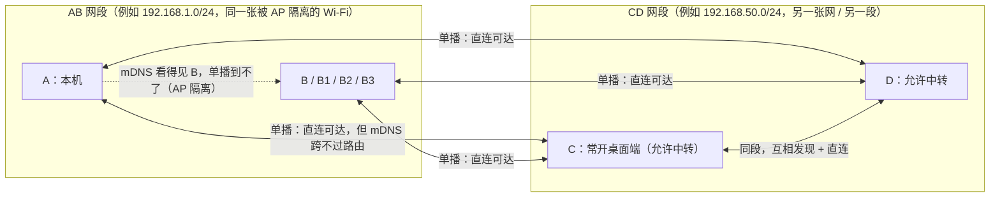
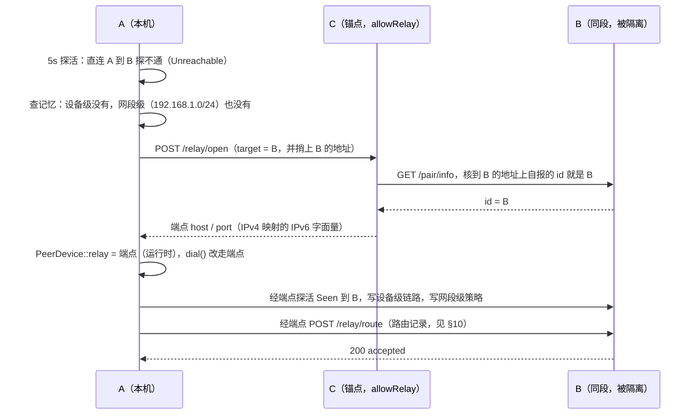

# 中转功能（现状 F-106 + 跨网段中转记忆 F-107）

> **状态**：**已实现**（F-106 是既有现状，F-107 的"记忆/泛化/失效转移/反向"本轮落地 —— 见 §15 的用例与 §16 的清单；与设计的偏离、平台限制、还没验的部分见 §17。**安卓端当锚点**：后端本来就支持，缺的是设置里那颗开关，本轮补上 —— §22）。
> **需求条目**：F-106（现状）、F-107（本文档新增）、S-09（开关，语义放宽）、S-10（新开关）—— 都在 `requirements.md`。
> **实现现状**：`p1-implementation.md` §18。
> **代码**：`src-tauri/src/relay.rs`、`src-tauri/src/server/routes_relay.rs`、
> `src-tauri/src/state.rs`（`probe_peers_once` 的中转分支）、`src-tauri/src/discover/mod.rs`、
> `src-tauri/src/server/routes_discover.rs`、`src-tauri/src/config.rs`（`PeerDevice` / `RelayAddr`）；
> 两端的设置界面：`src/lib/components/SettingsPanel.svelte`（桌面端）、`src/mobile/tabs/SettingsTab.svelte`
> （安卓端，§22）。

---

## 1. 场景：三台设备、两个网段、一段被掐死的单播



四条事实决定了这个功能的形状：

| 事实 | 后果 |
|---|---|
| A、B 同段，mDNS 能发现，**单播被 AP 隔开** | 设备列表里 A 看得见 B，但直连探不通 → 是 F-106 的原始场景 |
| mDNS 跨不过路由（组播 TTL=255） | A 永远发现不了 C、D；A、B 也永远发现不了 CD 网段 —— **必须手动添加 + 配对一台锚点** |
| A、B 各自都够得着 C、D；C↔D 直连 | 中转这一跳成立，而且是**双向**的：C 能替 A 到 B，也能替 B 到 A |
| CD 网段内部互相看得见（C 的 `/discover` 表里有 D、也有 C 自己自报的能力位） | A 只配对**一台** C，就能拿到"CD 这段里还有谁、谁允许中转" |

**现状 F-106 只解决"这一跳怎么搬"**：A 直连探不通 B 时，向一台"已配对 + 自报允许中转 + 在线"的设备请一条端点，然后 A 对 B 的拨号地址改走端点。它**每次都要重新找中转方**，而对面的 B 完全不知道 CD 网段存在（B 没跟 C 配对、也没法发现它），所以 B→A 只能靠用户再手动配一次 C。这就是本需求要补的三件事：**记忆、泛化、反向**。

---

## 2. 目标行为（一句话版）

1. A 手动添加并配对 C（跨段锚点）→ 双向交换设备列表（F-11a）→ A 的列表里出现 A、B（自己的 mDNS）+ C、D（学来的）。
2. A 对 B 发消息 / 发配对邀请：直连探不通 → **经 C 中转**（C 到 B 的地址上核实 "你就是 B" 之后放行）→ A 的流量到达 B。
3. A **记住**："AB 网段里探不通的设备，走 CD 网段中转"。这条记忆**落盘**，并且是**网段级**的 —— B1、B2、B3 以后直接复用，不必每次重新请 C 开路。
4. A 经中转到达 B 之后，**在同一条链路上把这条路由告诉 B**（反向记录）；B 存下对称的记忆，B→A 从此不需要跟 C 配对。
5. C 离线 → A（和 B）从 CD 网段的**中转设备池**里自动换一台（当前是 D），**不需要重新匹配**、不需要用户动作。
6. CD 网段的设备列表变了（D 上线/下线、换了地址、关了中转开关）→ 记忆里的池跟着刷新（来源就是每 5s 的那一拍 `/discover`）。
7. **直连恒优先**：记忆只是"这条直连不通时的下一跳提示"，直连一恢复就收起中转、记忆跟着退休。

---

## 3. 现状（F-106）：已有机制摘要

这一节只记要点，细节见 `p1-implementation.md` §18。

| 环节 | 现状 |
|---|---|
| 能力位 | `/pair/info` 与 `/discover` 各带一个 `relay`（= `Config::allow_relay`，S-09，**默认开**，用户可在设置里关掉；缺省对旧配置也按"开"读）；请求方在 5s 探活那一拍学到（`state::probe_addr`） |
| 控制面 | `POST /relay/open`（`server::routes_relay` → `relay::open`）：**只对 `Caller::Peer`（已配对）开放**；开关关着 403、目标不合格 404、限流/上限 429、开不出来 503 |
| 目标认定 | 优先取中转方地址簿里**此刻在线**的那一台；不认识 / 不在线时退回请求方捎来的 `addr`，但**必须到那个地址问一次 `/pair/info` 核实自报 id**（否则就成了"给任意局域网地址开隧道"的工具） |
| 数据面 | `TcpListener::bind(0.0.0.0:0)` → 按**来源白名单**（请求方的控制面来源地址 + 它此刻在地址簿里的地址）放行 → 连目标**自己的直连地址**（单跳）→ `copy_bidirectional` 原样搬字节。上限 8、同一请求方 3s 冷却、无活连接且 120s 无新连接才回收；关开关立刻全收（`relay::close_all`） |
| 请求方 | 5s 探活**恒探直连地址**（这是"直连通不通"的信号，走中转时也探）；判离线时 `relay::ensure_for` 挑一台"已配对 + 允许中转 + 在线 + 自己没在走中转"的设备请端点（同一目标 30s 一次）；成功写进 `PeerDevice::relay`（`#[serde(skip)]`，**不落盘**）；中转这一跳也不通就收掉再按离线处理 |
| 取址 | **只有一处** `PeerDevice::dial()`：直连有路走直连，已开中转走端点。上报类（`/discover` 的表）用 `ip`/`port` |
| 指纹 | 端点字面量是 IPv4 映射的 IPv6（`net::relay_host`），与中转方自己的服务各占一个 `net::Trust` 键位；`refresh_trust` 一起钉 |
| 别记中转方地址 | `state::is_relayed_source`：经中转过来的请求，来源是中转方，**不许**记成对端的拨回地址 |
| 界面 | 未配对 + 看得见 + 探不通的行照常列出（`seen && !online`），只在发起连接时提示"这张 Wi-Fi 可能隔了客户端"；中转**不上界面**（2026-10-15 起：两端都不写「经 X 中转」、悬停也不再提中转记忆；`relayVia` 只留给 `unicastBlocked` 那条判据） |

**现状的三个缺口**（正是本需求要补的）：

1. **无记忆**：端点只在运行时段，重启/换网就没了；B1/B2/B3 每次都要重新走一遍"探不通 → 请锚点开路"（每台 30s 限流 + 一次控制面往返 + 一次身份核实）。
2. **无网段概念**：`PeerDevice` 只有 `ip`/`port`，没有"它属于哪个网段"这回事，所以"同段设备共用一条中转策略"表达不出来。
3. **无反向**：B 不知道 CD 网段存在，B→A 只能靠用户去配 C。而**只有 A 知道这条路**（A 配了 C、通过了中转），所以这条路由只能由 A 带过去。

---

## 4. 数据模型

### 4.1 两级记忆（设备级链路 + 网段级策略）

```toml
# ── 网段级策略（新增，落盘）：key = 目标网段 CIDR ─────────────────────────
[[relayRoutes]]
targetCidr = "192.168.1.0/24"        # 这一段里的设备，直连探不通时经中转
viaCidr    = "192.168.50.0/24"       # 中转网段（CD 段）
viaDevices = ["<C-id>", "<D-id>"]    # 池：该段里「允许中转 + 在线」的设备 id（按上次刷新）
viaAddrs   = [                       # 池里那些设备的**最后已知地址**（与 viaDevices 同一批）
  { id = "<C-id>", name = "PC-C", ip = "192.168.50.7", port = 3890 },
  { id = "<D-id>", name = "PC-D", ip = "192.168.50.8", port = 3890 },
]
viaPaired  = ["<C-id>"]              # 其中本机已配对的（控制面更稳、优先用）
lastOkAt   = "2026-09-30T12:00:00Z"  # 最近一次经该段成功到达某台目标
okCount    = 3
seenAt     = "2026-09-30T12:00:00Z"  # 池最后一次刷新（源自锚点的 /discover 表）

# ── 设备级链路（新增，落盘）：key = 目标设备 id ───────────────────────────
[relayLinks."<B-id>"]
viaId   = "<C-id>"                   # 上一次把本机送到它的中转设备
viaCidr = "192.168.50.0/24"          # 它所在的段（= 设备级命中的那条链路）
okAt    = "2026-09-30T12:00:00Z"     # 最近一次经这条链路成功够着它
```

**为什么设备级单开一张表、而不是塞进 `peers` 条目**（实现时的取舍）：与 `deviceRemarks`
（F-101）同一条理由 —— 键是**设备 id**，跟着设备走、不跟着地址走；而且 `PeerDevice` 的构造点
全仓有几十处（含全部集成测试），往那个结构上加字段会把每一处都拖下水。语义上它仍然是"这条
地址簿行的记忆"，只是存成了并排的一张表。

**为什么两级**（这是刻意的，不是冗余）：

- **网段级**负责"泛化"：一条 `AB 段 → CD 段` 策略服务 B1/B2/B3 —— 这是"记忆"的意义。
- **设备级**负责"首跳与例外"：某台设备上次实际走的是哪台中转；也用来表达"同段里个别设备其实能直连"（它有自己的 `relayViaId` / 直连状态，不受策略强行绕行）。
- 同段互相中转的老拓扑（A、B、C 都在同一张 Wi-Fi 上）也装得下：那时 `viaCidr == targetCidr`。

**运行时段（不落盘，沿用现状）**：`PeerDevice::relay: Option<RelayAddr>`（`#[serde(skip)]`）依旧是"此刻这条路"的唯一权威；内存里的 `relay_pool: HashMap<targetCidr, Vec<PoolEntry>>` 由每 5s 的视野刷新派生，落盘只留 `viaDevices` 作为**冷启动的最后已知池**，真值永远来自刷新。

`PoolEntry = { id, name, ip, port, paired, online, lastOkAt }`。

### 4.2 与既有字段的关系

| 字段 | 归属 | 落盘 | 说明 |
|---|---|---|---|
| `PeerDevice::relay` | 运行时 | ✗（`#[serde(skip)]`） | 当前实际拨号用的端点。**不变**：F-107 不把它落盘 |
| `Config::relay_links`（新） | 配置（并排的一张表，见上） | ✓ | 设备级链路记忆（提示） |
| `Config::relay_routes`（新） | 配置 | ✓ | 网段级策略（含池：`viaDevices` + 池里那几台的地址 `viaAddrs`） |
| `Config::allow_relay` | 配置 | ✓ | 中转方开关（S-09，缺省**开**），F-107 放宽其适用范围，见 §12.1 |
| `Config::relay_memory`（新） | 配置 | ✓ | 本机是否记住并复用中转记忆（S-10） |

> 为什么设备级可以落盘、端点却不行：端点描述的是"**某台设备此刻替我们开的一个 TCP 端口**"——重启/换网/对方回收之后必定失效，落盘只会留下死地址（`config::relay_addr_never_hits_the_address_book` 就在盯这件事）。而"AB 段要经 CD 段中转"描述的是**网络拓扑的稳定事实**，重启后仍然成立，只是要先探活再启用。

---

## 5. 网段信息的采集与交换（F-107 的前置）

现有报文里**没有任何网段信息**，所以"同段设备共用一条策略"无从表达。三处各补一项，全部是**对端自报**（决策见问题 5）：

| 载体 | 新增 | 用途 |
|---|---|---|
| mDNS TXT（`discover::register`） | `relay=1/0`、`nets=192.168.1.0/24,10.0.0.0/8` | 同段的任何观察者零请求拿到"它允不允许中转 + 它在哪些段" |
| `GET /pair/info`（`state::probe_identity`） | `nets`（同上） | 跨段那一侧没有 mDNS，只能靠这一问答 |
| `GET /discover`（`routes_discover::discover`） | 响应加 `nets`（应答方自己的段）；`ver` 1→2；每条 `PeerEntry` 加 `cidr`（**报出它的那一方**认为它属于哪个段）与 `relay`（该设备是否允许中转，取自它自己的 TXT/探测） | 池的构造：`cidr == viaCidr && relay` 的条目就是候选 |

规则与边界：

- **`nets` 是本机非回环 IPv4 网卡的 `(网络号, 掩码)` 集合**，掩码取真实前缀（/24、/22、/16 都可能，`discover::local_subnets` 已是同一套算理）。回环不算。
- **`cidr` 由报出方填**：它只报自己 L2 视野里的设备（F-11a 的"只回本机自己发现的"），那些设备必然落在它某块网卡的段里，所以它填得出来。**只学到的行（`state.learned`）不进表**，多跳边界不变。
- **老版本兼容**：缺 `cidr` 记为 unknown（退回"本机按自己的掩码计算"，同段场景两者一致）；缺 `relay` 按"不允许"读 —— 这是"**对方没报**"（老版本 / 报文缺字段），不能拿本机开关的缺省（开）去推对端；本机的缺省只管本机自报什么。`ver` 只用于日志与降级判断，不强制。
- IPv4 only：`nets`/`cidr` 都只表达 IPv4 段（与 `server::local_ipv4_addresses`、`net::relay_host` 一致）。IPv6-only 环境不支持中转记忆。

---

## 6. 链路建立：A → B（记忆的第一次形成）



编号步骤：

1. **探直连失败**：`state::probe_peers_once` 里直连那一跳 `Unreachable`（这一拍只决定"要不要走中转"，不决定"走哪条"）。
2. **查记忆**（顺序见 §11.1）：设备级 `relay_via_id` → 网段级 `relay_routes[目标所在段]` → 都没有才退回现状 F-106 的广扫（本机已配对 + 允许中转 + 在线）。
3. **请中转**：对选中的中转设备发 `POST /relay/open`，带上 `target`（B 的 id）与 `addr`（B 的直连 `ip:port`，来自 A 自己的 mDNS 视野）。`addr` 这一手是必须的：跨段的中转方**够得着 B 却从没认识过它**。
4. **核实目标身份**：中转方到 `addr` 问 `/pair/info`，自报 id 必须是请求方点名的 B —— 这一关不能省（F-106 既有规则，原样保留）。
5. **端点写进运行时段**：沿用现状（`PeerDevice::relay` + `dial()` 唯一取址）。
6. **确认可达**：对端点那一跳再探一次，`Seen` 且 id == B 才算"这条路通了"（这就是需求里的"C 尝试 B，确认可达之后消息就能到"）。
7. **写记忆**（§7）。
8. **发反向记录**（§10）。

---

## 7. 记忆的形成与提升

写入点只有一个：**`Seen` 是通过中转端点拿到的那一刻**（第 6 步），而不是"控制面 200"那一刻 —— 后者只证明"中转方愿意开"，不证明"目标真的在"。

| 写入 | 条件 | 内容 |
|---|---|---|
| 设备级 `relay_via_*` | 经端点探到目标（`Seen`、id 对得上、指纹已钉） | `relayViaId` = 这次实际用的中转设备；`relayViaCidr` = 它的段；`relayOkAt` = now |
| 网段级 `relayRoutes[targetCidr]` | 同上，且目标的段已知（TXT `nets` 覆盖目标地址，或目标与本机同段时由本机掩码算出） | `viaCidr`、`viaDevices` = **当前可见的池**、`viaPaired`、`lastOkAt`、`okCount` |
| 池刷新 | 每次锚点的 `/discover` 回来（已有 5s 节拍，`state::learn_from_peer`） | 重建 `relay_pool[viaCidr]`；`viaDevices` 落盘为最后已知值 |

**提升规则**：**一次成功即写策略**（不做"N 次才信"）——因为策略不是"绕过直连的许可"，只是"直连不通时的候选顺序"。真正决定要不要绕的是**每拍对直连的探活**（§11.2）。若目标的段未知，就先只写设备级，等它自报 `nets` 或出现同段第二台设备再提升。

**池的构造**（每次刷新重算）：

```
pool(viaCidr) = { 锚点自己（若它 allowRelay） }
              ∪ { e ∈ 锚点的 /discover 表 : e.cidr == viaCidr ∧ e.relay ∧ e.online }
```

- **锚点自己进池**：`/discover` 会过滤掉应答方自己（`p.id != own_id`），所以不能只读表 —— 应答头里的 `id/name/port + relay` 就是锚点那一条（现状 `DiscoverOutcome::Ok.identity` 已经在读 `relay`）。
- **地址以池自己带的为准**（`PoolEntry.ip`/`port` 来自锚点的观察值；落盘的那一份是 `RelayRoute.viaAddrs`），id 为键；换了地址就跟着换（`learn_peers` 已有"学来的对端换了地址"这条日志）。**不能只按 id 去设备表里找**：那些行是锚点带来的（`learned` 20s / `adopted` 15min），锚点一离散就被收走，剩下的 id 谁也拨不动（真机上"锚点掉线后换同段的另一台"因此从不发生 —— 见 §19）。
- **只信 5s 的活视野**：`viaDevices` 落盘只为冷启动；重启后第一拍 `/discover` 回来就整份替换。**地址与 id 一起落盘**（`viaAddrs`）—— 锚点离散时"最后已知的池"仍然拨得动，直到策略按 §11 退休。

---

## 8. 记忆的更新与失效转移

### 8.1 设备列表变了 → 池跟着变

池（`relay_pool`，**键是目标段**：回答"去这一段该借谁"）有两个来源，都不要求请求方预先配对：

1. **锚点的 `/discover` 视野**（要配对才有）：应答方那一段里允许中转的设备，按策略
   （`relayRoutes[目标].via_cidr`）记到**目标段**上 —— 每 5s 一拍，所以 D 上线/关掉中转/换地址都会跟着变。
2. **中转方的自报**（不必配对）：`POST /relay/open` 的回话里带上**它自己那一段**（`viaCidr`）
   与**那一段里此刻愿意中转的设备**（`viaDevices`，含它自己）—— 请求方拿它当池。
   为什么要这一条：池原先只从"已配对对端的 `/discover`"来，于是"不配对就借中转"那条路虽然能借到
   **当前这一台**，却永远不知道那一段里还有谁 —— 中转方掉线就再也借不到第二台（真机上就是这样）。

两个来源都只是**提示**：用的时候仍然"先探直连 → 再按池顺序试着借 → 目标身份由中转方在那一跳核实"。

> **报来的地址要连"段"一起记**（真机踩出来的）：记录/回话里带进来的地址属于**别人**，
> 而"这台设备在哪一段"原先只能靠它自己自报（`/pair/info` 的 `nets`）—— 可 `adopted` 那一档
> **不进探活队列**，永远不会自报。于是 `cidr_of()` 返回 `None`：`note_relay_success` 只写得出
> 设备级链路、写不出**网段级策略**（真机日志里就是 `via_cidr=` 空的），"同段其他设备复用"和
> "把这条路由推给对端"两件事一起落空。现在报出方说的那一段会以 `note_relay_net` 补到这些新 id 上
> （**只在它们还没自报时**；已经有自报的以自报为准）。

> **键踩过的坑**：池一开始挂在"中转方所在的段"上，而选路按"目标段"查 —— 只有
> `viaCidr == targetCidr`（F-106 那种同段互相中转）才偶然命中；跨网段（本文档 §1 的主场景）
> 永远查不到，于是池形同虚设、只有"广搜"能选中锚点。现在键统一成**目标段**。

不需要新的同步通道：A 与锚点 C 之间本来就有每 5s 的 `/discover`（F-11a 的跨段发现）——**那一次问答顺带就是池的刷新**。所以：

- D 上线 / 打开中转 → 下一次刷新进池；
- D 下线 / 关掉中转 → 下一次刷新出池（`relay` 位或在线位的变化）；
- D 换地址 → 表里换，池跟着换（设备级 `relayViaId` 若是 D，会自动指向新地址）；
- 锚点 C 离散 / 隐身 → 视野断供，池按"最后已知 + `seenAt`"保留一段时间（§11.3），期间仍可试。

### 8.2 C 离线 → 自动换 D（不需要匹配）

这一条是 S-09 语义放宽的直接收益（§12.1）：池里的 D 只要**允许中转**，A 就可以直接向它 `POST /relay/open`，**不需要与 D 配对**。触发与选择：

1. 当前端点那一跳探不通（`probe_addr` 对端点返回非 `Seen`）→ 现状逻辑 `state.clear_relay` 收掉端点（这一步已有）。
2. 下一拍直连仍不通 → `ensure_for` 重选：**池里排除刚失败的那台**，按 §11.1 的排序取下一台（D）。
3. D 开新端点 → 写回 `PeerDevice::relay`，`relayViaId` 更新为 D，`relayRoutes` 的 `viaDevices/viaPaired` 保持不变（同一段）。
4. 全池失败 → 退回广扫；仍无 → 该目标判离线 + `relay::notify_undeliverable`（现状语义：排队等它上线 + 给用户一句解释）。
5. **限流不放开**：同一目标仍是 30s 一次（`REQUEST_COOLDOWN`），避免"每 5s 探活各换一台试"。

### 8.3 反向那一侧同样转移

B 的记忆（§10）里是**同一份池**，所以 C 掉了 B 也会换 D —— 前提是记录是新鲜的，靠 A 的内容变化重发维持（§10.3）。

---

## 9. 选路：记忆只是提示

### 9.1 候选顺序（直连探不通之后）

| 顺序 | 来源 | 条件 |
|---|---|---|
| 1 | 设备级 `relayViaId` | 该设备此刻在线、允许中转、且不是目标自己 |
| 2 | `relay_pool[targetCidr]`（活视野） | 池内排序：**已配对 → 上次成功过的那台 → `(id, name, ip, port)` 字典序**（顺序固定，行为可复现） |
| 3 | `relayRoutes[targetCidr]` 里的池（`viaDevices` + `viaAddrs`，冷启动/视野断供） | 同上，但需先探活确认在线 |
| 4 | 现状广扫（`relay::relay_candidates`） | 本机已配对 + `allowRelay` + 在线 |

一律排除：目标自己、正在替别人中转的设备（**不做链式**）、非 IPv4 地址。

**地址一律跟着候选自己走**（第 2、3 档）：活池那条用 `PoolEntry.ip`/`port`，落盘那条用 `RelayRoute.viaAddrs` —— **不按 id 去设备表里找**。设备表里那些行是锚点带来的（`learned` 20s / `adopted` 15min），锚点一离散就被收走；只按 id 找地址的结果是"锚点掉线后池里没有一台拨得动"（真机反馈第五轮，见 §19）。第 1、4 档本来就是本机自己认识的设备（地址簿里那行不会因锚点离线消失），照旧按 id 找。

### 9.2 直连恒优先（记忆不是权威）

- 5s 探活**恒探直连地址**（现状，不变）；直连一通，`relay::clear_for` 立刻收起端点。
- **设备级记录**：直连**连续 3 拍（15s）**都通 → 清掉该设备的 `relay_via_*`（给一点宽限，避免一次抖动就把记忆抹掉）。
- **网段级策略**：该段**已知设备全部连续 3 拍直连可达** → 认为这一段恢复了，把 `relayRoutes[targetCidr]` 退休（写日志后删除）。将来若又被隔离，会按现状 F-106 重新发现一次（代价：一次控制面往返），不影响功能可用性。
- 记忆**从不阻止**直连尝试，也**从不**被用来"跳过探活"。

---

## 10. 反向记忆：让 B 也知道 CD 网段

### 10.1 为什么必须专门传

B 无法自行得知 CD 网段存在：mDNS 跨不过路由，B 又没跟 C/D 配对（所以拿不到它们的 `/discover` 表）。**知道这条路的只有 A** —— 它在 §6 里亲自走过。所以路由信息必须由 A 经**那条已经建立的中转链路**送给 B。

### 10.2 载体：`POST /relay/route`（新，需凭据）

```
POST /relay/route                      # 已配对：Bearer；未配对：自报身份（requester{id,port}）并被核实
                                       #   接收方只在 targetCidr 含本机地址时采纳（见 §10.3）
{
  "routes": [{
    "targetCidr": "192.168.1.0/24",    # 「这一段里的设备需要中转」
    "viaCidr":    "192.168.50.0/24",   # 中转段
    "viaDevices": [{ "id":"<C>", "name":"PC-C", "ip":"192.168.50.7", "port":3890 },
                   { "id":"<D>", "name":"PC-D", "ip":"192.168.50.8", "port":3890 }],
    "viaPaired":  ["<C>"],             # 发送方与池里哪些已配对（接收方据此知道"这枚记录的出处"）
    "confirmedAt": "2026-09-30T12:00:00Z"
  }]
}
→ 200 { "accepted": ["192.168.1.0/24"], "ignored": [] }
```

### 10.3 规则（防投毒、防陈旧）

- **信任前提（按"能留下什么"分两档）**：
  ① **已配对对端**（Bearer + 对端证书按指纹钉住）：记录可信，可以落盘；
  ② **自报身份并被核实**、或**经记录自己点名的中转方送达**（`carried_by_named_relay`）：
  只能算**提示**。这两档的门槛只是"在某个地址上起个会回话的端口"（`/pair/info` 是公开的
  自报端点），局域网里任何能到达本机的设备都做得到 —— 所以它们写进来的路由**只存在于本进程内**：
  `RelayRoute::ephemeral`（15 分钟 TTL、`save_config_at` 会把它滤掉、不能覆盖已落盘的记忆），
  并按来源地址限流（30 发/分钟）。第二条是**必需**的：被中转的那一侧（B）往往从来没跟锚点（C）
  配过，而"B 也能知道 A 是怎么来的"正是这条功能的用途。代价（如实）：仍然存在一个**元数据/DoS
  面**（能让本机把"同段设备"的流量偏好到某台中转方上，而 TLS 仍是端到端的，看不到内容），
  但一条报文已经无法把路由写进重启后还在的配置里。
- **接收方自校验**：只有当 `targetCidr` **含本机地址**时才采纳（否则丢弃 —— 一条与本机无关的路由没有意义）。
- **只并"还不认识"的设备**：记录里点名的设备，凡是**设备列表或地址簿里已有的**，一个字都不动
  （`upsert_peer` 是覆盖语义：会被这次传进去的空名字抹掉、地址会被对端的观察值改写、`paired`
  会被写成 `false` 并落盘。正常双向流程就会踩到 —— 反向推回来的那份记录里含着锚点自己）。
只有新 id 才并进设备列表，而且归 `adopted` 那一档：**有 TTL**（15 分钟，长于记录的刷新间隔）、
  **不进探活队列**（本机跟它们之间没有关系；要借中转时按需拨，那一次就验证了可达性）。
  条数也有上限：单条记录最多 16 台、一次最多并 64 台 —— 不设限时一个 64MB 的请求体就能把
  设备表灌满，还得每 5s 逐个探活。
- **本机自己永远不是中转方、也不是对端**（2026-10-27 修）：反向推回来的记录里可能点着**收件人
  自己**（发送方的池里还留着你的地址）。推送前 `relay::without_recipient` 把收件人剔掉、池被
  剔空的记录整条不发；接收侧 `apply_relay_routes` / `adopt_devices` / `merge_pool` 丢弃 own id；
  选路 `relay_candidates` 排除 own id 与**本机监听端点**（池里那条可能挂着别的 id、地址却是
  本机）；`/relay/open` / `/relay/route` 对自称本机的请求直接 400。启动时
  `Config::scrub_self_identities` 清掉旧版本写进盘里的自己（池、观察记忆、观察指纹、链路）。
  **真机回归**：更新重启后池里带着本机 → 第一拍向自己请中转 → 服务端把自己登记成**在线设备**，
  设备列表里出现"自己"（`adopted` 档，15 分钟后才随 TTL 收走）。
- **`adopted` 那一档能被"担保人的转述"升格**（2026-10-15 修）：这些行不探活、也不打 `seen`，
  界面的准入（`online || paired || seen`）一条都不满足 —— 所以**已配对的对端**在它自己的
  `/discover` 表里报来同一台时，`learn_peers` 把它按"学来的"接管（写存活/地址/名字、并从
  `adopted` 摘掉，存活改由那张表每 5s 刷新，20s 不收就随 `sweep_learned` 一起走）。
  地址簿里的、或已配对的行不在此列（本机自己的关系，存活只由探活说）。
  少了这一条，真机上就是"本机能借它中转、设备列表里却永远没有它"。
- **记录里不含目标地址**：只有段与中转设备（设备带 `ip:port`）。这既够用，又正好绕开"经中转过来的 TCP 来源是中转方"这个坑（`state::is_relayed_source` 那条规则照顾的问题）。
- **只作提示**：B 用这张表时，仍然"先探直连（B 与 A 同段，直连探不通才用）→ 再按池顺序开中转 → 目标身份由中转方核实"。记录错了最多是白试一次。
- **新鲜度**：B 存 `seenAt`。发送方 A 维护 `routeRev`（池/段的内容哈希）：**内容变化或未被 ack 时重发**，最短 30s 一拍；未变化不重发（不然每台已配对设备每 5s 来一发）。
- **清理**：B 的这条策略同样受 §9.2 的退休规则约束（本地直连恢复即退休），并且**池里所有设备都长期不可达 → 降级为仅设备级提示**，不再阻断。

### 10.4 效果

B 落库后：`relayRoutes[AB 段] = { viaCidr: CD 段, viaDevices: [C, D] }` —— 与 A 那份**对称**。C 离线时 B 换 D；D 换地址时 A 的下一次重发会把新地址带过来。**B 从头到尾没有跟 C/D 配对过。**

---

## 11. 记忆的失效与回收

| 情形 | 处置 |
|---|---|
| 直连恢复（设备级） | 连续 3 拍直连可达 → 清 `relay_via_*`（§9.2） |
| 直连恢复（网段级） | 该段已知设备全部连续 3 拍直连可达 → 删除 `relayRoutes[…]` |
| 池空（段还在，但一台可拨的中转方都没有） | 保留策略（`seenAt` 不再刷新）；选路时没有候选，退回广扫。池一旦有成员就**不按缺席淘汰**（§21）—— 只是这一拍它没露面不算它走了 |
| 锚点离散 → 它带来的设备行被收走（`learned` 20s / `adopted` 15min） | **策略里的池与活池都不受影响**（§21 起活池也按"并"更新、不按设备表清）：拨号用的是池自己记下的地址，与设备表无关，所以"换同段另一台"仍然成立，直到策略退休（§19） |
| 锚点长期离散（`seenAt` 超过 7 天） | 删除该条策略（拓扑共识已经不可信） |
| 本机换网段（DHCP / 开热点 / 连了别的 Wi-Fi） | `targetCidr` 这个键变了 → 旧条目成为孤儿，按上一条 TTL 收走 |
| 中转设备换了 device id（`rekey_peer`） | 池按 **id** 存，刷新时对不上就自然出池；`viaDevices` 跟着活视野整份替换 |
| 设备列表里出现同 id 两行 | 池以 id 为键，天然去重 |
| 本机隐身 / 离线 | 不探活、不刷新；记忆原样保留（用户自己的动作，不该被惩罚） |
| 解除配对（与锚点、或与目标） | **不动记忆**（解绑只清 token 与配对标记，见 `AppState::unpair`）：池与 `viaAddrs` 是"这一段怎么够得着"的**拓扑事实**，不是"关系" —— 解绑之后照样直接拨记忆里那台，不必等锚点再在线互换一次视图（§21.1）。代价：与锚点解除后视野断供，池停在最后一次刷新；与目标解除后设备级记录保留无妨（它只是提示），但下次走中转仍要目标身份核实 |

---

## 12. 开关与界面

### 12.1 S-09 语义放宽（按你的确认）

**中转方是否愿意替别人中转，只由「允许中转」（S-08 + S-09 合并成的那一颗；后端 `Config::allow_relay` 管盲转字节、`group_relay` 管群消息）决定，且这个开关不限于已配对设备：开着就允许。首次启动就是开着的；用户在设置里关掉之后，落盘的是显式 `false`，一直按关读。**

含义与代价（必须写进设置项副文案与风险清单）：

- `POST /relay/open` 的调用方门槛从 `Caller::Peer`（已配对）放宽为"**能到达本机的任意局域网设备**"。
- **仍然强制保留**的四关（放宽的只是"认识不认识"）：① 目标身份核实（到地址问 `/pair/info`，自报 id 必须对得上）；② 端点来源白名单（只有发起方的来源 IP / 它在地址簿里的地址能拨）；③ 上限 8 + 同源 3s 冷却 + 空闲 120s 回收；④ 内容看不见（两端 TLS 端到端）。
- **新增的强化**（已实现，见 §17）：① 发起方自报 `deviceId` + 自己的监听端口，中转方用「TCP 来源
   IP + 自报端口」问一次 `/pair/info` 核实；② **控制面限流按来源地址记**（不按自报的 id —— 那个
  id 只有公开的自报端点背书，换个名字就能重来一遍，8 条额度几秒就被一台机器占满）；
  ③ 自报那一档的**端点来源白名单只认它的来源地址**（可信凭据那一档才额外认"它在地址簿里的地址"
  —— 否则冒名者报到某台设备的 id，就等于顺手把**别人**也写进了白名单）；
  ④ **核实失败的回话只说"核实不过"**，`哪个地址上是谁 / 通不通` 只进 `debug!` 日志：把 id 回给
  调用方，等于把"绕过核实所需的 id"亲手交出去（它下一句就能点名那个 id，让本机去连一个它自己
  够不着的地址 —— 那正是这一关要防的"给任意地址开隧道"）。
- 中转方界面需要**可见**：设置里显示「正在替 N 台设备中转」并可一键收掉（`relay::close_all` 已有）。
- **切到「离线」= 隐身，中转也停**（F-107 补）：离线要**当场收掉**本机替别人开着的全部中转端点
  （`apply_offline` → `relay::close_all`），在跑的那些连接一起断；`relay::serve` 里另有一道
  `is_online` 兜底。端点在 `relay` 里是个**裸 TCP 监听**，不归 HTTP 那层管 —— 只靠
  `presence_middleware` 的 503 拦不住"离线前已经开出去的那一条"（真机上就是：切成离线之后
  两边照旧在经它互发）。

### 12.2 S-10（新设置）

**「记住并自动复用跨网段中转」**，`Config::relay_memory`，**默认开**。

- **开**：按 §7–§11 建立、复用、泛化、传播中转记忆。
- **关**：行为**完全退回现状 F-106** —— 端点仍然每次现开、用完/直连恢复就收，不落盘、不泛化、不传播。
- 默认给"开"的理由：这条开关**不花别人的带宽**（花带宽的是中转方的 S-09），也不向对端暴露本机的新信息（配置是本地的）；它只影响本机自己的选路效率。**S-08/S-09 现在也是这个口径**（三条都默认开、旧配置缺项也按"开"读）；它们的区别不在"开不开"，而在那两条都是**本机替别人做事 / 向网络暴露本机能力** —— 想省这笔带宽就在设置里关掉那颗「允许中转」。
- **两端设置里都不单列开关**（本轮）：它只影响本机自己的选路，用户没有"要不要"的余地，保存时一律写开（`Config::relay_memory` 保留：旧配置缺此项按"开"读；安卓端保存时整份回传，跟着后端真值往返）。

### 12.3 界面

- **两端设置里各有一颗「允许中转」开关**（桌面端 `SettingsPanel`、安卓端 `tabs/SettingsTab` 的「中转」一格，同一口径）：同时控制 S-08（替群聊转消息）与 S-09（替其它设备盲转字节）—— 二者语义都是"本机替别人做事、花本机上行带宽"，就没有理由分成两颗。**默认开**（首次启动就是开的 —— 装上就能当锚点，不必先翻设置；不想出这笔上行带宽就在设置里关掉）；关掉立刻收掉本机正替别人转的每一条（`update_settings` → `close_all`，现状）。
- **安卓端本来就是合格的中转方**（本轮补上界面）：中转那一套实现（`relay.rs`）、`POST /relay/open` 的认人规则与服务器本身（`server::start_server` 在两端都跑）全是**平台无关的同一份代码**（这几处没有任何 `cfg(desktop)` 门控），所以手机不配对就能借中转、也能被借。两端唯一的差别是**存活**：手机得先活着等到别人来借，后台被系统冻结就没人借得到 —— 靠 F-81 的前台服务（`OrbDropService`）与电池优化白名单撑着，设置里「后台与通知」那一格就在提示这件事。
- **中转流量（S-11，本轮）**：两端设置里都只读显示本机替别人中转的**累计流量**（收发两方向之和）与连接数。中转方的代价就是上行带宽（手机上是流量），这里就是这笔账。字节数两处合流：盲转的连接字节 + 替群聊**转发出去的消息**字节（S-08 的中转那一跳，`AppState::note_relay_message`）；**连接数只数盲转的连接**。落盘在 `Config::relay_bytes_total` / `relay_conns_total`，重启接着算；面板/设置页开着时按 5s 轮询刷新（没有可订阅的中转事件）。
- **设备行**：中转**不上界面**（2026-10-15 起）：既不写「经 X 中转」，悬停也不再提"该网段经哪一段中转"（`relayVia` / `transit` 都不进界面，后者连字段一起删了）。中转是本机的选路细节 —— 用户看不到跳数，也不需要为它做任何事。
- **被隔离的未配对行**：`seen && !online && !relayVia` → 发起连接时提示"这张 Wi-Fi 可能把客户端之间的单播隔开了"（现状）；中转接管后自动回到在线行。
- **不再在设置里显示"中转记忆"清单与"正在替 N 台设备中转"**（本轮）：两者都只是本机自己的运行状态（记忆 = 选路提示、正在中转 = 此刻的端点），后端照常维护，用户不需要看 —— 设置里只留那颗开关与上面那条用量记录。命令（`relay_memory` / `clear_relay_memory` / `relay_status` / `close_relays`）保留在后端，随时可再接界面或用它排障。

---

## 13. 安全与风险

| 风险 | 说明 | 缓解 |
|---|---|---|
| **中转方被当跳板**（S-09 放宽的直接后果） | 网段内任何设备都能消耗中转方上行带宽 | 默认开但可一键关（关掉立刻收掉在跑的那些）；发起方身份核实（§12.1，已实现）；上限 8 + **限流按来源地址**（自报 id 换一个也没用）+ 空闲回收；来源白名单（自报那一档只认来源地址）；界面可见 + 一键收掉；日志留痕 |
| **目标隧道化** | 若允许"给任意地址开隧道"，中转方就成了穿透工具 | **目标身份核实不可省**（现状已有，原样保留）：必须到请求方给的那个地址问出"自报 id == 目标"；而且**核实失败的回话只说"核实不过"** —— "那个地址上是谁 / 通不通"只进日志，否则等于把绕过这一关所需的 id 交回给对方 |
| **反向记录改写本机设备 / 灌设备表** | 已配对的对端（或被冒名的对端）推一条记录，就能把本机某台设备的地址改写成它选定的 `ip:port`、把名字抹掉、把 `paired` 写回未配对；或一次塞进上万台设备让本机每 5s 逐个探活 | **只并本机还不认识的 id**（地址簿里已有的行一个字都不动）；单条记录 ≤16 台、一次 ≤64 台；并进来的行归 `adopted`（15 分钟 TTL、**不进探活队列**）；目标段必须含本机地址 |
| **记忆投毒**（伪造路由记录） | 恶意对端塞一条假路由 → 本机去拨不存在的池设备；一条报文被写进重启后还在的配置 | **只有 Bearer 来源的记录落盘**；自报/经中转送达只做本进程内的提示（`ephemeral`：15 分钟 TTL、`save_config_at` 滤掉、不能覆盖已落盘的记忆），并按来源地址限流（30 发/分钟）；接收方要求 `targetCidr` 含本机地址；记录只是提示，用之前要真的连通、目标身份仍由中转方核实；条数上限 + TTL |
| **记忆陈旧**（对方 DHCP 换了地址 / 关了中转） | 拨不通，浪费一拍 | 池按活视野整份刷新；失败即换下一台；`seenAt` TTL；内容变化重发 |
| **隐私（本机配置落盘）** | `relayRoutes` 会记下别的网段的设备 id/地址 | 配置本来就在本机数据目录（N-10）；界面可见可删（§12.3） |
| **与"不做中继服务器"的边界** | 用户可能误解成互联网中继 | 明确：不经互联网、不引入第三方服务、**单跳**、局域网内两台够不着彼此的设备借一台都够得着的设备搬一趟（`requirements.md` §7 同一条边界） |

---

## 14. 边界与不做

- **不做多跳**：中转仍是单跳（A→C→B），不链式（排除"正在替别人中转的设备"）。发现仍是单跳（F-11a 的"只回本机自己发现的"不变）—— **F-107 不是"发现的多跳"**，它只是把"我已经知道的跨段中转关系"记住并泛化到同段设备。
- **不做互联网穿透 / 中继服务器**：同现状（`requirements.md` §7）。
- **不做 IPv6 / 不做域名**：段与端点都按 IPv4 字面量（§5）。
- **不把端点落盘**：§4.2。
- **不改 `dial()` 的唯一取址地位**：记忆只影响"何时、请谁开端点"，端点怎么用仍由 `PeerDevice::dial()` 一处决定。
- **不要求用户为每台 CD 设备配对**：池内直接借用（§12.1）；但仍要求**一台**锚点先配对（那是发现 CD 网段的唯一入口）。

---

## 15. 验收（已实现的用例与实测结果）

单测（`cargo test --lib`，254 项全绿；下表是本条特性新增的）：

| 用例（文件名） | 断言 |
|---|---|
| `subnet::tests::{parses_and_normalizes, rejects_junk_without_panicking, membership_respects_the_real_mask, list_roundtrip_skips_junk, host_nets_exclude_loopback_and_dedupe}` | 网段解析/规整（主机地址按掩码归一）、坏字符串**不让整份配置作废**、归属判定用真实掩码（/22 跨段边界）、`nets` 串往返、本机段表不含回环且去重 |
| `config::tests::relay_memory_round_trips_and_never_becomes_a_dial_address` | 记忆能落盘读回；`dial()` 只认端点/直连地址，记忆**永远不是**拨号地址；S-10 默认开 |
| `config::tests::relay_routes_are_capped` | 网段级策略有条数上限（`MAX_RELAY_ROUTES`），超出按最久没成功过的淘汰 |
| `config::tests::config_round_trip_preserves_shares_and_settings`（扩写） | 策略 + 设备级链路 + S-10 的显式值一起跨重启保留 |
| `state::tests::pool_from_discover_keeps_only_same_cidr_relay_capable` | 池只收「报出方说自己在这一段 + 允许中转」的，外加锚点自己；锚点关掉开关就出池 |
| `state::tests::cidr_of_prefers_the_peers_own_report` | 归属段优先用**对端自报**、且自报的段必须覆盖它自己的地址；同段才退回本机掩码 |
| `state::tests::relay_success_promotes_the_device_link_into_a_subnet_route` | 唯一写入点：经中转真的到达 → 设备级链路 + 一次即提升成网段级策略（带池与 `ok_count`）；**落盘后重新读回**；S-10 关着就不记 |
| `state::tests::memory_retires_when_direct_is_stable` | 直连**连续** 3 拍可达才退休；中间抖一拍要重新数 |
| `state::tests::route_record_rejected_when_target_cidr_excludes_self` | 目标段不含本机地址 / 没有可拨设备 → 丢弃；采纳时只记**本机自己**的配对状态；池里设备进列表但**不写地址簿** |
| `state::tests::relay_report_fills_the_pool_without_pairing` | 中转方自报的那一段池：不配对也能拿到，池按**目标段**记；段算不出来时不记 |
| `state::tests::route_record_never_rewrites_known_rows` | 回归：记录里点名**已有**的设备时，名字 / 地址 / 配对状态一个字都不动（内存与地址簿都一样）；新 id 才并进来并归 `adopted` |
| `state::tests::a_route_naming_itself_never_becomes_a_peer`（§10.3） | 记录里点名本机自己：一行都不建、观察记忆里也不留 |
| `state::tests::observing_own_id_never_creates_or_marks_a_row`（§10.3） | `observe_verified_addr` / `note_heard_online` / `upsert_peer` 都挡本机自己的 id |
| `state::tests::pool_never_contains_the_local_device`（§10.3） | 活视野/反向记录的中转池里出现本机 id 时，`merge_pool` 直接丢掉 |
| `state::tests::identity_reconcile_does_not_migrate_a_row_onto_the_local_device`（§10.3） | 地址上答话的是本机自己：作废旧行地址，绝不迁移出一行"自己" |
| `relay::tests::a_route_pushed_to_a_peer_never_names_that_peer`（§10.3） | 推给 P 的记录里剔掉 P；池被剔空的记录整条不发 |
| `relay::tests::relay_candidates_never_include_the_local_device`（§10.3） | 池里留着本机 id 时，选路永远不返回自己 |
| `relay::tests::relay_candidates_skip_addresses_that_are_our_own_listener`（§10.3） | 地址是本机监听端点的候选被跳过；同机多开的另一个端口不误伤 |
| `config::tests::self_identities_are_scrubbed_from_persisted_memory`（§10.3） | 启动自清：地址簿 / 观察记忆 / 备注 / 观察指纹 / 链路 / 策略池里的自己一次清干净，第二次不再算"动过" |
| `state::tests::pool_refresh_keeps_the_addresses_on_the_route`（§19 新增） | 活池刷新要把**地址**写进策略（`RelayRoute.viaAddrs`）：锚点离散后"拨得动池里那台"全靠它 |
| `state::tests::relay_capability_refreshes_from_the_live_discover_reply`（§19 新增） | 已配对 + 长连接活着的对端（不走 `probe_addr`）也要在 `/discover` 活回话里刷新 `relay` 位 —— 否则锚点表里那台永远 `relay:false`，请求方那边没有可换的第二台 |

集成（`cargo test --test relay_memory`，10 项全绿；全部真 HTTP + 真 TLS + 真中转端点）：

| 用例 | 断言 |
|---|---|
| `relay_open_verifies_a_non_paired_requester` | ① 不带身份 → 401；② 冒名 → 403；③ 自报端口上没人答话 → 403；④ 身份对得上 → 200 且**端点真的把字节搬到位**；⑤ 开关关掉 → 403 |
| `relay_route_accepts_only_paired_peers_and_local_targets` | 无凭据也无自报 → 401；含本机地址的那条被采纳、`203.0.113.0/24` 那条被丢弃；采纳后池里的设备能被拨、但不进地址簿；**未配对但自报身份核实通过 → 也收下**（bug 2 的回归）；自报对不上 → 403 |
| `going_offline_stops_relaying` | 离线前端点通、字节往返；`apply_offline` 之后**端点当场停**（不再接受连接）、`relays.active() == 0`、控制面 503（bug 1 的回归） |
| `relay_pool_directs_and_fails_over_to_an_unpaired_relay` | 池里已配对的那台先被选中且**字节经它往返**；把 C 停掉之后自动改用**未配对**的 D（手里没有它的任何凭据）并把字节搬到位 |
| `discovery_reports_nets_and_per_peer_cidr` | `/pair/info` 带 `nets` 与 `relay`；`/discover` 带 `nets` + `ver: 2`，表里每条带 `relay` 与 `cidr`（算不出归属段时省略这一格） |
| `remembered_pool_from_a_route_record_opens_a_relay` | 应用反向记录之后（接收方对那一段**没有任何 mDNS 视野**），按记录里的池借到中转、端点把字节搬到位 |

> 日志级别：`开了中转端点` / `复用已开的中转端点` / `中转方报来它那一段的中转池` 现在是
> `debug` 级（稳态下每 30s 会各出现一次，默认 `info` 里只剩状态变化）。复现下面的记录时带
> `RUST_LOG=debug` 看这几行。

真机 / 真进程（本机实测：同时起 3 个 `orbdrop.exe` 实例 —— 中转方 C（`allowRelay=true`）、
目标 B、请求方 R；C 的地址簿里认识 B；请求方**未与 C 配对**）：

| 步骤 | 实测结果 |
|---|---|
| `GET /pair/info`（走局域网地址） | `id=smoke-c`、`relay=true`、`nets="198.51.100.0/24"` —— 三处自报在真进程里都对 |
| `POST /relay/open` 不带身份 | **401** |
| `POST /relay/open` 冒名（自称另一台） | **403**（到「来源地址 + 自报端口」问了一次 `/pair/info`，id 对不上） |
| `POST /relay/open` 身份对得上 | **200** + `{"host":"[::ffff:198.51.100.106]","port":…,"expiresInSecs":120}` |
| 中转方日志 | `开了中转端点 requester=smoke-r target=smoke-b in_book=true` |
| **裸 TCP 拨端点** | 接受（中转方 accept → 连目标） |
| **TLS 穿过端点访问目标** | 拿回 `id=smoke-b` 与它的自签证书 —— 字节真的经本机搬到目标、且**两端端到端 TLS**（中转方看不到内容） |
| 中转方配置 | `relayMemory = true`、`relayRoutes = []`、`[relayLinks]`（本机是中转方，记忆在对侧 —— 与设计一致） |

> 映射字面量那一档：curl/reqwest 在 Windows 上拨 `[::ffff:…]` 均失败（`AddrNotAvailable`/`000`），
> 拨它映射到的那个 IPv4 成功 —— 与 §17 的平台限制一致。

**真机（用户的两台安卓手机 + 本机当锚点；两轮）**：

| 实测项 | 结果 |
|---|---|
| 拓扑 | 手机甲 `203.0.113.198`、手机乙 `203.0.113.27`（同段 `203.0.113.0/24`）；本机 `198.51.100.106`（**另一段**） |
| 手机 ↔ 手机 `ping` | **100% 丢包**（两个方向）—— 单播真的被 AP 隔开 |
| 手机 → 本机 `ping` | 2/2、28ms ✓（跨网段可达） |
| 第一轮：本机当锚点（用户的实例，`allowRelay=true`） | 两个方向都开了端点：`开了中转端点 requester=<手机甲> target=<手机乙>` 与反方向；端点上有 ESTABLISHED 连接；两台手机界面都显示 **「经 D1159 中转」** |
| 第二轮：三个 bug 的修复 | ① 两台手机都在**不配对**的情况下经锚点中转（`logcat`：`中转记忆：经中转够着了目标 target=…` 每 ~7s 一次 → "经中转真的够着才写记忆"这条规则在真机成立）；② **未配对**对端写的反向记录被真机收下（对两台手机各推一条，都回 `{"accepted":["203.0.113.0/24"]}` http 200 —— bug 2 的修复）；③ 从真机拿到锚点自报的池 `viaCidr=198.51.100.0/24` + `viaDevices=[…]`（bug 3 的机制）；④ 离线停中转（bug 1）由用例 `going_offline_stops_relaying`（真端点 + `apply_offline`）覆盖 —— 本机 UI 的「离线」开关没法在这里自动化，真机那一侧靠同一条代码路径 |
| 第二轮**没能强制**的 | 让手机**在指定的两台锚点之间**换（停掉 C 换 D）：用户网络里还有他自己的桌面端（`31f36e0e`）也在池里、且一直通着，手机不会去换。换的机制与顺序由 `relay_pool_directs_and_fails_over_to_an_unpaired_relay`（真 HTTP/TLS、两个真锚点、停掉 C 之后必须用 D）+ 两个单测守着 |

---

## 16. 落地清单（已实现）

1. **协议字段** `[已实现]`：mDNS TXT `relay`/`nets`（`discover::register`）；`/pair/info` 与 `/discover` 的 `nets`；`/discover` 的 `PeerEntry.cidr/relay` + `ver: 2`。（§5）
2. **配置模型** `[已实现]`：`Config::{relay_links, relay_routes, relay_memory}`（`config.rs`）；端点的落盘规矩不变。（§4）
3. **池与刷新** `[已实现]`：`AppState::{peer_nets, relay_pool}` + `absorb_view`，挂在既有 `/discover` 节拍上（`probe_addr` / `learn_from_peer`）。（§7/§8.1）
4. **选路与写记忆** `[已实现]`：`relay::relay_candidates` 的四档候选；`probe_peers_once` 的"经端点探到目标"那一支写 `AppState::note_relay_success`。（§6/§7/§9）
5. **失效转移** `[已实现]`：`AppState::relay_failed`（`clear_relay` 记下刚失败的那台，300s 内排到最后）+ 池内重选。（§8.2）
6. **反向记录** `[已实现]`：`POST /relay/route`（`routes_relay::relay_route` → `AppState::apply_relay_routes`）+ 发送端 `relay::maybe_send_route`（内容哈希 + 未确认 30s / 已确认 5 分钟刷新）。（§10）
7. **S-09 放宽** `[已实现]`：`/relay/open` 移到公开路由，认人规则在 handler 里（凭据优先，其次"自报 + 到来源地址核实"）。（§12.1）
8. **界面** `[已实现]`：设备行悬停说明（`stores/devices` 的 `transitHint`）；设置里的 S-10 开关、中转记忆列表（可逐条/全部清除）、"正在替 N 台设备中转"+ 一键收掉。（§12.3）
9. **退休与 TTL** `[已实现]`：`AppState::sweep_relay_memory`（每拍一次：网段级退休、锚点 7 天 TTL、设备级 30 天 TTL、池里认不出的行）。（§11）
10. **池自己带地址** `[已实现，§19 第五轮]`：`RelayRoute::viaAddrs` 与 `viaDevices` 同批落盘（`absorb_view` / `absorb_relay_report` / `note_relay_success` / `apply_relay_routes` 四处写）；`relay::relay_candidates` 的第 2、3 档用池自己的地址拨号，不按 id 去设备表里找；`absorb_discover_view` 顺带刷新 `relay` 能力位。（§9.1 / §11 / §19）

---

## 17. 实现记录：与设计的偏离、限制、还没验的部分

**代码落点**（F-107 全部改动）：

| 文件 | 内容 |
|---|---|
| `src-tauri/src/subnet.rs`（新） | IPv4 网段：解析/规整/归属判定/本机段表（`Cidr`、`host_nets`、`own_ip_in`、`local_net_of`、`parse_list`/`format_list`） |
| `src-tauri/src/config.rs` | `RelayLink` / `RelayRoute`（+ `MAX_RELAY_ROUTES`）、`Config::{relay_links, relay_routes, relay_memory}`、`Config::relay_route_mut` 等入口 |
| `src-tauri/src/state.rs` | `peer_nets` / `relay_pool` / `direct_streak` / `route_push` / `relay_failed`、`absorb_view`、`cidr_of`、`note_relay_success`、`note_direct_probe`、`apply_relay_routes`、`route_push_gate`、`sweep_relay_memory`、`relay_routes_json`、`clear_relay_memory`；`probe_peers_once` 的两处挂钩 |
| `src-tauri/src/relay.rs` | 四档候选 `relay_candidates`、`ensure_for`（记忆 + 非配对自报）、`RouteRecord`/`RouteDevice`、`maybe_send_route`、`clear_relay` 记下刚失败的那台 |
| `src-tauri/src/server/routes_relay.rs` | `/relay/open` 认人（凭据优先，其次自报 + 核实）、`/relay/route`（只收已配对） |
| `src-tauri/src/server/{mod,routes_discover,routes_pair}.rs`、`src-tauri/src/discover/mod.rs` | 路由表调整 + 三处自报字段 |
| `src-tauri/src/lib.rs` | 四个新命令（`relay_memory` / `clear_relay_memory` / `relay_status` / `close_relays`）、`list_devices` 加 `transit`、设置项 `relayMemory`、开关变化时重播 TXT |
| `src/lib/{types,api}.ts`、`src/lib/stores/devices.svelte.ts`、`src/lib/components/{SettingsPanel,DeviceTab}.svelte` | 界面（S-10 开关、中转记忆列表、正在中转 + 一键收掉、设备行悬停说明 `transitHint`） |
| `src/mobile/tabs/SettingsTab.svelte` | 安卓端设置页的「中转」一格（S-08 + S-09 的「允许中转」开关 + S-11 的只读中转流量），与桌面端同一口径 —— 见 §22 |

**与设计的两处偏离**：

1. **设备级记忆存成并排的一张表**（`Config::relay_links`，键是设备 id），不是塞进 `peers` 条目：
   `PeerDevice` 的构造点全仓几十处（含全部集成测试），加字段会牵动每一处；语义不变（见 §4.1）。
2. **"发起方身份核实"从"建议"变成了必做**（§12.1）：非配对设备借中转时必须自报 `id` + 监听
   端口，本机到「TCP 来源地址 + 那个端口」问一次 `/pair/info`，对不上就 403。少了这一关，
   "开着开关"就等于"局域网里谁都能冒名借带宽"。

**平台限制（F-106 就有，F-107 未引入也未修）**：Windows 上 reqwest 连不上"IPv4 映射的 IPv6"
字面量。本机实测（`http://[::ffff:<lan>]:<port>/` → `Os { code: 10049, AddrNotAvailable }`；
同一端口用普通 IPv4 → 连得上）。因此：

- **本机（Windows）当请求方**时，"直连不通 → 借中转"这一跳拨不到端点，除非本机在请求方那个网段
  上还有**第二块网卡地址**（那时端点是普通 IPv4，任何平台都能连，见 `pick_own_ipv4`）。
- **手机（安卓，双栈）当请求方不受影响** —— 用户的环境正是"本机当中转方、手机当请求方"。
- 这条限制让"整条链路（探活 → 借中转 → 探到目标 → 写记忆）"无法在**本机单进程**里端到端跑通，
  所以集成测试里：控制面与选路走真 reqwest，**端点的数据面用裸 `TcpStream` 拨**（拨它映射到的
  那个 IPv4），并单独用 `AppState::note_relay_success` 的**单测**守住"经中转到达即写记忆"。
  彻底解法是"指纹按设备钉而不是按地址钉"（要动信任模型），不在本次范围。

**其它实现取舍**：

- **反向记录**：已配对对端走凭据；没配对的对端走"自报身份 + 到来源地址核实"（见 §10.3 的信任前提与
  代价）。发送端在拿到在线那一拍推一次，内容没变就按刷新间隔重发（对端**重启**之后仍能重新拿到记忆）。
- **同一台机器上多个实例共用一个凭据库**时，`peer_id_from_token` 规定"存成应答方自己 id 的 token
  不算"（一台设备不能用自己身份认证自己），所以**请求方侧的池/记忆**在集成测试里由"中转方自报的
  池"（`Opened.viaDevices`）与"未配对对端写的记录"这两条**真 HTTP** 路径驱动；真机上请求方与应答方
  各有一份凭据库，没有这条约束。
- **S-10 的开关两端都不单列**：桌面端保存时一律写开；安卓端设置页同样没有这一项（它有的是与桌面端同一颗「允许中转」，管 S-08 + S-09），保存设置时整份回传，`relayMemory` 跟着后端真值往返，不会被改回默认。
- **池的刷新**只在拿到锚点 `/discover` 活视野时发生；锚点离散后池按"最后已知"保留，靠 TTL 收走
  （§11）。这也是 `relay_pool` 不落盘、只把 id 列表写进 `relayRoutes.viaDevices` 的原因。

**独立复核（一轮对抗式评审 + 修复）**：实现完成后又对整份 diff 做了一次独立评审，查出并修掉：

| 问题 | 处置 |
|---|---|
| `apply_relay_routes` 用 `upsert_peer` 并设备 → **覆盖**地址簿里已有的行（名字被空串抹掉、地址被改成对端报的、`paired` 被写回未配对并落盘）。正常双向流程就会踩到（反向推回的记录里含着锚点自己） | 只并**本机还不认识**的 id；配上回归测试 `route_record_never_rewrites_known_rows` |
| 反向记录带进来的行没有上限与 TTL，且每 5s 被探活（还会被拿去请中转） | 单条 ≤ `MAX_ROUTE_DEVICES`(16)、一次 ≤ `MAX_ADOPTED_DEVICES`(64)；归 `adopted` 档（`ADOPTED_TTL` 15 分钟）+ 探活跳过 |
| `/relay/open` 核实目标失败时把「哪个地址上是谁 / 通不通」回给调用方 → 可借此拿到 id 再点名它，让本机去开一条通往本机够不着的地址的隧道 | 回话改成泛化文案，细节只进 `debug!` |
| 自报的 id 只由公开的 `/pair/info` 背书，却被当限流键与白名单依据 | 限流键改成**来源地址**；自报那一档的来源白名单只认来源地址；日志/界面同时记自报 id 与来源地址 |
| 评审确认干净的三块 | 加锁顺序（新方法全是同一方向、无守卫跨 `.await`、已修掉两处反向嵌套风险）、既有行为回归（调用点/形状/`ver`/旧配置兼容）、网段与回收算理（掩码按真实前缀、跨 /22 边界、退休要求连续 3 拍、TTL 与上限按设计生效） |

**真机反馈的三个 bug（用户实测 → 已修 → 真机复验）**：

| 现象 | 根因 | 修复 |
|---|---|---|
| 中转方切到「离线」之后**照旧在替人中转** | `apply_online(false)` 只注销 mDNS + 断长连接 + 标对端离线，**没收藏出去的端点**；端点是不归 HTTP 那层管的裸 TCP 监听，`presence_middleware` 的 503 拦不住已经开出去的那一条 | 新增 `apply_offline`（`unregister_mdns` + `ws.drop_all` + **`relay::close_all`** + 标离线），`apply_online(false)` 调它；`serve` 每轮再查一次 `is_online` 兜底。用例 `going_offline_stops_relaying` |
| A 经中转给 B 发过消息之后，**B 回不去**（B 连不上中转） | 反向记录 `maybe_send_route` 在"没有 token"时直接 return，`/relay/route` 又挂在鉴权路由上 —— 而未配对的 A、B 之间正是这种情形，B 于是永远不知道 C 能中转 | 记录改走**公开路由** + 与 `/relay/open` 同一套"自报身份 + 被核实"（**只做本进程内的提示**：不落盘、15 分钟 TTL、不能覆盖已落盘记忆、按来源限流；只有 Bearer 来源落盘）；发送端在无凭据时自报身份发送。用例 `relay_route_accepts_only_paired_peers_and_local_targets`（补未配对一档） |
| 只能经 C 中转，**C 掉线换不到 D** | 池的**键写错了**（挂在"中转方所在的段"，选路按"目标段"查 → 跨网段永远查不到）；而且池只从"已配对对端的 `/discover`"来，未配对时是空的 | 键统一成**目标段**；`Opened` 增加 `viaCidr`/`viaDevices`（中转方自报它那一段的池，**不必配对**）。用例 `relay_pool_directs_and_fails_over_to_an_unpaired_relay`（改成不配对、靠自报的池换 D）+ 单测 `pool_from_discover_keeps_only_same_cidr_relay_capable`、`relay_report_fills_the_pool_without_pairing` |
| 真机日志里 `via_cidr=` 是**空的** → 网段级策略写不出来（"同段复用"与"把路由推给对端"跟着落空） | 报来的地址（`adopted`）**不进探活队列**，永远不会自报 `nets`；而"它属于哪一段"原先只认自报 → `cidr_of()` 返回 `None` | 报出方/记录说的那一段用 `note_relay_net` 补到这些新 id 上（已有自报的不覆盖）。单测断言进 `relay_report_fills_the_pool_without_pairing` 与 `route_record_never_rewrites_known_rows` |

**还没验的部分**（如实列出）：

- **真机三设备**（用户环境：本机 = 中转方，两台安卓手机 = A/B，同 Wi-Fi 互相直连不通）：本机
  这一侧已经用三个真进程验过（§15 的最后一张表：自报字段、放宽后的认人、端点、端到端 TLS 穿过
  中转）；剩下的是**手机侧要有带 F-107 的版本**才有"记忆/反向"可言 —— 那时本机是否真的替两台
  手机开中转，直接看设置里那张「正在替 N 台设备中转」与设备行的「经 X 中转」。
  另外：**请求方那一侧的记忆**（A 侧）在这台 Windows 机上没法端到端自测（映射字面量那条限制），
  要由双栈的对端（手机/桌面端自己那台）来跑。
- **CI 无法模拟"AP 隔离"**：集成测试里"直连探不通"是**调用方（`ensure_for` 的使用者）**的判断，
  与生产一致（`probe_peers_once` 判离线后才发起），但网络层隔离本身没法在单机上复现。
- **mDNS TXT 里的 `relay`/`nets`**：真进程跑起来了、`/pair/info` 与 `/discover` 的自报也验过；
  TXT 那一份只在本机注册时写入（网卡换了要重播），没做独立的抓包核对 —— 它对**未配对的同段
  设备**有用，而那种设备的存在与否只能由真机决定。
---

## 18. 真机反馈（第四轮）：**单向通 ≠ 双向通**（已修）

**现象**（用户两台安卓手机 + 本机当锚点；拓扑与 §15 同一套：手机甲 `203.0.113.198`、
手机乙 `203.0.113.27`，同段但互相 `ping` 100% 丢包；本机 `D1159` = `198.51.100.106` 开着
`allowRelay`）：

| 观测 | 证据 |
|---|---|
| 手机乙 → 手机甲的会话消息**送得到** | 锚点日志：`开了中转端点 requester=<手机乙 id> target=<手机甲 id>`；手机乙设备行上手机甲那一条标着「经 D1159 中转」 |
| 手机甲 → 手机乙**永远送不到**（停在「排队」） | 锚点日志里**没有**反方向的端点（`requester=<手机甲> target=<手机乙>`）；手机甲的设备列表里 `手机乙` 只有名字、地址是 **`:0`**、未绑定 |
| 反向记录被对端拒（从中转端点那一侧实测） | 在手机乙上 `curl -k -X POST https://<锚点>:<端点端口>/relay/route`（自报手机乙身份）→ **HTTP 403** |

**四个根因**（前三个是设计/实现的缺口，第四个是这台设备收不到 mDNS）：

| # | 根因 | 为什么"单向通"推不出"双向通" |
|---|---|---|
| 1 | **`/relay/route` 的身份核实要求"来源地址 + 自报端口"能答出那个 id**，而反向记录**只能经中转方**送过来（被中转的那一侧自己够不着本机）→ 来源地址是中转方，`/pair/info` 答的是中转方的 id → **必然 403** | 记录送不到，被中转的那一侧永远不知道"该经谁回去" |
| 2 | **`relay::ensure_for` 在"目标没有可拨的直连地址"时当场返回**；`chat::deliver_http` 同样要求"它自己的地址"非空 | 即使知道了中转方，也借不到那条路、更送不出去 —— 直连地址这种"只有被中转的那一侧才缺"的东西，正好被当成借中转的前提 |
| 3 | `probe_peers_once` 的候选只要"有直连地址"的行 → 借来的那条端点**没人验证、也没人回收** | 端点空闲 120s 回收之后 `dial()` 还指着它：消息一直失败，`ensure_for` 又因为"已经有路了"不再重开 → 卡死到重启 |
| 4 | **这台手机甲收不到手机乙的 mDNS**（同段组播收不回来）：所以手机甲那边 `手机乙` 那一行只有名字（来自中转发来的会话信封），从来没有过地址 | 正常路径（mDNS 补地址）在这台设备上不成立 → 只能靠 F-107 的反向记录，而它被 ①② 挡住 |

**修复**（都在本仓，4 处 + 2 条集成用例）：

| 文件 | 改动 |
|---|---|
| `server/routes_relay.rs` | `/relay/route`：自报核实失败时，若**TCP 来源地址等于记录自己点名的中转方地址**（`via_devices[*].ip`）→ 收下。来源地址伪造不了；记录仍只是提示（`apply_relay_routes` 的三道校验一条不少，目标身份在借中转那一跳由中转方核实）。见 `carried_by_named_relay` |
| `relay.rs` | `ensure_for`：目标没有直连地址也照样借（`addr` 那一格空着，中转方按 id 在它地址簿里找，找不到就 404 → 换下一台候选）；池的键退回**含本机地址的那几条策略段**（`own_segment_route_cidrs`，与收记录同一套判据）。`maybe_send_route`：对端地址未知时推"本机这一段怎么够得着" |
| `chat.rs` | `deliver_http`：判据从"它自己的地址非空"改成"**此刻拨得动**"（`dial()`：直连地址或手里那条端点）；`flush_queued` 够不着时**先当场借一次中转**（与 `send_text` 里那一跳同一套）—— 否则"记录推到了、路也认得出来"这件事要等用户再发一条才会动 |
| `state.rs` | `dial_endpoint` 同样按 `dial()` 判（`PeerDevice::dialable()` 是判据的收口）；`probe_peers_once` 把"只有一条借来的端点"的行也纳入探活（直连那一档恒"够不着"，可达性由端点证明；端点死了 `clear_relay` 收掉，下一轮重开）；`apply_relay_routes` 采纳记录后叫一次 `flush_all_queued`（"出路刚刚出现"）；`group::reachable` 也认这条借来的路 |
| `relay.rs`（续） | `ensure_for`：**没有候选就不吃那 30s 额度**（那一档一次 HTTP 都不发，纯内存判断）—— 否则一条失败的尝试会把"记录晚一秒到"变成"再等 30 秒" |

**验收**：

- `cargo test --test relay_memory`：`relay_route_accepts_a_record_carried_by_the_relay_it_names`（来源是中转方 → 收下；冒充者 → 照旧 403）、
  `addressless_peer_borrows_the_recorded_relay_and_gets_the_message`（目标**没有直连地址**时借到记录里的池、端点把字节搬到目标、
  会话消息经那条路真的送到目标；把路收掉后又回到「够不着」）、
  `an_arriving_route_record_kicks_the_queued_message_into_borrowing_a_relay`（记录一到就**自己**借到路，不必再有人点发送；
  先做一次"没有候选"的 `ensure_for` 也不许把那 30s 额度吃掉）。
- 真机（**已实测通过**）：给手机甲装上带本轮修复的包之后 ——
  - 锚点日志出现反方向的端点：`开了中转端点 requester=<手机甲> target=<手机乙>`（这一发只可能由"手机甲收下了手机乙的记录、
    按记录里的池去借"触发：手机甲地址簿里没有锚点那一行，mDNS 也跨不过网段）；
  - 手机甲设备行显示 `手机乙 203.0.113.27:3890 经 D1159 中转`（方向反过来了）；
  - 从手机甲界面发一条消息 → 手机乙的会话列表里立刻出现同一条（反方向送达成功）。

**还没验 / 已知限制**：

- **这台手机甲的 mDNS 为什么收不到**（组播锁已持有：`dumpsys wifi` 里 `Multicaster{orbdrop-mdns}`；同段另一台正常）
  没有定论 —— 属于设备/ROM 层。本轮修的是"没有 mDNS 也要能双向通"，mDNS 那一层仍是**同段自动发现的快路**。
- 根因 1 的判据**不能证明"发送方就是自报的那个 id"**：经中转的连接里本机看不到发送方的地址。与这条路由
  一直以来的口径一致（记录只是提示），但要说清楚：**同一局域网里能自报身份的设备本来就能写这条记录**
  （`/pair/info` 是公开自述端点），这条判据不改变那件事，只是把"经中转过来的那一侧"放进来。

---

## 19. 真机反馈（第五轮）：**锚点离线之后，同段的中转方换不上**（已修）

**现象**（用户的两台安卓手机 + `198.51.100.0/24` 里两台桌面锚点；拓扑与 §15 §18 同一套）：

| 观测 | 证据 |
|---|---|
| 手机与 **D1159**（`198.51.100.106`，`allowRelay=true`）配对、经它单向/双向中转发过消息 | 本机日志（D1159 这一侧）：`开了中转端点 requester=<手机乙> target=<手机甲>` 与反方向成对出现（10-02 14:16–15:09、17:40、22:17、23:53；10-03 04:21、04:36） |
| **D1159 离线**，同段的 **D0622**（`198.51.100.136`，也是开着 S-09 的桌面端，D1159 的地址簿里 `paired=true`）从不接手 | D1159 的日志到 `local presence changed online=false`（10-03 12:26）为止；此后**没有任何**请求方来借中转的记录（手机侧日志不在本机，但锚点这一侧"没人来借"本身就是证据） |

**两个根因**（都在请求方那一侧，都是"设计说可以、实现做不到"）：

| # | 根因 | 为什么失效转移从没发生 |
|---|---|---|
| 1 | **池只存 id，地址靠设备表**：`relay_candidates` 拿到 `viaDevices` 里的 id 后，只能到 `state.peers` 里按 id 找地址；而那些行是**锚点带来的**（`learned` 20s、`adopted` 15min）。锚点一离线：`sweep_learned` 把行收走 → `sweep_relay_memory` 又把活池按"本机认识的设备"清掉 → 池里剩下的 id **一台也拨不动** | §8.2 的"C 离线自动换 D"只在锚点掉线的**头 20 秒**里偶然成立（`adopted` 那一档最多 15 分钟）。用户是过一会儿再试的，于是永远没有候选 → 「排队」+ 没有可用的中转 |
| 2 | **锚点侧从不刷新 `relay` 能力位**：已配对 + 长连接活着的对端在 `probe_peers_once` 里走的是 `learn_from_peer`（`absorb_discover_view`），**不经过 `probe_addr`** —— 而 `set_relay_capable` 只在 `probe_addr` 与 mDNS TXT 两处被调。TXT 只在注册/重播时到过一次 | 锚点的 `/discover` 表里那台（D0622）永远是 `relay:false` → 请求方的池里**根本没有第二台**：连"头 20 秒"都没有，锚点一掉线就只能广扫（而广扫只认本机认识的设备，跨段那侧一台都没有） |

复现（本机、真 HTTP/TLS/真端点，一次性夹具）：池里有 D、`ensure_for` 借到 C；C 一停，紧接着**能**换到 D；
把 D 那行按 `learned` 超时收走再跑一遍回收 → `ensure_for` 返回 **None**（修复前）。

**修复**（都在本仓，4 处 + 3 条用例）：

| 文件 | 改动 |
|---|---|
| `config.rs` | `RelayRoute` 新增 `viaAddrs: Vec<RouteDevice>`（与 `viaDevices` 同一批设备，带 `name/ip/port`）：池的**最后已知地址**，与池一起落盘 |
| `state.rs` | 四个写入点同步这一份地址：活视野 `absorb_view`（只改内存，落盘交给下面两处）、中转方自报 `absorb_relay_report`、经中转成功那一刻 `note_relay_success`、收到反向记录 `apply_relay_routes`；`PoolEntry::to_route_device` 做形状转换；设置里的记忆列表（`relay_routes_json`）在设备表里查不到那行时**退回池自己记的地址**，锚点离散后界面照样列得出来 |
| `relay.rs` | `relay_candidates`：第 2、3 档（活池、策略里的池）**用池自己带的地址**（`PoolEntry.ip/port`、`RelayRoute.viaAddrs`），不再按 id 去设备表里找；第 1、4 档（设备级链路、广扫）本来就是本机自己认识的设备，保持原样 |
| `state.rs`（`absorb_discover_view`） | 用 `/discover` 的活回话刷新 `relay` 位（与 `probe_addr` 同一套语义）—— 根因 2 的一行修复 |

**验收**：

- 集成（`cargo test --test relay_memory`）`a_pooled_relay_is_still_dialable_after_its_row_is_reaped`：按锚点活视野里的那份表建池（`absorb_view` + `learn_peers`，与 `/discover` 吸收同一套）→ `note_relay_success` 把池与地址落盘 → C 关掉中转并停服 + D 那行按超时收走 + 活池清掉（前提断言）→ **仍然借到未配对的 D**（真 HTTP/TLS，D 那头回调核对请求方身份）且**字节搬到位**。把"用池自己的地址"这一格临时关掉，这条用例**变红**（先验过）。
- 单测：`state::tests::pool_refresh_keeps_the_addresses_on_the_route`（活池刷新把地址写进策略）、`state::tests::relay_capability_refreshes_from_the_live_discover_reply`（活回话刷能力位）、`state::tests::relay_success_promotes_the_device_link_into_a_subnet_route`（扩写：池里那几台的地址要一起写）、`config::tests::config_round_trip_preserves_shares_and_settings`（扩写：`viaAddrs` 跨重启保留）。
- 全套 `cargo test`（lib + 集成）全绿（见 §15 的口径）。

**还没验 / 已知限制**：

- **真机复验要等带本轮修复的包**：装上之后，"D1159 离线 → 手机自动改走 D0622"应当出现在 D0622 那一侧的日志里
  （`开了中转端点 requester=<手机>`），手机设备行也会重新变成「经 D0622 中转」。本机这一段用真进程/真 HTTP 验过，
  但"用户的真实网段、真实手机"只能由用户跑。
- **目标地址仍然必须有来源**：新中转方（D0622）要核实目标身份，而它从没认识过那台手机 —— 所以请求方得把目标的
  直连地址捎过去（§18 根因 2 的边界）。**两边都知道彼此地址**的会话不受影响；"只知道名字、连地址都没有"的那一侧
  仍然只能靠原中转方（它地址簿里有目标）。本轮没有改变这条边界。
- `viaAddrs` 里的地址可能是**陈旧的**（对方 DHCP 换地址之后、记录还没刷新）：陈旧的地址最多白试一次
  （目标身份仍由中转方到地址上核实），池按 §11 的 TTL 与退休规则收走 —— 与"记忆只是提示"这条口径一致。
- **写测试时撞到的两个既有隐患**（不是本轮引入的，本轮顺手修了第一个）：
  - `config::write_atomic` 的临时文件名原先**固定**（`<名字>.orbdrop-tmp`）：同一个文件被两处同时写
    （配置每拍都在存、凭据库被 HTTP 线程写、身份文件被并发的 `start_server` 写）时，先完成的那次
    `rename` 会把临时文件搬走，后一次 `rename` 报 ENOENT（真机上就是"偶发保存失败"）。已改成
    **pid + 递增序号**的唯一临时名。
  - `net::Trust` 是**进程级、按 IP 索引**的钉表（`seed()` 整份替换）：一个进程里跑多个 state
    （同一个 IP、各自一把证书）时，谁最后 `refresh_trust` 谁说了算 —— 跟同 IP 上的另一个身份握过手
    之后，回调核对（`/pair/info`）会被指纹校验挡下。产品里正常只有一个身份，所以不影响真机；
    但**同机多实例**（文档 §17 已经记着的另一条限制同理）会踩到。合并进测试套件时用"不在这条用例里
    跟锚点握手"绕开了它，这一条如实记在这里。

---

## 19. 真机反馈（第五轮）：设备行的**地址与状态**（已修）

**现象**（同一台手机甲）：消息经中转送得到，可设备行一直写着

```
手机乙
:0
未绑定
```

—— 既没有地址，也没有「经 X 中转」，状态点是离线。用户问：既然能发消息，为什么这一行说不清？

**两个根因（都在"这一侧从来没有目标地址"上）**：

| # | 根因 |
|---|---|
| 1 | **地址**：那一侧从来没学到过目标的地址 —— mDNS 在这台设备上收不回来（§18 根因 4）、会话信封里带的是"谁"（`sender.id`）而不是"在哪"（`is_relayed_source` 明确不许把中转方的来源地址记成对端的地址）、而反向记录**按设计不含目标自己的地址**（§10.2）。于是行上永远是 `:0`，`ensure_for` 下一次也拿不出要用的 `addr` hint |
| 2 | **状态**：`online` 与「经 X 中转」都要求"此刻有一条活着的路"，而那条路是**按需**借的（`ensure_for` 只在探活判离线、或有人要发消息时才被叫）—— 重启之后没人发消息之前，那一行就只能显示离线（`:0` + 无中转 + 离线 = 用户看到的全部） |

**修复**（4 处）：

| 落点 | 改动 |
|---|---|
| `relay::Opened.target_addr` | 中转方在回话里带上**目标此刻的地址**（`ip:port`，就是它刚才用来连上/核实的那一个） |
| `relay::ensure_for` | 拿到回话后把它**只补空行**地记到目标那一行上（`AppState::observe_verified_addr`，与 mDNS 记录同级：只补空、不覆盖、不声明在线）—— 设备行说得清地址，下一次请中转也带得上 hint |
| `relay::open` + `routes_relay` 两处自报核实 | 核实**证明了**"这个地址上答得出这个 id"：请求方与（hint 核实过的）目标各记一行 → 之后同目标 / 同请求方都不必再靠 hint（真机上"本机不认识设备 X"→404 就是这条缺失） |
| `state::probe_peers_once` | "一条路都没有"的行（没地址、没端点、没链路）也纳入探活：试着**借一次**（`ensure_for` 自带 30s/台限流、没候选时一次请求都不发）→ 重启之后地址与状态自己就回来，不必等人先发一条消息 |

**验收**（`cargo test --test relay_memory`，12 条全过）：

- `a_hint_verified_target_needs_no_hint_next_time`：中转方用 hint 核实过一次之后，**不带 hint** 的同目标请求也进得来（以前 404：「本机不认识设备 X」），且回话里的 `targetAddr` 就是核实过的那个地址。
- `a_probe_tick_borrows_a_relay_for_a_peer_with_no_path_at_all`：一拍探活之后，"什么路都没有"的那台自己借到了路，并顺带把目标地址补上（设备行不再显示 `:0`）。
- `addressless_peer_borrows_the_recorded_relay_and_gets_the_message`（§18 那条）追加了"借到路之后目标那一行有了地址"。
- `relay_open_verifies_a_non_paired_requester`（既有）追加了"核实过的请求方地址要留下"。

**根因 1 的另一半（安卓侧，一并修了）**：这台手机甲"学不到地址"还有一个自己的原因 ——
组播锁原先挂在 `MainActivity` 的生命周期上（`onCreate` 拿、`onDestroy` 放），而这条应用是
**前台服务保活**的：界面先走（从最近任务划掉 / 被 ROM 回收），进程还在、锁已经放了 ——
mDNS 从此收不到任何东西，且**没有任何异常可看**（设备表停在原地、地址不再更新）。
处置：锁改由 `OrbDropService` 持有（拿/放与"应用在局域网上活着"同寿），`MainActivity` 不再碰它。
真机复验：按住返回键退出界面（进程靠常驻服务继续活着）之后 `dumpsys wifi` 里
`Multicasters: OrbDropService`（旧行为：界面一销毁锁就没了）。

**还没验的部分**：真机复验需要**有一台允许中转的锚点在网**——本轮用户把 D1159 切到「隐身」去做别的验证（日志 `local presence changed {online: false}`），所以那一侧此刻没有可借的中转；改用同段的 D0622（`relay: true`）复验。

---

## 20. 真机反馈（第六轮）：**"看得见"被当成了"连得上"**（已修）

**现象**（同一台手机甲，设备页与聊天页）：

| 观测 | 用户的疑问 |
|---|---|
| 设备页 `手机乙` 那行：状态点是**蓝环**（在线）、胶囊是「未绑定」 | —— |
| 会话页（点进与它的会话）那颗点是**实心绿**，副标题写着「离线 · 消息不会送达」 | "并没有长连接，为什么显示绿灯？" |

**三个根因**（第一个是语义，后两个是画法）：

| # | 根因 |
|---|---|
| 1 | **mDNS 记录被写成了"在线"**：`PeerEvent::Online` 里 `upsert_peer(online: true)`，而 `online` 的定义是"5s 探活成功 = 真够得着"（DTO、状态点、推送都这么读它）。于是"同段但被 AP 隔离"的设备 —— mDNS 看得见、单播全灭 —— 一直顶着"在线"：真机上那颗点持续是 `--accent` 蓝环（像素采样 `(23,120,225)`、18 秒内 6/6 次都是），而它一条消息都送不出去。这一档的真相在 `seen`（"看得见但连不上"），界面也早就为它写好了措辞（`unicastBlockedTip`） |
| 2 | **会话页/会话列表把五档压成了"绿/黄/灰"**（原型那两颗色）：`dotCls` 把 `live` 与 `online` **都**映射成实心绿 —— 而设备页的规矩是"**绿只给长连接**"。同一台设备在两页上于是各画一套，"经中转/探活够得着但没长连接"看起来就是"长连接" |
| 3 | **会话副标题只看长连接**：`online`（那个变量其实数的是 `connected`）为 0 就写「离线 · 消息不会送达」—— 于是"经中转够得着、消息真的送得到"的会话顶着"离线"，与同一行的点自相矛盾（`docs/relay.md` §18/§19 修好的那条路正好落进这一档） |

**修复**：

| 落点 | 改动 |
|---|---|
| `lib.rs`（mDNS 事件） | 发现事件**不再声明在线**（`online: false`；`upsert_peer` 对已有行是 `\|\|`，不会把链路/中转刚证实的在线打回去），接回/flush 的触发判据改成"**第一次看见它**"（`seen` 的翻转） |
| `mobile/ChatScreen.svelte`、`mobile/tabs/ConvosTab.svelte` | 那颗点改用**五档原档位**（`cv-dot live/online/offline/retrying/repair`），不再压成两颗色；`mobile.css` 给 `cv-dot` 补上与设备页 `.dot` 同一套语义（实心绿 = 长连接、**蓝环 = 在线**、灰环 = 离线、琥珀环 = 重连中、红环 = 需配对） |
| `mobile/ChatScreen.svelte`（副标题） | 一对一：长连接 → 「长连接 · 在线」；够得着 → 「在线」（2026-10-15 起不再写「经 X 中转 · 在线」，「经中转够得着」与"直连够得着"在界面上同一档）；都没有 → 「离线 · 消息不会送达」。多台会话按"几台**送得到**"数（不再是"几台有长连接"） |

**验收**：

- `npm run check`：138 文件 0 错误 0 警告。
- 真机（手机甲）：设备页那颗点由**蓝环**变**灰环**（`seen` 那一档的预期画法：关系没建立就按 `offline` 画，悬停/发起连接时才补那句"这张网可能隔了客户端"）；会话页那颗点与副标题跟设备页一致（无路时两边都说离线，经中转时两边都说在线的那个路口径）。
- 仍未验：**经中转**那一档的文案（"经 X 中转 · 在线"）要等有一台锚点在网（本轮 D1159 一直处于「隐身」）。

---

## 21. 真机反馈（第七轮）：**中转记忆被"一次快照"抹掉**（已修）

**现象**（用户的 A、B 两台安卓手机 + C、D 两台桌面锚点；AB 同段被 AP 隔离、CD 同段不隔离）：

| 观测 | 用户的话 |
|---|---|
| 只切换一次都正常：C 离线 → 自动改走 D；D 离线 → 自动改走 C | "让 C 设备离线，可以通过 D 中转" |
| **来回切换几次之后**：C 离线、D 在线，A 与 B **都看不见 D**，消息发不出去 | "之前有通过过的应该是有记忆的……现在只能看到 C 是离线的，看不到设备 D，导致消息发不出去" |

**根因：池是"整份替换"的，而快照只含此刻在线的设备。**

写入池的三处（锚点的活视野 `absorb_view`、中转方的自报 `absorb_relay_report`、反向记录
`apply_relay_routes`）原先都是**整份覆盖**（`pool.insert(target, 这一份)` +
`route.via_addrs = 这一份`）。而这三份源里，
- 锚点的 `/discover` 表**只报在线的设备**（`routes_discover::discover` 的 `p.online` 过滤）；
- 中转方的自报 `relay_devices_in` 同样只报 `p.online` 的；

于是 **D 只要离线一会儿（哪怕 C 还在）**，下一份快照就把它从池与 `viaAddrs` 里删掉。
之后 C 真离线（快照断供，再没有第二份能把 D 加回来）、D 又上线 —— 记忆里只剩 C，
`relay_candidates` 四档全空（tier 3 的 id 在、地址没了；tier 4 只认本机认识的设备，
而 D 那行是**锚点带来的** `learned`，锚点离散 20 秒后就被 `sweep_learned` 收走）。
界面于是只显示"C 离线"，D 连一行都没有 —— `state::sweep_relay_memory` 的
"池里那些本机已不认识的设备清掉"还顺手把活池按设备表又清了一遍，把这条路钉死。

**设计口径的修正**（§7 / §8.1 / §11 的原文按此读）：

> 池**按"并"更新**：一份快照里没有它，**不代表它没了**（它可能只是离线一会儿，而它恰恰是
> "锚点离线之后要接手的那一台"）。**成员不按缺席淘汰** —— 只有一段的条数上限
> （`MAX_POOL_ENTRIES = 64`，且**只数这一段里"允许为其它设备中转"的设备**：段里设备再多，
> 没开 S-09 的一台都不进池）超了才按"最久没露面"淘汰；整条记忆的寿命由**策略的退休**决定
> （该段直连稳定恢复、或长期没有一次成功；策略没了，挂在它上面的池跟着收）。
> 只有**第一手**证据才算"它不干了"（锚点自己在 `/discover` 回话头里说它关着 S-09 —— 那是它
> 亲口说的、活的）：这一档当场删除。表里那台的 `relay:false` 是**二手**知识（锚点对它的能力位
> 可能还没刷新到，见 §19 根因 2），不当删除证据 —— 它只是这一份里没被列进候选。
> 陈旧的地址最多白试一次（借的时候目标身份仍由中转方在地址上核实）。

**修复**（5 处）：

| 落点 | 改动 |
|---|---|
| `state::merge_pool`（新） | 并一份新快照进某个目标段的池：新鲜的以它为准并记 `seen_at`；这份里没有的**留着**（不按缺席淘汰；只有一段的条数上限 `MAX_POOL_ENTRIES = 64` 超了才按"最久没露面"淘汰，刚被报过的那几台排最前、不会先掉）；`gone`（锚点亲口说自己关了中转开关）直接删 |
| `PoolEntry::seen_at`（新，`#[serde(skip)]`） | 本机自己的观察时间（只用于条数封顶时挑最久没露面那几台；**不是新鲜度规则**） |
| `absorb_view` | 逐目标段 `merge_pool`；`viaAddrs` 写并好的那一份；顺带区分"缺席"与"它在回话头里说自己关了 S-09"（后者进 `gone`） |
| `absorb_relay_report`、`apply_relay_routes` | 同样改为并（记录只是提示，不该把本机已知的那几台挤出去） |
| `state::sweep_relay_memory` | 删掉"按设备表清活池"那一段（池里的设备本就是别段报来的），只收掉"策略已经没了的池"与空池 |
| `RelayRoute::pool_ids()` / `pool_addr()`（新） | 池的成员 = `via_devices` 与 `via_addrs` 的**并集**：`relay_candidates`、`relay_routes_json`、`lib.rs` 的 `transit.poolSize` 都改用它 |
| `relay::routes_where` | 推给对端的反向记录里，池那几台的地址**设备表里没有就退回 `viaAddrs`**（原先只认设备表 → 对端学到的记录里那台没有地址，"B 也看不到 D"） |

**验收**（并见 §21.1「解绑不清记忆」）：

- 单测 `state::tests::a_relay_that_blinked_stays_remembered`（新增；先验过"修复前变红"：
  `via_addrs` 只剩 `[c]`）：经中转成功过一次 → 一份**不含 D** 的活视野 → D 的最后已知地址
  仍在策略与活池里。
- 单测 `state::tests::unpairing_keeps_the_relay_memory`（新增）：解除与锚点 C、目标 B 的配对
  之后，策略、池成员与 D 的最后已知地址**一个字都没动**。
- 单测 `state::tests::pool_is_capped_and_keeps_the_fresh_ones`（新增）：超出一段的条数上限时
  只淘汰"最久没露面"的，这份里刚被报过的那几台一台不丢。
- 单测 `state::tests::pool_ignores_devices_that_do_not_relay`（新增）：段里 200 台设备、
  只有 1 台开着 S-09 → 池里就那 1 台（上限只数允许中转的设备）。
- 集成 `relay_memory::relay_pool_directs_and_fails_over_to_an_unpaired_relay`（扩写）：
  经 D 到过目标 → D 那行被回收 + 一份只含 C 的活视野 → **仍然借到 D**（真 HTTP/TLS +
  端点把字节搬到位），C 已离线。
- 集成 `relay_memory::a_pooled_relay_is_still_dialable_after_its_row_is_reaped`（原断言
  "活池里已经没有 D"是**旧行为**，已按新口径改写为"池里要留着 D 的最后已知地址"；并追加
  "先 `unpair(C)` 解绑"再借 D）。
- 全套 `cargo test`（lib 263 项 + 全部集成）全绿。

---

### 21.1 追问：**解绑不该清掉记忆**（已确认 + 已加回归）

用户追问："解除绑定之后 A/B 能通过 C 发消息，但 C 离线时用不上 D —— 是不是解绑会清池子？
不需要清，解绑之后也要能直接用 D。"

**代码层面：解绑本来就不碰中转记忆。** `AppState::unpair`（`lib.rs::unpair_peer` → 它）只做
三件事：把那一行的 `paired` 置回 false、从地址簿 `Config::peers` 里摘掉、删掉 token 与指纹。
`relay_routes` / `relay_links` / `relay_pool` / `peer_nets` **一处都没动**（`clear_relay_memory`
只有设置里的显式清除命令会调）。所以"解绑之后用不上 D"是**先前那个缺陷的另一面**：解绑之后
锚点不再供表（没有 token，`/discover` 拿不到），而池当时已经被"某一份不含 D 的快照"抹掉了
—— 于是只剩本机**认识**的设备（C 还能靠宽扫：它在线、探活学得到 `relay` 位），D 连一行都没有。
这也解释了"好像可以通过 D，但需要 C 在线一次互换过信息"：那一拍就是唯一能把 D 放回池里的时机。

**§21 的修复之后**：池按"并"更新、且不按缺席淘汰 → 记忆里的 D（带最后已知地址）在解绑之后
照样拨得动，**不需要锚点再上线互换一次**。回归：单测 `unpairing_keeps_the_relay_memory` +
集成 `a_pooled_relay_is_still_dialable_after_its_row_is_reaped` 里"先解绑 C 再借 D"，
两条都是真 HTTP/TLS。

**还没验 / 已知限制**：

- 真机复验要等带本轮修复的包：拷机来回切换 C/D 之后，A 与 B 的设备页应当一直显示
  「经 PC-D 中转」（D 的名字出现在**目标那一行**的中转标注上；D 自己不会因此多出一行设备
  —— 中转池不是设备表，§12.3 的口径不变）。
- **记忆能活多久**：池里的成员**不按缺席淘汰**（离线一会儿、几天都不会被忘掉）；整条记忆
  的寿命由**策略的退休**决定 —— 该段直连连续 3 拍稳定可达（真的不需要中转）、或该段连续
  7 天没有一次经中转成功（`ROUTE_TTL_DAYS`，拓扑共识已不可信）。要更久就调那一个常量。
- 一段的条数上限 64 台（[`MAX_POOL_ENTRIES`]），且**只数这一段里开着「允许为其它设备中转」的
  设备** —— 段里设备再多、没开 S-09 的一台都不进池（用例 `pool_ignores_devices_that_do_not_relay`：
  200 台设备只有 1 台允许中转 → 池里就 1 台）。它是防炸/防积累的兜底（池要落盘，而"谁都在线"
  这种正常刷新不该让 `config.toml` 无限长大），不是新鲜度规则：超了才按"最久没露面"淘汰，
  刚被报过的那几台排最前、不会先掉。

---

## 22. 安卓端也能当中转方（本轮）：设置里补上与桌面端同一颗开关

**问题**（用户提出）：安卓设备能不能像 PC 一样当**中转方**？能不能在手机设置里也加一颗开关？

**答案：后端本来就能 —— 缺的只有界面上那颗开关。**

| 环节 | 桌面端 | 安卓端 | 结论 |
|---|---|---|---|
| 服务器（`server::start_server`） | 起 | 起（`setup` → `setup_server_task`，无 `cfg` 门控） | 同一份代码 |
| 中转实现（`relay.rs`、`server/routes_relay.rs`） | 有 | 有（`relay.rs` 里唯一带 `cfg` 的是 `#[cfg(test)]`） | 同一份代码 |
| mDNS 自报能力位（TXT `relay=1/0`） | 有 | 有（`discover::register` 收的就是 `Config::allow_relay`） | 同一份代码 |
| 入站可达 | 常开进程 | 靠 F-81 前台服务（`OrbDropService`，含 `WifiManager.MulticastLock`）+ 电池优化白名单 | **手机唯一的差别：得先活着等到别人来借** |
| 设置里的开关 | `SettingsPanel` 一颗「允许中转」 | **本轮补上**（`tabs/SettingsTab` 的「中转」一格） | 口径一致 |

**怎么改**（只有前端一处 + 文档）：

- `src/mobile/tabs/SettingsTab.svelte` 新增「中转」一格：**「允许中转」开关**（一颗管两条路 ——
  `allowRelay` + `groupRelay`，与桌面端 `SettingsPanel::save` 逐字同一口径）＋ S-11 的**只读中转
  流量**（`relay_traffic`，进页读一次 + 5s 轮询，离开即停）。读法也照桌面端：`allowRelay || groupRelay`
  任一条开着就显示成开；保存时两颗一起写。
- **不改后端**：`update_settings` 收的字段与所有平台同一条路径（写 `Config::allow_relay`、落盘、
  `old && !new` 时 `relay::close_all`、开关变化重播 mDNS TXT）。
- `relayMemory`（S-10）照旧整份往返，手机设置里**不单列**。

**校验（真机 + 本机，全部跑过）**：

- `npx svelte-check` 0 错误 0 警告；`npm run build:mobile` 通过。
- **真实产物 + 真实 Chromium**：起 `vite preview --mode mobile` 服务 `dist-mobile`，用 `init_scripts`
  注入 `window.__TAURI_INTERNALS__`（假 IPC），393×852 下实测：① 开关如实画后端那一份
  （那一轮后端缺省是**关** → 开关是关的；缺省**已改为开**，见 §12.1）；
  ② 点开 → 保存 → 后端收到的 `update_settings` 里 `allowRelay=true`、`groupRelay=true`，
  `relayMemory` 与设备名/端口原样带回；③ 后端 `allowRelay=true`（或只有 `groupRelay=true`）→
  开关显示成开；④ 中转流量有值 / 为 0 两种画法都对。
- **真机（用户的两台安卓手机，本轮）**：构建 `tauri android build --apk` → universal release APK，
  装机后**核对过 `base.apk` 的 sha256 与本地产物逐字节相同**（`7adb0b73…`），再逐台操作：
  - **设置里那颗开关真的在**：`uiautomator dump` 里能看到「中转 / 允许中转（CheckBox）/ 中转流量」；
    点开关 → 滚动到「保存设置」→ 点它 → **设备的 `/pair/info` 从 `relay:false` 变成 `relay:true`**
    （后端真的收下了，不是只有界面变了）。两台都验过（手机乙、手机甲）。
  - **手机真的在替别人搬字节**：用一份临时探针（复刻请求方的控制面与数据面，不启动第二个 OrbDrop
    实例）对手机发 `POST /relay/open`：请求方自报 = 本机桌面端 D1159（来源 `198.51.100.106` + 端口
    `3890`，手机会到那个地址核实身份），目标 = 另一台桌面端 D0622（`31f36e0e…`，手机能到达、
    但从没认识过它 → 走"请求方捎来的 `addr` + 到那儿核实身份"这条真实分支）。两台手机都回
    `200`，端点为 `[::ffff:203.0.113.27]:…` / `[::ffff:203.0.113.198]:…`；**从本机拨进端点、在隧道里
    做一次 TLS + `/pair/info`，回来的 373 字节里对端 id 就是 D0622**。
  - 手机侧自己的证据：logcat `开了中转端点 requester=72c80a87… target=31f36e0e… host=[::ffff:…]`；
    设置页「中转流量」变成**「累计 2.8 KB · 1 条连接」**（两台都有）。
  - **熄屏也在**：`KEYCODE_POWER` 熄屏 8 秒后再走一遍，两台手机都照样 `200` + 373 字节 ——
    前台服务（`OrbDropService`）把进程活着，中转端点跟着活。

**已知的拓扑限制（不是本功能的问题，但决定了真机能验出什么）**：

- 用户这张 Wi‑Fi **隔离客户端单播**（实测：手机 → 手机 `curl` 直接 `exit=7`；两台手机 → 桌面端都通）。
  于是"**另一台手机当请求方**去借某台手机的中转"在这张网上**不可能发生** —— 请求方连锚点的 3890 都
  连不上。所以本轮的真机验证是：**手机当锚点**（手机当中转方那一侧，全部走通）、**桌面端当请求方**、
  **另一台桌面端当目标**；"手机 ↔ 手机借手机中转"要等换一张不隔离的网，或三台都在这个网段里。
- 手机被系统冻结（电池优化没放开）时端点会随进程一起停：请求方那侧表现为"这一拍不通 → 30s 后重选"，
  记忆与换锚点的逻辑不受影响。长期当锚点要按设置里「后台与通知」把电池优化与自启动放开。
