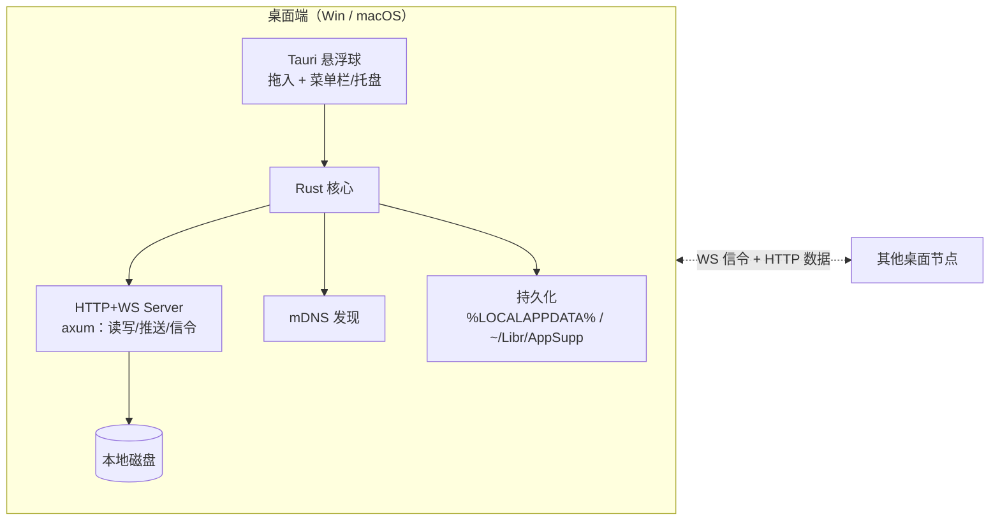

# OrbDrop 需求文档

> 版本：v0.5（2026-09-14）
> 状态：需求已对齐（桌面端完整需求链，基础功能优先），技术方案草案待定

## 1. 项目概述

**OrbDrop** 是一个局域网文件中转工具，主体是一个**始终置顶的悬浮球**，点击展开主界面。提供两条独立的文件流通路径：

- **拖入可见（引用模式）**：把目录/文件拖入悬浮球，**定向选择**对哪些已配对设备可见 → 对端设备标签页中实时出现该目录，可浏览、下载、BeyondCompare 比较、修改/删除/新建（**直接写回源文件**）。零拷贝，文件始终留在本机。
- **推送（真传输）**：从本机共享项列表中选中文件/目录，**指定目标设备**推送 → **已绑定（已配对）设备不经同意直接收**（token 就是那份信任；长连接与否都一样），**未绑定设备才弹同意** → 文件真传输到对端本地磁盘，之后与发送方是否在线无关。收完对端留一条**待确认的通知**（面板右下角气泡，点「知道了」才消失；「知道了」左边还有一颗「打开目录」，按它直接打开落盘目录，并按完也撤掉这条）。

两条路径可分别选择不同的目标设备；设备有三种状态（未绑定/已配对/长连接），控制和能力各有不同。

**目标平台**：

| 平台 | 角色 | 备注 |
|---|---|---|
| Windows 10/11（x64） | 完整对等节点 | 拖入可见 + 推送接收/发送 + 写回（含新建）|
| macOS | 完整对等节点 | 与 Windows 功能对等 |
| Android | 接收为主（暂缓） | 接收推送 + 浏览下载引用 |

**当前专注桌面端**（Win + macOS），Android 需求已记录待后续启动。

**部署范围**：仅局域网（LAN），不做互联网穿透。

**发布计划**：可能公开（GitHub 发布）。macOS 需过 Notarization 公证。

## 2. 核心场景

### 场景一：拖入可见（引用访问）
1. 用户 A 把 `C:\Projects\X` 拖入 OrbDrop 悬浮球 → 共享项上架登记，**自动广播给所有长连接设备**
2. B 处于长连接状态，其悬浮球主界面**自动**出现 A 的设备标签，标签内展示共享项 `X` 的目录树（零拷贝，实时读取 A 的磁盘）
3. B 在树中浏览；右键调用 **BeyondCompare 通过 WebDAV 直连**比较 A 的 `X` 与本地目录（P2）；修改/新建/删除保存后实时写回 A 的源文件
4. B 也可右键"下载到本地"，复制一份到 B 磁盘（落盘位置由设置控制）
5. A 可随时关闭广播开关撤销可见性，或中断连接

### 场景二：推送（真传输）
1. A 在悬浮球本机标签的共享项列表中选中目录/文件，勾选目标设备 B，点击推送
2. B 是**已绑定（已配对）设备**（长连接或只是在线都算）→ **不问同意，直接开收**；B 是**未绑定设备** → 面板右下角一张通知气泡（带文件名与**接收/拒绝**，同意制兜底）。两种情况都**不主动弹面板**：悬浮球左上角的橙色数字就是要不要点开的信号
3. 收下 → 文件流式传输落盘到 B 本地（默认**下载目录** S-01：一律落在 `<发送方名>/` 下，按发送方选中的那些项各自的**名字**展开 —— 单文件 `A.txt`、单目录 `D/…`、多选 `甲目录/…` + `散文件.txt`），完整保留目录结构
4. 传输完成后 B 本地文件独立存在，A 离线不影响 B 使用；B 这边留一条**待确认的长通知**（面板右下角气泡：谁推的、几项、落在哪个目录），点「知道了」才消失，「知道了」左边的**「打开目录」**直接打开那个落盘目录（按了同样撤掉这条）—— 收了什么、收在哪，不会随一条 2 秒的提示一起蒸发
5. B 离线时 A 推送**直接失败提示**（不排队）

**多目标推送（同一次选择发给多台）**：入口是会话里输入框左边那颗「＋」（推给这个会话的收件人；群会话就是一次推给多台；1:1 会话即单台推送）—— 开**一次**文件选择框挑一批文件 → 每台各收到**自己的那条邀请**（已配对的直接收、未绑定的各自点同意，规则与单台一模一样），清单只建一次、各台落盘的内容与目录结构完全一致。A 这边只多一张**汇总卡片**（右下角通知组里）：标题「推送给「B」「C」等 3 台设备」、一行实时计数「成功 1 · 等待 2」、逐台一行状态（等待对方同意 / 传输中 62% / 已发送 8.2 MB / 对方拒绝 / 失败：原因），可逐台取消或整批取消。**一台送不到不影响其余几台**；一台都送不到时才整体失败提示（同样是"不排队"）。

### 场景三：双机对称（桌面端）
- 每台 PC 上的 OrbDrop 实例角色对称：既是共享方，也是接收方
- 多台 PC 可同时在线

## 3. 功能需求

### 3.1 悬浮球与主界面
| 编号 | 需求 | 平台 | 优先级 |
|---|---|---|---|
| F-01 | 悬浮窗始终置顶（Always-on-top），可拖动位置 | Win/mac | P0 |
| F-02 | 无边框，球/圆角形态，可自定义尺寸 | Win/mac | P0 |
| F-03 | 托盘/菜单栏图标 + 显隐快捷键 | Win/mac | P0 |
| F-04 | 点击悬浮球展开主界面 | 全端 | P0 |
| F-05 | 可选：点击穿透模式、自动隐藏 | Win/mac | P2 |
| F-06 | **开机自启**选项（默认开启，可关闭） | Win/mac | P1 |
| F-07 | **本机显示名称**配置（默认取主机名；安卓没有主机名，取设备型号/厂商名，见 S-05；可修改） | 全端 | P1 |
| F-08 | **拖入反馈**：支持拖入时悬浮球高亮/抖动；拒绝非文件/非目录拖入 | Win/mac | P0 |
| F-09 | **本机信息条**（面板 footer）：左侧「端口 · **本机内网 IP**」—— IP 点一下复制 `IP:端口`（跨网段手动添加 F-11 直接粘过去），**多网卡（有线+无线+VPN）时只显示首选那个、悬停列出全部**（私有网段优先，链路本地 `169.254` 排最后；一块 footer 装不下三四个地址）；取不到地址（离线/无网卡）时只显示端口。**网卡地址变了（插网线、开/关热点、切 Wi-Fi、VPN）自动刷新**（后端 5s 巡检一次网卡，只在真变了时发 `local://addresses`）。最右侧是通知铃铛（F-56） | Win/mac | P1 |

**主界面布局**：**一级设备标签栏** + 内容区。

**面板内的层叠顺序（定死）**：右键菜单（根层级）> 对话框（`.overlay` / 文件选择框 `.picker-layer` 90）> 设置面板（`.sheet` 85）> 通知浮层（`.panel-bottom` 70）> 状态框展开的选项列表（30，挂面板头、向下盖过标签栏；见 F-94）> 正文/tab 栏/footer。**模态必须压过通知浮层** —— 反过来的后果是"推送选择框/设置面板开着，通知气泡正盖在它的按钮上，点下去被气泡接走"。通知浮层**左右 12px、上下就是两条横线**（滚动区域夹在"标签栏下缘"与"footer 上缘"之间，内容越不过线）；浮层与容器不吃指针、只有气泡自己吃，**阴影是点击穿透的**（气泡的阴影收在盒子内部的留白里，见 F-56）。右键菜单贴指针出现，**空间不够时翻到指针左上、四周留 8px，不许顶出所在容器**（面板级菜单与选择框里的菜单共用同一份实现）。

- 每台**长连接**设备一个标签（F-25：只有连着的设备才有页 —— 标签在不在它就是那一档状态，
  所以标签上**不挂状态点**，那会是一枚每条都绿的常量）；另有「本机」标签（管理本机共享项）
  与「设备」标签（配对 / 长连接的关系管理）
- 标签 = 设备，内容区 = 该设备的共享项列表/目录树
- 设备标签的宽度封在 132px，名字超出**不加省略号、右端 12px 渐隐**（与悬浮框列表同一套，
  见 `main.css` 的 `.tab.peer-tab .tab-name`）：备注（F-101）让显示名变成「备注(设备名)」之后，
  一行装不下是常态，全名与 `ip:port` 在 `title` 里兜底

**持久化（跨重启保持）**：共享项列表、已配对设备列表、下载目录、窗口位置、本机名称、开机自启设置、文件选择框的「常用」位置——自动保存，重启恢复。token 独立存放于数据目录的**凭据文件**（见 F-15），不与配置文件一起。详见 N-10。

### 3.2 设备发现与配对
| 编号 | 需求 | 优先级 |
|---|---|---|
| F-10 | 自动发现**同网段**在线设备（mDNS），零配置 | P0 |
| F-11 | **手动添加设备**（输入 `IP:端口`）以支持跨网段场景 | P1 |
| F-11a | **跨网段发现**（F-10 与 F-11 的合流）：与一台**已配对**的跨网段设备建立关系之后，它每次探活回答里带回「**它此刻看得见的设备**」表（**整份视野**：本机多网卡——有线 + 无线 + 热点 + VPN——时每一块网卡上看到的设备都在里面，不按拨号地址划段），本机把那些设备也列出来 —— 每跨一个网段只需手动添加/配对**一台**锚点，其余自动出现。**长连接活着也照做**：链路只证明"本机跟这一台的关系"，不证明"它的视野已经同步过"，而学来的条目 20s 没人再担保就收走（所以是跟着每一拍持续交换，不是"配对那一次交换一次"）。**发现只走单播、不做多跳**（**群消息另有一条最多 3 跳的成员间中转，见 F-100 —— 那是消息通路，不是发现通路**）：那是 mDNS 组播跨不过路由的必然结果（组播包 TTL=255 且接收端校验，被路由转发过就丢掉），所以换传输而不是换协议；对方**转述来的**条目不再往外报（那是多跳），要看第三段就再与那一段的某台配对。学来的条目**临时**（不写地址簿、重启即忘）、**不被本机探活**（存活跟着锚点走：锚点不再提到它、或锚点自己掉了，约 20s 后收走），**解除配对即失去该网段的视野**。反向同理：对端也拿到本机这一整份视野 | P1 |
| F-12 | **首次配对**（两条路，任一端都能发起）：**① 配对码**：A 点击"配对"→ A 显示 6 位码（2 分钟有效）→ B 输入码 → 双向确认 → 交换 token → 后续 Bearer 认证；**② 配对邀请**：A 在配对弹窗里点「发起邀请」→ 邀请**通过按钮点击推送**到 B（`POST /pair/invite`，一次 HTTP，不需要 WS、不需要预先配对）→ B 面板右下角挂一条带「接收/拒绝」的通知（60s 没人处理自动作废）→ B 点「接收」即完成配对（谁都不用输码）。A 侧弹窗**当场收起**，这条邀请变成同一组里的一张「等待对方确认配对」卡（带「取消」）：对方接受 → 卡片收掉 + 提示配对成功；被拒/超时/联系不上 → 卡片收掉并写明原因；点「取消」→ 撤回 B 界面上那条通知 | P1 |
| F-13 | 设备列表展示：名称、**状态（未绑定/已配对/长连接/离线）**、在线状态、共享项摘要。列表**在线在前、离线在后**，在线组内按 长连接 → 已配对 → 未绑定 排（见下方"列表内容与排序"）| P1 |
| F-14 | 随时中断与指定设备的连接；解除配对：**双向**清 token + 断链，但设备行**不立即消失** —— 它仍在发现范围内就继续以"未绑定"列出（可再次配对）。**解除配对是本机动作，不要求对方在线**（对端离线时本机照样清干净，只少一次"通知对端"这一步）；已配对的设备离线后**仍留在列表**（排在在线设备下方，只提供「解除配对」），解除后仍在线则以"未绑定"列出，离线则不再列出 | P0 |
| F-15 | **App 内凭据管理**：设备列表显示配对状态（未配对/已配对/连接中）；配对、解除配对、重新配对、查看密钥状态——全部在 App 内完成。**一键清空**：设置面板里「清空全部凭据」一个动作清掉本机全部配对（含写进 Beyond Compare 的 WebDAV profile），用户无需（也不应）去翻文件或系统凭据管理器 | P0 |
| F-16 | **长连接**：**由用户点「连接」建立** WS 长连接（实时在线/变更通知通道）——配对只确立"已配对"关系，不自动建链（mDNS 发现/探活不拨号）；「断开」= 断链 + 本机暂停 + 清本机"上次是长连接"的记忆（对端的重拨被拒，双方界面都回到"已配对"）——**暂停也落盘**（地址簿条目的 `paused`）：重启后本机既不主动拨，也照旧拒绝对端的自动重拨；任一台点「连接」立即拨号恢复，对端的显式请求也会结束本机的暂停。**重启恢复**：关机时处于长连接的设备，下次启动自动拨回来（记忆在链路建立那一刻落盘，用户点「断开」即清除） | P0 |
| F-94 | **本机「在线 / 离线」**（面板右上角那个状态框）：点一下**向下展开**选项列表（在线 / 离线），选一次即切、随即收起；**当前值永远在第一行**（收起时它就占着框里那一行，展开时它是最上面那条），列表顺序随之换位。**展开只动高度**（行数 = 选项条数，这里是 2 行）、**圆角不变** —— 收起是现在的单行胶囊（左右半圆），展开是同一个圆角的矩形；框**向下长**、不顶动面板头（框绝对定位贴着面板头上沿，长出来的部分盖在标签栏上，见「面板内的层叠顺序」）；**宽度在两种状态下必须一样**（两行始终参与定宽；在线那行的长连接数在离线时只是藏起来、仍占位）。文案与改前那颗胶囊一致：在线时是 `在线 · 长连接 N`；本机离线时长连接数不显示，那条只剩 `在线`。**离线 = 隐身**：注销 mDNS 广播（对端发现不到本机）、断开全部长连接与拨号循环、对**一切**入站请求回 503（对端 5s 探活因此判本机离线 —— 只注销 mDNS 瞒得住发现、瞒不住状态）。**配对关系、token、共享项、地址簿里的长连接记忆一律不动**：切回在线即重新广播、并按记忆把链路接回来（F-16）。离线期间一切对外动作（连接 / 推送 / 配对邀请）**直接报错**，不排队、不静默失败。状态**落盘、跨重启有效** | P1 |
| F-58 | **设备列表搜索（纯前端）**：工具条「局域网设备 ?」右侧常驻一个搜索框（**有设备时才出现**），按**设备名或 IP** 的大小写不敏感子串**实时筛选当前列表**（设备起了备注时按显示名匹配，见 F-101） —— 只改显示：不发请求、不碰长连接与设备状态、不排队。右侧计数在筛选时改显「匹配 x / 共 y 台」（一眼看出是筛剩这么多，而不是设备真只有这么几台）；没有命中时摆**专门的空态**（写明只匹配名称与 IP，带「清除搜索」），**不能**摆「还没有已配对设备」那张（会像是设备丢了）。入口位置与台数同一行。 | P1 |
| F-59 | **设备行「发消息」**：在线设备的行右侧给一颗**「发消息」**（纸飞机图标），点一下打开与这台设备的会话（浮层直接落在该会话上）—— 未绑定 / 已配对 / 长连接三档都在：消息**长连接优先、HTTP 兜底**，两条都够不着就**排队等对端上线**（见 F-95）；离线行不给（同 F-14 的离线行规则）。设备行**不再有「推送」按钮**，右键菜单里也不给「推送…」：推送的唯一入口是会话里那颗「＋」（F-50） | P0 |
| F-101 | **设备备注**（本机私名）：右键设备行 →「修改备注」，给这台设备起一个**只存在本机**的备注（留空保存 = 清除）。设好之后，本机界面上的设备名一律显示成「**备注(设备名)**」—— 设备行、标签栏、会话标题、收件人选择框、推送卡与通知都算；备注**不随任何报文发给对端**，对方看到的始终是它自己的名字。落盘在 `config.toml` 的 `deviceRemarks`（键是**设备 id**），所以它**跟着设备走、不跟着地址走**：换网段、重新配对、解除配对之后都还在，重启后仍在。**不要求对方在线**（纯本机动作）：离线行与未绑定行同样能改。**移动端不提供入口**（那里已有「重命名设备」） | P1 |
| F-106 | **经第三方盲转（中转）**：有些 Wi‑Fi 的 AP 把**同一网段里客户端之间的单播**隔开了 —— 组播还能过、单播全灭（ARP 应答收不到、TCP 握手卡在 `SYN_SENT`、mDNS 记录看得见却连不上，表现是"设备列表闪一下就没"），于是两台设备各自只够得着第三台设备（常见是常开的桌面端）。本机在**直连这一跳探不通**时，向一台"**已配对** + 自报**愿意中转** + 此刻在线"的设备请一条中转端点（`POST /relay/open`：要凭据；目标取那台设备地址簿里**此刻在线**的设备，且不是请求方自己、不是它自己 —— 它不认识目标、或目标在它视野里不在线时，请求方可以把**目标的地址**一起捎来，它到那个地址核实自报的 device id 就是这一台之后照样转：跨网段的中转方常常"够得着却从没认识过"目标。**核实这一关不能省**，否则它就成了"给任意局域网地址开隧道"的工具）；拿到端点后，本机对那台设备的**拨号地址改走端点**（`PeerDevice::dial` 是唯一取址处 —— 能直连就直连，直连恢复即**收起**中转）。中转方**只搬字节**：两端 TLS 端到端不变，它看不到内容、也不懂协议；**单跳**（不链式中转）、并发上限 8 条、空闲 120s 回收，来源白名单只放请求方（它在地址簿里的地址换过也认）。中转端点**不落盘**（重启/换网由探活重算），端点地址用 **IPv4 映射的 IPv6** 字面量（否则端点上那台设备的证书会与中转方自己服务的指纹键位撞车 → 同地址两枚指纹 → 退 TOFU）。中转方愿不愿意由 S-09 决定（默认关）；**请求方不需要自己的开关**。**被隔离时的两个界面后果**（与上面这条同源）：① 设备列表**照旧列出**记录还在（对端在喊）却探活不成的那种（不是"闪一下就没"），但**不给它单独一档状态** —— 关系没建立就是「未绑定」、点照旧按 `offline` 画；"这张网把单播隔开了"只在**发起连接**时弹一句 tip（配对 / 长连接 / 立即连接 / 配对邀请，见 2026-09-30 的改动；`seen` 由 mDNS 记录存续决定，与 `online` 刻意分开；中转接管后自动回到正常在线行，并标「经 X 中转」）；② 发消息实在送不出去（直连不通、也没有可用的中转）时给一句提示（事件 `chat://undeliverable`）—— 消息本身照旧排队等它上线（F-95），**先当场试一次中转**，成了就把这条立刻重发过去 | P2 |
| F-107 | **跨网段中转记忆**（设计与算法见 [docs/relay.md](relay.md)）：F-106 只回答"这一跳怎么搬"—— 每次直连探不通都要重新找中转方，而被中转的那一侧（B）根本不知道中转网段存在、自己回不去。本条补三件事：**① 记忆（落盘）**：直连探不通的设备一旦经中转**真的到达**，就把"这一段设备经哪一段中转"记进地址簿 —— **设备级链路**（`relayViaId`/`relayViaCidr`/`relayOkAt`，上次实际经手的那台）＋ **网段级策略**（`relayRoutes[目标网段] = {viaCidr, viaDevices, viaPaired, lastOkAt}`），同段的 B1/B2/B3 直接复用，不必每次重开；**② 泛化与失效转移**：中转段的设备列表靠既有的每 5s `/discover`（F-11a）持续刷成**中转池**（该段内自报允许中转且在线者，含锚点自己），C 离线自动换池内下一台，**不需要重新匹配**（中转方可被非配对设备借用，见 S-09）；**③ 反向记录**：经中转到达 B 之后，在**同一条已建立的链路上**用 `POST /relay/route`（需凭据）把这条路由交给 B，B 存一份对称记忆（接收方只在记录的目标网段**含本机地址**时采纳），此后 B→A 不必再与 C 配对。**前置**：三处报文补网段自报 —— mDNS TXT 与 `/pair/info` 加 `nets`（本机非回环 IPv4 网卡的「网络号/掩码」），`/discover` 每条 `PeerEntry` 加 `cidr` 与 `relay`（`ver` 2）。**直连恒优先**：记忆只是"直连不通时的候选顺序"，5s 探活照旧恒探直连，直连一通即收起端点，设备级记录在直连连续稳定 3 拍后清除、网段级策略在该段已知设备全部连续可达后退休；锚点 7 天不再担保即删。边界不变：**单跳**（不链式）、不经互联网、不引入第三方服务；端点仍**不落盘**（`PeerDevice::relay` 是运行时段，`dial()` 仍是唯一取址处）| P2 |

> 「断开」的"拒"**只针对自动重拨**，不是解绑，也不拒绝人对人的连接请求：链路建立时**两侧**都会写下 `autoConnect` 记忆，所以若断开只断链、什么都不拦，对端自己的重连循环会在 5 秒内把链路接回来，按钮等于没按。因此 WS 升级入口（`server::events_ws_handler`）在暂停期间只对**不带 `manual=1`** 的拨号回 403；**这一条暂停也写在地址簿里**（条目的 `paused`）——「断开」的对方那一侧并没有点过断开、它那份记忆照旧，只把暂停留在内存里的话，本机一重启就又会照收它拨来的链路（而且被拨号的一端会顺手把 `autoConnect` 写回来，此后每次重启都自己连）；用户在对端点「连接」时带 `manual=1`，一律放行**并顺手结束本机的暂停**（`manual=1` 只搭在这一次拨号上，不是循环的长期属性）。两种信号别混：**403 = 对端暂停**（关系还在，谁点一次「连接」就恢复）；**401 = 对端不认本机 token**（关系已不成立，只能重新配对）。被 403 拒后本机的拨号循环**停手**，不再每分钟敲门（敲门永远不会变成连接）。

**设备状态模型**：

```
未绑定 ──配对──▶ 已配对 ──点击"连接"／启动恢复──▶ 长连接
 │                │                     │
 │                │                     ├──点击"断开"（断链+本机暂停，两者都跨重启）─▶ 已配对
 │                │                     │    └──任一端点"连接"─────────▶ 长连接
 │                └──解除配对──────────▶ 未绑定（仍在线则留在列表，离线则不再列出）
 └──可推送（接收需同意）
```

**列表内容与排序**（F-13/F-14）：

- **在线设备全列**，组内按 长连接 → 已配对 → 未绑定 排（同级按名称）
- **已配对但离线的设备排在其下方**（「离线」状态，虚线标记）：对方不在线才是真正需要
  「解除配对」的场合 —— 解除是纯本机动作（`POST /unpair` 只是尽力通知对端），不需要对方在线
- 离线**且未绑定**的设备不列：它没有任何可做的动作
- 离线行只提供「解除配对」：`连接` 的目标不在网上（只会开一个空转的拨号循环）；
  「发消息」也不给 —— 设备页这一行不是消息的入口（会话列表里与它的那条会话一直在，
  那儿的输入框照样能用，消息会排队等它上线，见 F-95）
- 行里的名字可能很长（备注，F-101）：超出时**只淡名字**（右端 12px 渐隐，与标签栏同一套），
  状态 pill **完整显示、不被裁** —— "长连接 / 已配对 / …"那几个字是这一行的结论，
  名字被切一半能忍，结论被切一半不能

**状态 pill**（一律 ≤3 字，完整原因写在悬停说明里；颜色说"链路与广播范围" —— **绿只给长连接**，
因为自动广播的对象就是它，扫一眼色相即知哪几台收得到）：

| pill | 条件 | 配色 |
|---|---|---|
| 长连接 | 在线 + WS 链路活着 | 绿（点呼吸） |
| 已配对 | 在线、已配对、没有拨号意图 —— **本机点过「断开」、或对端点过「断开」都落回这一档**（都是有人主动做的事，不是故障；原因只在悬停说明里） | **蓝**（项目主色） |
| 未绑定 | 在线、未配对 | **中性**（局域网设备的默认状态：不配对也能推送，接收方同意即可 —— 不是告警） |
| 离线 | 已配对但对端不在网上（含"拨号正在待命"） | 中性 + 虚线 |
| 重连中 | 退避重试建链中（**含被网络打断后自动接回**） | 琥珀（非稳态，点呼吸） |
| 需配对 | 对端不认本机 token（401：它清过数据 / 解除了配对）—— 唯一"关系已不成立"的异常 | **红** |

> 设备行**不再挂「自动广播」标签**：会收到广播的就是长连接那几台，状态点/胶囊的颜色已经说了
> 这件事（绿只给长连接），说明正文写进设备页标题旁那颗「?」（与"处于长连接的设备会自动收到
> 你拖入悬浮球文件的广播"同一条），行上少一枚重复的标签。

> `waiting`（对端不在网上、拨号转入待命）**不单独成档**：它蕴含"对端离线"，pill 归「离线」，
> "本机还在等它上线，一出现就自动接回"这层意思写进「离线」的悬停说明。
>
> **未绑定**这一档只给两个动作：「配对」与「发消息」（后者只是打开会话；消息**长连接优先、
> HTTP 兜底**，对端还收不到就排队等它上线，见 F-95）；「连接」拨不动（未配对不建链），「解除配对」也没有关系可解，
> 两者都不出现在行内与右键菜单里。推送不在设备页给（唯一入口是会话里那颗「＋」，未绑定的目标仍走同意制，见 F-51）。

「需配对」这一档的行内动作是**「配对」（重新配对）**，不是「连接」—— 拨号必然 401、
`stop_reason_for` 会让循环立刻停手，点多少次都一样；重新配对会让对端发一枚新 token
（本机存的那枚与 BC 里那份一起更新）。配对成功时清掉这台设备残留的拨号状态，否则界面
会停在「需配对」继续叫他重新配对（`state::mark_paired`）。

这一档**两个方向都要能重新配对**：本机发起的邀请/配对码照常；**对端发来的配对邀请也不能
被挡掉** —— 那枚老凭据早已被对端删掉，再拿它当门槛只会把一次正常的重新配对挡成静默 401
（对端点「配对」、本机连通知都没有）。所以「自称已配对设备必须出示凭据」这道门在
**本机已知需重新配对**时放行到通知里，仍然由用户手动点「接收」（见
`routes_pair::must_prove_identity`）。

- **未绑定**：mDNS 发现/手动添加，未交换 token。**可推送**——推送邀请直接 HTTP 发送，接收方同意才传输（同意制兜底安全），不要求预先配对
- **已配对**：token 交换完成，具备认证。可推送；长连接**不自动建立**（唯一例外是"上次关机时它是长连接"，见 F-16 重启恢复），设备行给一个「连接」按钮，由用户点击建立
- **长连接**：已配对 + WS 实时连接（以真实 WS 会话为准，非"HTTP 可达"；由用户点「连接」进入，或启动时按上次状态恢复）。**拖入文件时自动广播**给所有长连接设备
- **离线**（限定"已配对"）：对方不在 mDNS/探活视野里 —— 行仍在列表**最下方**（F-13/F-14），此时唯一能做的事就是「解除配对」。离线**未绑定**的设备不列

> 长连接意图存在**地址簿**（`config.toml` 的 `peers` 条目 `autoConnect` 与 `paused`，同一个意图的两面：本机要不要拨、接不接对端的自动重拨）：链路一建立就写 `autoConnect`、用户点「断开」就把它清掉并写下 `paused`、点「连接」（或对端带 `manual=1` 拨进来）两者一起翻转。写在发生的那一刻而不是退出时，所以强杀进程/断电都不会丢。启动恢复的拨号**不带** `manual=1`——对端点过「断开」时照旧被拒，不替它解除暂停。

> mDNS **不能跨网段**（这是协议设计：组播包要求 TTL=255 且接收端校验，被路由器转发过就丢）；跨网段靠**单播**——本机与已配对对端之间每 5s 的那一拍（探活 / 链路巡检）顺带交换各自的 mDNS 视野（F-11a），**长连接活着也照做**（不然点过「连接」的锚点就再也不报表了），一台锚点换回**它看得见的全部设备**。**token 存储**：全部已配对设备的 token 与**对端证书指纹**合成一份映射，存在数据目录的一个文件里 —— `%LOCALAPPDATA%\OrbDrop\credentials.dat`（macOS `~/Library/Application Support/OrbDrop/`）。格式 v3（`{设备id: {token, fingerprint}}`，整块混淆的 base64），v1/v2 启动时就地升级。本机自己的身份（自签证书 + 私钥）单独一份 `identity.pem`，**只生成一次、永不轮换**。是一整块混淆过的 base64 文本（内层才是 `ODBF <版本>` 头 + JSON 正文 + `# 177plus` 署名），**这一层只是遮挡、不是加密**：文件等价于明文，任何拿到它（以及源码里那枚固定混淆密钥）的人都能解出全部 token。所以这个文件是"本机唯一一处 App 自己的凭据"：App 内「清空全部凭据」删掉它就是全清，同时把写进 BC 的 WebDAV profile 一起剪掉；解除单台设备只从映射里移除那一台，不影响其他设备。（老版本曾把这份映射放在系统凭据库里，那条路**已彻底删掉**：它是只读入口加一次性迁移，迁移完成后就不再需要，代码与依赖都没了。`identity.pem` 不在清空范围内 —— 清凭据不换身份。）

### 3.3 拖入可见（引用模式，仅桌面端）
| 编号 | 需求 | 优先级 |
|---|---|---|
| F-20 | 支持将目录/文件从 Explorer/Finder **拖入悬浮球**；本机页那块「拖入文件或文件夹，点击添加共享项」点一下也能挑（开同一个文件选择框）—— 两条路最终都落到同一个登记动作 | P0 |
| F-21 | 拖入即**登记上架**（零拷贝，仅登记本地路径），**自动广播给所有处于长连接状态的设备**（开播初值由 S-07 的「添加后自动共享」决定，默认为关）。**同一条路径只登记一次**：重复登记（拖回卡片、选择框里又挑到同一项、同一个目录换个写法——大小写/结尾分隔符/符号链接）是**幂等**的，返回已登记那一项，不新增、不改名、不重置广播开关；**配置里历史遗留的重复项在读配置时整条收掉**（保留最先登记的那一条，并把清理结果写回文件） | P0 |
| F-22 | 共享项带**广播开关**（开/关状态图标）：开启 → 自动广播给所有长连接设备；关闭 → 撤销可见性，仅本机可见 | P0 |
| F-23 | 共享项可重命名、下架（从本机移除共享项）、删除。**下架有三个入口**：本机标签页里右键该项、该项所在目录树节点右键、以及**圆角矩形悬浮框的卡片上右键那一格**（2026-09-29 加，见 `orb-functional-design.md` §13 的「卡片上的右键菜单」）。卡片那一档与面板同一份菜单、同一套处理，只是**小一号**（11px 行、实测 97×96）且文案更短（打开文件夹 / 复制路径 / 移除共享）、落点按**屏幕边**翻边（指针右下 → 右侧不够翻左侧）、窗口临时撑大到装得下它、关掉缩回；菜单开着时窗口里**第一下按下只关菜单**，不触发卡片自己的动作 | P1 |
| F-24 | 支持多共享项同时存在；对端设备标签内以列表/树展示 | P1 |
| F-25 | 无长连接设备时开启广播 → 提示"暂无长连接设备，请在设备列表建立连接"；对端长连接建立/断开时，共享项可见范围实时更新 | P1 |

**交互链**：拖入 → 悬浮球高亮 → 共享项登记到本机标签（广播开关初值跟设置里的「添加后自动共享」S-07，默认为关）→ 打开广播的项在所有长连接设备标签中自动出现 → 用户可随时用该项的广播开关撤销

> 广播对象 = **所有处于长连接状态的设备**（无需逐个勾选）。用户点「连接」建立的设备即自动纳入本机所有共享项的广播范围；断开长连接即从广播范围移除。

### 3.4 远程浏览（引用模式）
| 编号 | 需求 | 优先级 |
|---|---|---|
| F-30 | 设备标签内展示远程目录树，惰性展开（按需加载一层） | P0 |
| F-31 | 展示文件大小、修改时间等元数据 | P1 |
| F-32 | 目录缓存 + 并发预取（避免网络往返放大延迟） | P1 |
| F-33 | 共享方目录变更 **自动推送通知刷新** + 手动刷新兜底 | P1 |

> 边界处理：无权限目录 → 显示"无权访问"提示；空目录 → 正常展示空内容；文件被占用 → 仅影响读/写操作（返回错误），不影响浏览元数据。

### 3.5 文件操作（桌面端）
| 编号 | 需求 | 优先级 |
|---|---|---|
| F-40 | 右键：**下载到本地**（复制到设置的**下载目录**；可在设置中选择"默认存下载目录"或"每次弹窗选位置"）| P0 |
| F-41 | 右键：**BeyondCompare 比较**（本机共享项 ↔ 本机目录，或对端共享项 ↔ 本机目录）。对端走 BC 的 WebDAV profile 直连本机 DAV 端点：OrbDrop 自动往 BC 的 `BCProfiles.xml` 写入/更新一条 WebDAV profile（**名字固定为 `IP:端口`**，BaseURL `http://IP:端口/dav/`，用户名 `OrbDrop`、密码为该设备 token）。**解除配对时自动清理这条 profile**（token 已作废；只删用户名是 `OrbDrop` 的条目，用户手建的 profile 不动），再启动 `BCompare.exe "profile:IP:端口?<共享项id>/<子路径>" "<本地目录>"` | P0 |
| F-42 | BC 保存的修改/新建/删除 → 通过 WebDAV **实时写回发送方源文件**（发送方在线为前提）。无需暂存目录或临时文件 | P1 |
| F-43 | 右键：**删除**远程文件/目录（通过 WebDAV DELETE，破坏性操作需二次确认） | P1 |
| F-44 | 右键：**下载到本地并用 Explorer/Finder 打开**（落盘行为遵循 S-02 下载模式设置） | P0 |
| F-45 | 右键：**复制远程路径**（文本，供手动脚本/工具链使用） | P1 |
| F-46 | **拖拽下载**：本机共享项/对端共享项里的**任意文件或目录**都能直接拖到 Explorer/Finder 的某个目录里落盘（拖目录 = 整个目录含子目录与文件）；落下的动作只可能是**复制**，源文件/源共享项不受影响 | P1 |

> **F-46 拖拽下载（实机结论）**：网页里的 HTML5 拖拽出不了 webview —— 目的地是另一个进程，只能用 OS 的原生拖放（OLE `DoDragDrop`，见 `src-tauri/src/drag.rs`）。本机共享项走 `CF_HDROP`（磁盘上就是那些文件，只允许 `DROPEFFECT_COPY` + `Preferred DropEffect`，同盘拖拽的默认"移动"语义不会把用户的源文件搬走）。**对端共享项走 CFAPI 镜像**（`src/mirror/`）：抓起时只在本地建一个**占位符**（实测 0.22 ms、**0 字节磁盘**）就把真实路径交给 `CF_HDROP`，字节等目标真去读它的时候才从对端拉（`GET /file?offset=&len=`）—— 起拖零等待、零预下载，取消/落空不产生任何下载；目录的子树在目标枚举时按目录长出来（`FETCH_PLACEHOLDERS`）。这条路取代了更早的两条（小项"提前转存"到 `<数据目录>/staging`、大项走 OLE 虚拟文件 + 自定义 `IStream`），那两条与其验证开关已删。**为什么必须让目标看到真实路径**：虚拟文件是 shell 协议，只认 `CF_HDROP` 的应用（微信这类）根本不问 `FileContents`。镜像的实测数值、踩过的坑与还没验证的部分：`docs/cfapi-mirror.md`。

> **WebDAV 直连（BC 5.2 实测结论，别按直觉改）**：BC 的 WebDAV 位置**只能通过 profile 引用**——`profile:<profile名>` 取 profile 的 BaseURL，`profile:<profile名>?<子路径>` 再拼一层子路径（分隔符只有 `?` 有效）；裸 `http://x:<token>@IP:port/…` URL **不会**进 DAV 客户端（BC 只发 HEAD/GET，然后报"不能加载基文件夹"）。
> profile 存在 `BCProfiles.xml`：便携版＝BC exe 同目录，常规安装＝`%APPDATA%\Scooter Software\Beyond Compare 5\`。密码字段是 BC 自己的 `BCmp|1|` 信封（AES-256-GCM，密钥在同文件根节点 `Encryption` 属性里），**明文写进去会被 BC 丢弃**；OrbDrop 按同一格式自行加密写入，全程不需要用户操作 GUI。细节与验证记录见 `docs/p2-beyondcompare.md`。
> 服务端命名空间是 `/dav/<共享项id>/<相对路径>`（不用共享项名字：中文/空格/重名，且会和 `/shares`、`/tree` 抢前缀）；认证走 Basic（`OrbDrop:<token>`，用户名不参与校验、只作为"发起方是本应用"的记录），非回环请求必须先回 `401 + WWW-Authenticate: Basic`（BC 会先裸探一次，收到挑战才带凭据重试）。按需读取、实时写回，不占用本地磁盘暂存。

### 3.6 推送（真传输）
| 编号 | 需求 | 优先级 |
|---|---|---|
| F-50 | **推送本机文件/目录**：唯一入口是**会话里输入框左边那颗「＋」**（推给这个会话的收件人：1:1 会话即单台，群会话一次推给每台）—— 直接开**应用内文件选择框** —— 文件与文件夹在**同一个框里混选**，且选中的项**跨目录累积**（这两件事原生框做不到：Win32 只有 `FOS_PICKFOLDERS` 这一个开关，非此即彼）。一律多选（挑一个就是单发，不需要额外开关）；多选合并成**一条**推送：对端一张卡、一次同意、一条进度。**目标可以是任何在线设备（含未绑定、未配对）**——推送不要求预先配对。顶部「常用」由用户右键目录攒出来（**默认空**），随配置持久化；选中集在底部的**购物车**里可查看、逐项取消、全部取消（角标常显，换目录时收起、不自动展开） | P0 |
| F-51 | **接收侧的同意规则**：**已绑定（已配对）设备**（含正在长连接的）推送**不需要接收方同意** —— token 就是那份信任，到了就收；**未绑定设备**仍走同意制：面板**右下角一张通知气泡**（"收到「XX」的推送文件 XX" + 文件名）+**接收/拒绝**，60s 没动作自动拒绝。**收到通知不主动弹面板**（不抢屏幕）：悬浮球**左上角**的橙色数字就是"有事等你"的信号，处理完即消失 | P0 |
| F-52 | 同意后（或已绑定设备自动收下后）真传输到对端本地磁盘（默认落盘到**下载目录** S-01）：一律落在 `<发送方名>/` 下，按选中的项各自的名字展开（单文件 `A.txt` / 单目录 `D/…` / 多选各项各占一个名字）—— **没有"推送名子目录"那一层**；完整保留目录结构。**落盘根**：默认 = 下载目录；设了「每次询问」（S-02）时，**未绑定设备**那条（用户要点「接收」的）会先弹目录选择框（打开即下载目录），选中的目录就是这次的根，框里取消 = 拒绝这次接收；**已绑定设备免同意自动收，不问、恒用下载目录** | P0 |
| F-53 | 目标设备离线 → 推送**直接失败提示**，不排队 | P0 |
| F-54 | 传输进度展示（发送方进度卡 / 接收方进度条）、**双向取消** —— 任一端取消后，另一端那张卡片必须跟着收掉，不留"停在等待/接收中"的僵尸状态。发送方进度卡与通知同一个形状、同一组（F-56）。多目标那一批里，每台各有一行状态、可**逐台取消**，卡片上的「取消全部」一次撤掉整批 | P1 |
| F-55 | 推送记录：历史、重发 | P2 |
| F-56 | **通知组（右下角气泡 + 铃铛）**：**所有通知都在同一组气泡里** —— 未绑定的邀请（带接收/拒绝）、**配对邀请（带接收/拒绝，F-12 第二条路）**、**本机发出去的「等待对方确认配对」卡（带取消）**、正在接收（进度 + 取消）、**发送方进度卡**（"等待对方同意"可能等很久；多目标那一批是同一张卡上的多行）、已收到、接收失败；右对齐、宽 = **面板的 2/3**（不占满），多条垂直堆叠、新的贴最下缘（放不下才在组内滚，**不显示滚动条**）。**滚动区域正好夹在"标签栏下缘"与"footer 上缘"两条横线之间**（盒子上下边就是这两条线，滚动时内容越不过线），左右 12px。气泡阴影**点击穿透**、且收在盒子内部（更紧的 `--shadow-bubble`，不靠往外借位置）。整组**甩入/甩出**。收完/失败这类**点「知道了」才消失**（长通知），正文带**落盘位置**（`<下载目录>/<发送方名>`）—— 否则点完就再也找不到东西在哪。**铃铛**在面板**最右下角、版本号右边**，点一下展开/收起整组；**收起 ≠ 已读**：角标照旧挂着，与悬浮球左上角黄标是同一个数（= 组里还剩几件事：通知 + 在途推送；**一次多目标推送算一件事**）| P0 |

### 3.7 传输（通用）
| 编号 | 需求 | 优先级 |
|---|---|---|
| F-60 | 大文件流式传输，支持断点续传（Range 请求） | P0 |
| F-61 | 传输完整性校验（哈希），不一致时报错重传 | P1 |
| F-62 | 并发传输控制（同时进行中传输数上限） | P2 |

> 实现状态（本轮）：
> - **F-60 已扩到"块级续传 + 跨邀请可续"**：推送走 `POST /push/stream`，块大小由接收方定
>   （默认 4MB，可配 1–32MB），进度按**块位图**记在 `resume.json` 里，键是文件身份
>   （对端 id + 路径 + 大小 + 时间戳）而不是邀请 id —— **传失败后重新推一次会接着传**，
>   不再从零开始。落盘先写 `<key>.orbdrop-part`（`key` = 文件身份），收尾（长度核对 + 逐块复核 + 大文件 fsync）后**原子改名**
>   到最终路径：最终路径上只可能是"不存在"或"校验过的完整文件"。
> - **F-61 已实现（按块）**：每一块的 SHA-256 由发送端在读的同时算、尾随在载荷后面下发，
>   接收端边写边算、读完比对；不符则这一块不置位、重排重下（第二次仍不符 → 这条文件判失败）。
>   传输期间源文件被改（大小/时间戳变了）→ 该文件判失败，宁可不给也不给一份"半新半旧"的。
> - **F-62 已实现**：设置里的「传输并发数」（1–8，默认 4）与「分块大小」（1–32MB，默认 4MB）。
>   小文件（≤1MB）按"一批一个请求"打包（≤256 条 / ≤8MB），大文件按块并行。
> - **N-02（巨量小文件）**：推送侧不再"一个文件一次串行往返"（那正是 2 万文件要几分钟的根因）。
>   浏览侧的目录缓存/并发预取仍是独立的一条路，未变。
> - **实测（本机回环 TLS，热缓存）**：3000 个 4KB 小文件 7.03s → **1.72s**（2.34 → 0.57 ms/文件，4.1×）；
>   单个 128MB 文件 **101 MB/s**（N-01 千兆上限 118 MB/s）；混合 1500 小 + 128MB → 2.50s。

### 3.8 设备管理与安全
| 编号 | 需求 | 优先级 |
|---|---|---|
| F-70 | 设备标签显示：名称、在线状态、配对状态 | P1 |
| F-71 | 设备重命名、移除（解除配对，自动清理本机对应 token 与 BC profile）、拉黑——即 App 内凭据管理入口（对应 F-15） | P1 |
| F-72 | 写回（修改/删除/新建）需携带有效的对端身份 token；删除强制二次确认（仅删除，修改/新建不弹）| P1 |
| F-73 | 共享方对被写回的目标可配置策略（允许写回 / 只读） | P1 |
| F-74 | **状态持久化**：共享项、配对设备列表、下载目录、窗口位置、设置、文件选择框的「常用」位置——自动保存到磁盘，重启恢复；**token 存数据目录下的凭据文件**（见 F-15/N-10），不落配置文件 | P0 |

### 3.9 Android 客户端
*（已记录，桌面端 P0/P1 完成后启动，暂缓）*

| 编号 | 需求 | 优先级 |
|---|---|---|
| F-80 | **悬浮气泡**（`SYSTEM_ALERT_WINDOW`），显示连接状态，收到推送时抖动/改变颜色 | P0 |
| F-81 | **前台服务**保活，后台保持 WebSocket 长连接 | P0 |
| F-82 | 点击气泡展开主界面，设备标签页 + 远程目录树浏览 | P0 |
| F-83 | 接收推送 → 通知栏提示 → 同意/拒绝 → 流式落盘 | P0 |
| F-84 | 浏览 PC 共享项 + 下载到本地 | P1 |
| F-85 | 系统分享菜单入口：分享到 OrbDrop → 选目标 PC → 推送 | P1 |
| F-86 | 可选 SAF 外部目录作落盘位置（等同桌面 S-01；推送接收也落这里） | P2 |
| F-87 | 首次运行引导：悬浮窗权限 + 忽略电池优化 + 前台服务 | P0 |

> Android 不做拖入可见共享方，不做写回。

### 3.10 macOS 专用
| 编号 | 需求 | 优先级 |
|---|---|---|
| F-90 | **本地网络权限**（`NSLocalNetworkUsageDescription`）首次授权引导 | P0 |
| F-91 | 菜单栏图标（替代托盘），支持显隐 | P0 |
| F-92 | Finder 拖入支持（Tauri 原生支持 macOS） | P0 |
| F-93 | 写回与 BeyondCompare macOS 版（`bcomp`）集成，与 Windows 对等 | P1 |

### 3.11 设置项

| 编号 | 需求 | 优先级 |
|---|---|---|
| S-01 | **下载目录**：**默认**的落盘位置（默认 `%USERPROFILE%/Desktop`）——引用下载（F-40）与推送接收（F-52）都写这里；推送一律落在 `<发送方名>/` 下（按选中项的名字展开，见 F-52）。落盘根可被 S-02 的「每次询问」在**未绑定设备**那条上逐次改写（选的是根，`<发送方名>/` 这层不变）。同名文件自动改名 `xxx (1).ext` | P0 |
| S-02 | **下载模式**：下拉选项——"直接存下载目录"或"每次弹窗选位置"，默认"直接存下载目录"。作用两处：①**手动下载**每次弹保存文件框；②**接收未绑定设备的推送**时先弹目录选择框（打开即下载目录），框里取消 = 不落盘 / 拒绝该次接收。**已绑定（已配对）设备的推送不受影响**：免同意、到了就收，恒落下载目录。保存框里**取消就是不落盘**（不退回下载目录偷偷下完） | P0 |
| S-03 | ~~**收件目录**~~ **已并入 S-01**（不再单设）：两个"预设落盘位置"对用户是同一种操作，分成两份只会让人猜哪个生效 | — |
| S-04 | **开机自启**：开机自动启动，默认开启（对应 F-06） | P1 |
| S-05 | **本机名称**：设备显示名称，桌面端默认取主机名，可修改（对应 F-07）。**安卓上默认取"厂商放出来的市场名"**（小米 `ro.product.marketname`、OPPO 系 `ro.vendor.oplus.market.name`、vivo 系 `ro.vivo.market.name`），取不到退「品牌 + 型号」（`samsung SM-S928B`）、再退型号 / 品牌 —— 读的是系统属性（`__system_property_get`，不要权限、不走 JNI），一条都读不到才退 `OrbDrop-Android`。理由是安卓上没有主机名，而 `ro.product.model` 在国行 ROM 上是型号代码（`24129PN74C` / `V2502A`），摆进设备列表谁也认不出；**厂商市场名是这些私有属性，没有文档保证**，所以是"探一遍、取第一条存在的"而不是"必须有"。升级时会就地换掉早先自动取名留下的值（平台兜底串、型号、品牌），用户自己起过的名字一个字不动（`config::should_replace_auto_name`） | P1 |
| S-06 | **监听端口**：默认 `3890`，可配置。被占用时自动探测 `3891-3899` 取第一个空闲端口；全部被占则报错提示。mDNS 声明实际端口，同网段对端无感 | P0 |
| S-07 | **添加后自动共享**（F-25 的默认值）：打开后新添加的目录/文件**默认打开广播开关**，对长连接设备当场可见；**默认关闭**（新加的项默认不共享）。只作用于之后添加的项 —— 已在列表里的开关一个都不动（手动关掉的项不会被翻回来）。落盘在 `Config::autoBroadcastNew`（旧配置缺此项按"关"读） | P0 |
| S-08 | **允许为群聊中转消息**（F-100）：打开后本机把**本机也在其中**的群消息转给其他成员（最多 3 跳），用于跨网段；**默认关闭**。代价如实写在副文案里：转一份占一份上行带宽。落盘在 `Config::groupRelay`（旧配置缺此项按"关"读）。**桌面端设置里与 S-09 合并成一颗「允许中转」开关**（两颗一起开/关，见 §3.11 下方说明） | P2 |
| S-09 | **允许为其它设备中转**（F-106）：打开后本机替"够不着彼此、但都够得着本机"的两台设备**盲转字节**（AP 把同一网段的客户端隔开时用得上）；**默认关闭**。代价如实写在副文案里：替别人占用本机上行带宽。关掉时**立刻收掉**已经开出去的中转（不是等它空闲回收）。落盘在 `Config::allowRelay`（旧配置缺此项按"关"读）。**不限已配对设备**（F-107）：开着就允许 —— 本网段内**能到达本机**的任意设备都可以请本机开中转，不再要求它与本机已配对；强制保留的只剩"到请求方给的那个地址核实目标身份"这一关（少了它，本机就成了给任意局域网地址开隧道的工具）。代价如实写进副文案：同一张网里谁都能借本机的上行带宽。**桌面端设置里与 S-08 合并成一颗「允许中转」开关** | P2 |
| S-10 | **记住并自动复用跨网段中转**（F-107，设计见 [docs/relay.md](relay.md)）：**默认开启**。打开时本机把「哪一段设备要经哪一段中转」记进地址簿并自动复用/泛化/反向传播（设备级链路 + 网段级策略 + 中转池）；关闭时**完全退回 F-106 行为** —— 端点每次现开、用完即收，不落盘、不泛化、不传给对端。落盘在 `Config::relayMemory`（旧配置缺此项按"开"读）。**默认开**与 S-07/S-08/S-09 的"默认关"口径不同：这一条不替别人做事、也不向网络暴露本机的新能力（真正花带宽、暴露能力的那一侧由中转方的 S-09 把关），只影响本机自己的选路效率。**桌面端设置里不再单列开关**：它只影响本机自己的选路，保存时一律写开（移动端保存时原样往返） | P2 |
| S-11 | **中转流量记录**（F-106 / S-09）：本机替别人中转的**累计流量**（收发两个方向之和的字节数）与**连接数**，落盘在 `Config::relayBytesTotal` / `relayConnsTotal`（旧配置缺此项按 `0` 读），重启接着算（记账时累加并落盘）。字节数**两处合流**：① 盲转的连接字节；② 替群聊转发出去的消息字节（按序列化后的消息体大小计，S-08 的中转那一跳）。**连接数只数盲转的连接**（消息中转不是连接）。**只统计本机作为中转方替别人搬的那部分**；本机自己发出去、经别人的中转不计入。设置面板只读显示（面板开着时按 5s 轮询刷新） | P2 |

> **中转开关的口径**：桌面端设置里只有**一颗**「允许中转」开关，同时控制 S-08 与 S-09（替其它设备盲转字节 + 替群聊转消息），**默认关**；关掉时立刻收掉本机正替别人转的每一条。S-10（记忆）不在这颗开关里 —— 它只影响本机自己的选路、不替别人做事，恒为开且不给控制。S-11 是只读的用量记录，中转方的代价（上行带宽）在设置里就是这一个数。

> 设置项集中在 App 设置面板中管理，持久化到本地配置文件（N-10）。当前 P0 仅覆盖需要设置化的文件路径和模式；P1/P2 更多设置项随产品化逐步添加。

### 3.12 会话与群聊

> 会话（聊天）是推送的宿主（F-50 那颗「＋」就在会话的输入框旁边），但它在文档里一直没有自己的条目。
> 这一节把三档会话与群聊一次写清；落盘两份：`chat.json`（1:1 与群发名单）与 `groups.json`（群聊）。

| 编号 | 需求 | 优先级 |
|---|---|---|
| F-96 | **会话三档**，用一个"会话键"统一寻址：`dev:<设备id>` = **一对一**（与这台设备的完整往来）；`bc:<名单id>` = **单向群发**（一次发给几台，各台各收一条普通私聊 —— **成员互不可见**，回复各自回到与发送方的 1:1）；`grp:<群id>` = **共享群聊**。群消息**不镜像**进 1:1 会话（群有它自己的一条流；镜像会让 N 台群把每条消息灌进 N 条 1:1 里）。消息落盘 `chat.json`（每台 500 条，超了从最老那头砍），界面一律整份快照推进（`chat://changed`），前端不做增量演算 | P1 |
| F-97 | **群聊·名册**：名册 = `{id, 名字, rev, updatedBy, updatedAt, 成员[{id,名字}], 创建者}`，存在 `groups.json`（**独立文件**：`chat.json` 没有版本位，老版本读入→原样写回会抹掉新顶层键）。名册是 **LWW 寄存器**（`(rev, updatedBy)` 大者胜、平局按 `updatedBy` 字典序）：**任何成员都能改名/加减人**（对等，没有群主），并发变更**只留一个胜者**、不做合并。**成员不需要配对**（名册里只有 id 与名字；地址不进名册 —— 地址是"本机跟它之间"的关系）：未配对成员没有长连接，群消息走 HTTP 兜底那一跳。**未知群的第一份名册要人确认**：收到不认识的名册 → 会话侧一张邀请卡（**会话列表头顶 + 会话详情顶部**各一份，都不随消息流滚），「加入 / 不加入」，卡上写明「已有 N 条消息在等你」（攒着的那几条）；这张卡**不进右下角那组通知气泡**（那组是"没有落点、有期限"的：推送/配对邀请 60s 自动作废，而它没有期限、处理完的落点就是它将要成为的那条会话），而是**与未读一起算进「会话」那颗角标**（底栏入口 / 悬浮球左上角 / 移动端「会话」页签 —— 只画在会话侧而不计数的话，面板收着或停在别的页时一条邀请一个像素都不显示）。挂着期间到达的群消息**先攒着**（上限 50 条/群、8 个群），点「加入」那一刻并进会话、点「不加入」跟着丢。拒绝过的群之后一律忽略（卡片不反复弹）。**被移出**（名册里没有本机了）：停发、不再列在会话列表里，历史留在盘上。**自己退群**：入口是会话自己的「⋮」——桌面端＝会话右键菜单、安卓端＝会话子屏右上角那颗 ⋮ 的底板（`ChatActionsSheet`），两端同一项、同一套语义（`group_leave`）：名册里去掉本机、把"没有本机了"的名册广播给其他成员，**本机这份记录一并删掉**（`groups.json` 的群/会话/读位都清），其他成员不受影响；移动端先 `confirm` 问一句，退完退回会话列表（子屏的路由是 hash，不退就是一屏空壳）。上限 32 人（发送是"每台各一份"，无组播）；群名留空则标题回落到成员名 | P1 |
| F-98 | **群聊·消息**：一条群消息 = 一条记录（**不是**群发那样"N 份副本各进一台的会话"）。去重键 `(作者, id)`（补发、重连重投、跨段中转都是同一个 id 进来多次）；`seq` = 该发送方在这个群里的第几条（1 起）；展示顺序 `(at, 作者, seq)` —— 跨发送方按墙钟、同一个人按自己的序号。投递 = **逐成员各投一份**（无组播）：长连接优先、HTTP 兜底，**够不着的排队等它上线**（F-95 同一套）、对端明确拒绝的落「未送达」；**名册落后于本机时先补名册再发消息**（对方不认识的群，消息无处可放）。未读按**本地读位**（最后读过的那条消息 id）算 —— 群里多个发送方的 `at` 之间不可比，不能用墙钟水位。已读回执**逐发送者**（`up_to` = 读到的、你发的最大 `at`）→ 发送方显示「已读 n/m」；**读回执本身也是"它收到了"的证据**（那一份顺带升「已读」）。每群 500 条；群里发文件**没有新命令**：按名册跑一次多目标推送（F-50，未配对成员各自点一次同意） | P1 |
| F-99 | **群聊·补齐（补拉）**：跨网段/离线期间漏掉的消息，由**接收方主动要**（发送方根本没到对方的路径，重投多少次也到不了）。请求 = `since_at`（时间锚点 = 手上最新一条的 `at`）+ `holes`（**点名**缺了哪几个 `seq`：锚点只能表达"之后的全要"，中间那几个洞只能一条条点）。**冷启动**（本机在这个群里一条都没有）只问**一台**、只要**一批**（新入群的人看到最近一批就够）；之后按锚点问，对方说"还有更多"就接着追。上限：单次回 200 条、洞最多 8 个发送方 × 每个 64 条、连续追 6 轮、同一（群，设备）3s 冷却、另有 60s 兜底扫一遍（每个成员各向自己的邻居要，缺的那一段顺着链路传下去）。被问的人回自己手上的 + **顺带一份最新名册**（一次往返解决两件事）。拿回来的消息给**原作者**回一条「我拿到了」→ 作者那一份从「排队 / 未送达」升「**已同步**」。已知缺口在消息流顶部如实写一句「有 N 条消息未能同步（来源设备不在线）」。**边界**：回执也要有路径才能回去 —— 跨段时作者那一格可能停在「排队」，等任一侧能直连、或对方读过一次（读回执同样是送达证据）就会自动纠正 | P2 |
| F-100 | **群聊·跨段中转**：本机开关「允许为群聊中转消息」（S-08，**默认关**）。开着时，把**本机也在其中**的群消息转给"本机够得着、而这条路上还没经手过"的成员：跳数封顶 **3**、带 `reached`（这一路经手过的成员）抑制重复、**只在第一次见到这条时转一次**（不会转回给作者）。作者身份在中转后仍然正确：`author`（谁说的）与信封上的发送方（谁送来的）是两个字段。补拉（F-99）是"必然收敛"那条路，中转只是让它更快（毫秒级 vs 秒级）；两者叠加时首选中转，够不着的那部分由补拉兜住 | P2 |

## 4. 非功能需求

| 编号 | 需求 | 平台 | 优先级 |
|---|---|---|---|
| N-01 | 局域网 1Gbps 下传输可打满带宽 | 全端 | P1 |
| N-02 | 巨量小文件场景性能可用（缓存/预取是关键） | 全端 | P1 |
| N-03 | 深目录、长路径、特殊字符正确处理（Windows `\\?\` / macOS APFS 无此问题） | Win/mac | P1 |
| N-04 | 悬浮球常驻低资源占用（内存 < 100MB，CPU 空闲近 0） | 桌面 | P1 |
| N-05 | 掉线自动检测与重连；操作断线时给出明确错误而非挂死。重连为**证据驱动**：只在有人点「连接」或有证据对端在线时拨；对端不在时转入待命（不发无用连接）；对端**明确拒绝**（它点过「断开」/不认 token）才停手，且**停手理由在设备行可见** | 全端 | P1 |
| N-06 | Windows 防火墙放行：安装包/首次运行时按**程序路径**加防火墙规则（不依赖端口号），因此端口漂移不受影响。弹窗授权引导用户确认 | Win | P0 |
| N-07 | 推送/接收全程可见性：发送方知道对方是否同意/拒绝/完成 | 全端 | P1 |
| N-08 | Android 前台服务电量可控（暂缓） | Android | P1 |
| N-09 | Android 分区存储适配（暂缓） | Android | P1 |
| N-10 | **配置与状态持久化**：共享项/配对设备列表/下载目录/窗口位置/设置/选择框「常用」位置 → 自动保存到本地配置文件（`%LOCALAPPDATA%/OrbDrop/` 或 `~/Library/Application Support/OrbDrop/`），重启恢复；丢失配置文件不阻塞启动（恢复到默认状态）。**token 不写入配置文件**，单独存数据目录下的凭据文件（见 F-15）；该文件是整块混淆后的 base64 文本，内层的头/正文/署名都不可读（**遮挡、非加密**），正文是「设备 id → {token, 对端证书指纹}」。同一目录下另有一份 `identity.pem`（本机自签证书 + 私钥，只生成一次） | Win/mac | P0 |
| N-11 | **日志与排障**：应用日志写入本地文件（最多保留 7 天/100MB，轮转）；包含连接事件、配对事件、传输记录、写回记录；错误日志附带设备和路径上下文；首次连不上时提示防火墙/AP 隔离排查步骤 | Win/mac | P1 |

## 5. 技术方案（草案，待定）

### 5.1 整体架构



### 5.2 通信通道

| 通道 | 协议 | 用途 |
|---|---|---|
| 数据面 | **HTTPS**/1.1（`axum`，自签证书 + **对端证书指纹 pinning**），Bearer 认证 | 目录树、元数据、引用读写、推送内容下载 |
| WebDAV 面 | BC 连**本机的回环代理**（明文，只在回环），由本机加密转发到对端 `/dav/`；Basic Auth | BC 远程浏览/比较/写回 |
| 信令面 | **WSS**（同端口、同证书、同 pinning） | 在线状态、推送通知（同意/拒绝）、目录变更通知 |
| 发现面 | mDNS（同网段，**明文组播**）+ 单播 `/discover` 邻居表（跨网段，需已配对）+ 手动添加 `IP:端口` | 设备发现 |

### 5.3 协议草案

```
# 引用模式（拖入可见）
GET    /shares                                  # 本机共享项列表
GET    /tree?share=&path=                       # 目录惰性展开
GET    /stat?share=&path=                       # 元数据
GET    /file?share=&path=&offset=&len=          # 分段读取（Range）
PUT    /file?share=&path=                       # 写回：覆盖/新建
DELETE /file?share=&path=                       # 写回：删除
POST   /share/permissions                       # 设置对端可见性

# WebDAV（BC 直连，同一服务，路径映射到共享项）
PROPFIND /<share>/<path:.*>                     # 目录列表（XML），供 BC 浏览树
OPTIONS  /<share>/<path:.*>                     # 协议能力协商（DAV: 1, 2）
GET      /<share>/<path:.*>                     # 读文件（复用 /file 逻辑）
PUT      /<share>/<path:.*>                     # 写回（复用 /file 逻辑）
DELETE   /<share>/<path:.*>                     # 删除（复用 /file 逻辑）
Authorization: Basic <base64("OrbDrop:<token>")> # BC 只支持 Basic；用户名只是发起方标记，token 作密码

# 推送模式（真传输）
POST   /push/invite                             # 推送邀请 → 未绑定设备弹窗等同意；已绑定设备直接收下（响应即 accepted）
POST   /push/respond                            # 对端同意/拒绝
GET    /push/download?id=&offset=               # 接收端拉取推送内容（Range）
POST   /push/confirm                            # 接收完成确认

# 发现（跨网段；同网段由 mDNS 负责）
GET    /pair/info                               # 公开：我是谁 + 你把带这个 token 的调用方认作谁（探活/手动添加用）
GET    /discover                                # 需 token：我是谁 +「我此刻看得见的设备」整份视野（F-11a；多网卡时每一段都在里面，别台设备转述来的不再往外报）

# 信令（WebSocket）
WS     /events                                  # 在线状态 / 推送通知 / 目录变更通知

Authorization: Bearer <token>                   # 配对后认证（REST）
POST   /pair                                    # 6 位配对码换 token
POST   /pair/invite                             # 配对邀请：对端弹通知等同意，响应即 token（免输码）
POST   /pair/invite/withdraw                     # 发起方撤回一条还没被处理的配对邀请
```

> PUT `/file` 方法：若路径不存在 → 新建；若存在 → 覆盖。write-back 包含修改与新建。

### 5.4 技术栈

| 层 | 技术 | 平台 |
|---|---|---|
| **共享核心** | Rust（axum + 自实现 PROPFIND/OPTIONS + tokio-tungstenite + mdns-sd + sha2）| 全端复用一个 crate |
| **桌面 UI** | Tauri v2 + **Svelte 5**（编译时无虚拟 DOM，运行时开销最低，契合 N-04 常驻低资源；Tauri 官方模板一等支持） | Win / macOS 一套 |
| **WebDAV** | 同一 axum 服务、同端口；BC 连**本机回环代理** `/proxy/<设备id>/`（明文、只认回环），由本机加密转发到对端 `/dav/<共享项id>/…`（PROPFIND XML + OPTIONS 协商）。BC 因此不需要任何证书 | Win/mac |
| **持久化** | 本地配置文件（TOML）+ 数据目录下的凭据文件（整块混淆的 base64 文本，内层是 `ODBF` 头 + JSON 正文 + 署名，**遮挡非加密**；原子写；正文是 `{设备id: {token, 对端证书指纹}}`；老格式 v1/v2 在启动时就地升到 v3）+ 本机身份（`identity.pem`，自签证书 + 私钥，**只生成一次、永不轮换**） | Win/mac |
| **落盘** | `tokio::fs` 流式写入 | 全端 |
| **发现** | `mdns-sd` crate（同网段）+ `GET /discover` 单播邻居表交换（跨网段，复用 5s 探活，Bearer 认证）+ 手动添加界面 | 全端 |

## 6. 风险清单

| 风险 | 影响 | 应对 |
|---|---|---|
| 端口被占用 / 全部端口耗尽 | 启动失败 | 自动探测 `3891-3899` 兜底；全部被占时弹窗提示检查端口占用或更改配置 |
| 写回破坏性（误删/覆盖/误新建） | 数据丢失 | 删除强制二次确认；共享方只读策略；写回日志可回溯 |
| ~~HTTP 明文 + Bearer token 嗅探~~ | ~~token 泄露 → 未授权读/写~~ | **已解决**：设备之间的全部流量走 TLS（自签证书 + 对端证书指纹 pinning），token 与文件内容都在加密通道里。剩下的洞见下面两行 |
| **首次配对时的中间人（TOFU 的固有缝）** | 首次连某台设备时本机没有任何可核对的信息，按 TOFU 认下当场见到的那枚证书 → 若此刻有人在中间，它会成为被认下的那一枚 | 已知并接受（与 SSH 首次连接同一层次）。要堵它只能靠配对码那条带外信道跑 PAKE，或让两端人工核对短指纹 —— 都不是本版范围。**记住的是指纹**（不是主机名），所以后续任何一次替换都会被拦下并显示「需配对」 |
| **发现面仍是明文**（mDNS） | 设备名、device id、端口照旧在同网段广播 | 已知并接受（发现必须在"还不认识对方"时发生，加密无从谈起）。组播本身跨不过路由；跨网段那条路（`/discover`）已经在 TLS 里 |
| **凭据文件等价于明文** | token 存本机数据目录的 `credentials.dat`（整块混淆的 base64，**只是遮挡、非加密**：混淆密钥就在源码里）：**拿到这个文件 = 拿到全部配对 token 与对端证书指纹** | 已知并接受（同机任何进程都能读用户数据目录；且 BC 那条路早就有同一枚 token 的等价拷贝）。缓解：文件权限 0600；App 内「清空全部凭据」一键清除（含 BC profile）；解除配对；共享项广播开关。**要真正加密**只能引入密钥保管（Windows DPAPI / macOS Keychain），本方案不引 |
| **本机身份私钥（`identity.pem`）与凭据同级** | 拿到它就等于能冒充本机（对端会按那枚指纹认） | 与 `credentials.dat` 同级的文件级保护，同一条取舍。**它与凭据分开存**：清空凭据不换身份 —— 换身份会让**所有**对端都要求重新配对 |
| ~~系统凭据库时代的老数据~~ | ~~老版本把映射放在单条系统凭据里，且有 Windows 2560 字节上限（约 11 台设备即失败）~~ | **已彻底移除**：数据只在数据目录的凭据文件里，系统凭据库那条路（含只读回落与迁移）已从代码里删掉。文件格式 v1/v2 仍读得回来，启动时就地升到 v3（补上指纹字段） |
| 跨网段不可自动发现 | 部分设备不可见 | mDNS 组播跨不过路由（协议设计），F-11a 改走单播：与锚点配对后自动发现它那一段。**只单向一段、不做多跳/中继**——要看第三段就再与那一段配对（**群聊另有补偿**：同一个群里跨段的成员靠补拉 F-99 与中转 F-100 互相补齐 —— 见得到对方的名字就能在一个群里说话，不必"与那一段配对"）；本机到不了锚点同段某些设备时（锚点是 NAT/二级路由那扇门），那一台不会出现。手动添加仍是兜底；提示检查网段/AP 隔离。**同网段但被 AP 隔离客户端**（单播全灭、组播还过得去 —— 表现为设备列表闪一下就没）时由 F-106 的**盲转**兜底：要那台"两台都够得着"的设备打开 S-09（默认关），不打开就只能提示排查 AP 隔离 |
| Windows 防火墙拦截 | 首次无法互连 | 监听时引导授权；安装包预加规则 |
| macOS 本地网络权限 | 首次 mDNS 发现失败 | `NSLocalNetworkUsageDescription` + 引导用户手动授权 |
| 巨量小文件网络往返放大 | 浏览/下载性能不可用 | 目录缓存 + 并发预取（必须做） |
| 长路径/特殊字符 | 浏览/写回异常 | 路径转义；Windows `\\?\` 前缀 |
| 引用操作中发送方掉线 | 操作失败 | 断线检测 + 明确错误提示；可续传或重试 |
| 已绑定设备推送**不再问同意** | 老搭档（或拿到其 token 的人）能直接往本机下载目录里写文件（同名文件在**新文件校验通过之后**被原子替换；落盘期间以 `<name>.<key>.orbdrop-part` 形式存在） | 用户明确要的取舍（配对 = 互信）；落盘一律收在 `<落盘根>/<发送方名>/` 这一层下面（根默认是下载目录，设了「每次询问」时是用户在接收时挑的那个目录），不会散进那层根本身；收完留一条待确认通知（看得见收了什么、收在哪）；解除配对即断掉这条路。未绑定设备仍走同意制 |

## 7. 待定决策（阻塞项）

- [x] **传输加密**：**自签证书 + 对端证书指纹 pinning**（不走 CA：私网 IP 签不出来、企业 CA 等于把 MITM 能力交给网管；不装系统信任库：那要求用户点确认）。明文只留回环（本机 UI 自验 + BC 的 WebDAV 代理入口）；局域网上来的明文连接一律丢弃（同一个端口上按 TLS 记录首字节分派，见 `net::serve`）
- [ ] **首次配对认证（PAKE）**：TOFU 的缝只能用带外信道堵 —— 配对码那条路已经有"屏幕 → 眼睛 → 键盘"的 6 位码，把它从"发过去比对"改成 SPAKE2/CPace 即可**零感知**地获得首次认证。本版未做
- [ ] **写回冲突策略**：BC 会话期间远程文件被另一方修改 → 冲突检测方式（mtime / 哈希 / 版本号）及处理策略（提示用户 / 保持最新 / 合并）
- [x] **推送落盘位置**：并入下载目录（S-01）——不再单设收件目录；推送一律落在 `<发送方名>/` 下、按选中项各自的名字展开（**没有"推送名子目录"**：`A.txt/A.txt`、`3 项/a.txt` 那种嵌套不符合直觉），避免和手动下载的文件混在同一层
- [x] **WebDAV Basic Auth 安全**：BC 那条路不再跨网卡 —— profile 的 BaseURL 指向**本机回环代理**（`/proxy/<设备id>/`），BC 永远不接触对端的证书，本机到对端那一跳是 TLS + 指纹校验。BC 凭据仍是 Basic，但只在回环上走；`BCProfiles.xml` 里那枚 token 拷贝仍存在（等同凭据文件那一档取舍）
- [x] **跨网段发现**：不是"mDNS 降级"，而是**换传输** —— 跨不过路由的是组播，不是"发现"这件事。已配对设备之间用单播交换各自的 mDNS 视野（F-11a），一台锚点换回一整个网段
- [ ] **UDP 广播兜底**：mDNS 在本网段内失败（虚拟网卡、AP 隔离）时是否再试一次广播 —— 与跨网段无关，仍是同网段兼容性问题

## 8. 路线图

| 阶段 | 内容 | 交付 |
|---|---|---|
| **P0** | 悬浮球壳 + 拖入登记 + 广播开关 + 本机标签 + 设备标签页 + 引用目录树浏览 + 下载到本地（下载目录/模式设置 S-01/S-02）+ 状态持久化 | 桌面端端到端 MVP |
| **P1** | mDNS 发现 + 6 位码配对（含超时）+ 推送（通知/同意/拒绝/流式落盘）+ 断点续传 + 变更自动刷新 + 写回日志 + 开机自启 | 局域网完整双路径传输链路 |
| **P2** | WebDAV 直连 BC 集成（PROPFIND/OPTIONS/同端口） + 写回策略（只读/允许）+ 哈希校验 + `bcomp` macOS 集成 | 核心差异化 + 全文持 |
| **P3** | 缓存/预取优化 + 多设备管理打磨 + 断线重连 + 推送历史 + 长路径边界 + Android 启动 | 产品化打磨 |

> 会话与群聊（F-96~F-100）在 P3 之后落地：一对一/群发的会话记录早已在跑（`chat.json`），群聊（名册 + 群消息 + 补拉 + 跨段中转）后加，落盘 `groups.json`（**与 `chat.json` 分开**：老版本读入→原样写回会抹掉 `chat.json` 里新增的顶层键）。

## 9. 参考先例

- **LocalSend**：拖入式局域网文件传输 UI + 对端同意制接收
- **Snapdrop**：局域网设备自动发现，无需配对
- **BeyondCompare**：Win/mac 双平台文件夹比较，保存后写回

## 10. 术语表

| 术语 | 定义 |
|---|---|
| 悬浮球 / Orb | 始终置顶的悬浮窗，程序入口与入口视觉载体 |
| 主界面 | 点击悬浮球展开的窗口：设备标签栏 + 内容区 |
| 本机标签 | 主界面中管理本机共享项的设备标签 |
| 设备标签 | 主界面一级标签，代表一台**长连接**设备（未建链的设备没有页：它的共享项对本机不可见，F-25） |
| 拖入可见 / 引用模式 | 目录拖入后对指定设备可见，零拷贝实时远程访问（仅桌面端，广播对象 = 长连接设备）|
| 共享项 | 一个被拖入、登记了本地路径的目录/文件 |
| 上架 / 下架 | 建立 / 撤销一个共享项 |
| 可见性 | 某共享项对某设备是否可见——长连接设备自动获得所有共享项的可见性 |
| 推送 / 真传输 | 指定目标设备，把文件实体传输到对端本地：**已绑定（已配对）设备直接收下**（token 就是那份信任），未绑定设备经同意后收下；目标可含未绑定设备 |
| 推送批次 | **一次推送操作**（可能覆盖多台设备）= 发送侧界面上的**一张卡片**：一份清单、N 条独立邀请、N 行状态。单台推送也是一批（只有一行）。批次活在"整批走完"之前，逐台的成败/在途由后端算成快照（`push://batch`）推给界面 —— 界面不做聚合运算 |
| 多目标推送 | 一次选择发给多台（唯一入口 = 会话里那颗「＋」：推给该会话的收件人，1:1 即单台、群会话即多台）：**一次**文件选择框 → 同一份清单分头发给每台：各台独立邀请/同意/进度/取消，一张汇总卡片显示「推送给「A」「B」等 N 台设备」与实时「成功 x · 等待 y · 失败 z」；一台送不到不影响其余几台 |
| 会话 | 一条消息流 + 它的成员/收件人。三档：一对一（`dev:`）、单向群发（`bc:`）、共享群聊（`grp:`），见 F-96 |
| 单向群发 | 一批收件人的**一次**发送：对端各自收到一条普通私聊，**成员互相看不见**，回复各自回到与发送方的 1:1。它只是一份**名单**（`ChatBatch`），不拥有消息 —— 删名单不动消息 |
| 共享群聊 / 群 | 一份**共享名册** + 一条**所有人的同一条消息流**：任何成员发的消息所有成员都看得到（F-97~F-100）。与"单向群发"的分水岭就在这一句 |
| 名册 | 一个群的成员名单与版本（`{id, 名字, rev, updatedBy, updatedAt, 成员}`）：任何成员都能改（对等 LWW，见 F-97）。收到不认识的名册 = 一张邀请卡，**不是**已经加入 |
| 通知组 / 长通知 | 面板**右下角**那组气泡：未绑定的邀请（带接收/拒绝）、配对邀请（带接收/拒绝）、正在接收、已收到、失败各一条，外加发送侧的推送进度卡（多目标那一批在同一张卡上逐行展开），右对齐、宽 = 面板 2/3；收完/失败那两类**点「知道了」才消失**，收完那条在「知道了」左边多一颗**「打开目录」**（打开落盘目录，按了同样撤掉这条通知）。footer 最右侧（版本号右边）的**铃铛**整体展开/收起它，角标 = 未处理的通知数（与悬浮球左上角橙标同一个数，含在途传输；**一次多目标推送算一件事**） |
| 写回 | 接收方修改/新建/删除远程文件，直接作用于发送方源文件 |
| 配对 | 两台设备建立互信（6 位码换 token，或在弹窗里点「发起邀请」由对方在通知里点「接收」—— 免输码）|
| 未绑定 | 设备已发现（mDNS/手动）但未交换 token，可推送 |
| 已配对 | token 交换完成；长连接需用户点「连接」建立（配对本身不建链），但**上次关机时的长连接会在下次启动时自动拨回** |
| 长连接 | 已配对基础上建立 WS 实时通道（用户点「连接」建立、启动时按上次状态恢复，「断开」则断链并拒掉对端重拨）；拖入时自动接收广播、接收变更通知 |
| 广播开关 | 共享项的全局可见性控制：开启 = 自动广播给所有长连接设备；关闭 = 仅本机可见 |
| 凭据文件 | 数据目录下的 `credentials.dat`：全部已配对设备 token 的映射。文件是整块混淆后的 base64 文本，内层才是 `ODBF <版本>` 头 + JSON 正文 + `# 177plus` 署名 —— **遮挡、不是加密**（等价于明文；混淆密钥写在源码里）。所有读写经 App 封装，删除入口只有 App 内「清空全部凭据」（F-15）|
| WebDAV 直连 | BC 集成方式：OrbDrop 在 HTTP 服务上提供 WebDAV 端点，BC 通过 OrbDrop 写好的 profile（用户名 `OrbDrop`，密码 = 该设备 token）浏览/比较/写回，无需暂存临时文件 |

## 11. 非目标（明确不做）

- 不做互联网穿透 / 中继服务器（**成员间**的群消息可以最多 3 跳转发，见 F-100：那需要用户显式打开「允许为群聊中转消息」，且只是局域网内互为成员的两台设备之间搬一趟，不是中继服务器 —— 也不承载文件）。局域网内**已配对**的设备之间另有**盲转字节**的中转（F-106 / S-09，默认关、单跳、两端 TLS 端到端不变、中转方看不到内容）：同样不是中继服务器 —— 它不经互联网、不引入第三方服务，只是"够不着彼此的两台设备借一台都够得着的设备搬一趟"
- 不做跨 VLAN 自动发现
- 不做虚拟盘符挂载（WinFsp / WebDAV）
- 不做目录自动双向同步 / 实时镜像
- 不做云端存储 / 账号体系
- 不做历史审计 / 日志上报
- 不做 Android 引用共享方角色（拖入可见/写回）
- 不做**推送（文件实体）**的离线排队 / 挂起队列（推送到不了就是到不了，F-53）。**会话消息不在此列**：一对一与群消息按目标逐条排队重试（F-95 / F-98），另有接收方主动补拉（F-99）