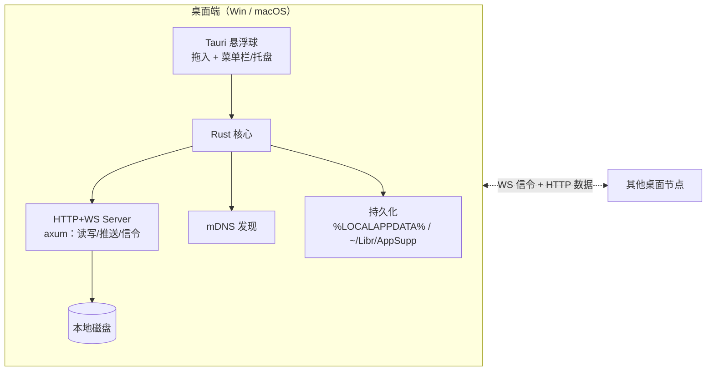

# OrbDrop 需求文档

> 版本：v0.5（2026-09-14）
> 状态：需求已对齐（桌面端完整需求链，基础功能优先），技术方案草案待定

## 1. 项目概述

**OrbDrop** 是一个局域网文件中转工具，主体是一个**始终置顶的悬浮球**，点击展开主界面。提供两条独立的文件流通路径：

- **拖入可见（引用模式）**：把目录/文件拖入悬浮球，**定向选择**对哪些已配对设备可见 → 对端设备标签页中实时出现该目录，可浏览、下载、BeyondCompare 比较、修改/删除/新建（**直接写回源文件**）。零拷贝，文件始终留在本机。
- **推送（真传输）**：从本机共享项列表中选中文件/目录，**指定目标设备**推送 → **已绑定（已配对）设备不经同意直接收**（token 就是那份信任；长连接与否都一样），**未绑定设备才弹同意** → 文件真传输到对端本地磁盘，之后与发送方是否在线无关。收完对端留一条**待确认的通知**（面板右下角气泡，点「知道了」才消失）。

两条路径可分别选择不同的目标设备；设备有三种状态（未绑定/已配对/长连接），控制和能力各有不同。

**目标平台**：

| 平台 | 角色 | 备注 |
|---|---|---|
| Windows 10/11（x64） | 完整对等节点 | 拖入可见 + 推送接收/发送 + 写回（含新建）|
| macOS | 完整对等节点 | 与 Windows 功能对等 |
| Android | 接收为主（暂缓） | 接收推送 + 浏览下载引用 |

**当前专注桌面端**（Win + macOS），Android 需求已记录待后续启动。

**部署范围**：仅局域网（LAN），不做互联网穿透。

**发布计划**：可能公开（GitHub 发布）。macOS 需过 Notarization 公证。

## 2. 核心场景

### 场景一：拖入可见（引用访问）
1. 用户 A 把 `C:\Projects\X` 拖入 OrbDrop 悬浮球 → 共享项上架登记，**自动广播给所有长连接设备**
2. B 处于长连接状态，其悬浮球主界面**自动**出现 A 的设备标签，标签内展示共享项 `X` 的目录树（零拷贝，实时读取 A 的磁盘）
3. B 在树中浏览；右键调用 **BeyondCompare 通过 WebDAV 直连**比较 A 的 `X` 与本地目录（P2）；修改/新建/删除保存后实时写回 A 的源文件
4. B 也可右键"下载到本地"，复制一份到 B 磁盘（落盘位置由设置控制）
5. A 可随时关闭广播开关撤销可见性，或中断连接

### 场景二：推送（真传输）
1. A 在悬浮球本机标签的共享项列表中选中目录/文件，勾选目标设备 B，点击推送
2. B 是**已绑定（已配对）设备**（长连接或只是在线都算）→ **不问同意，直接开收**；B 是**未绑定设备** → 面板右下角一张通知气泡（带文件名与**接收/拒绝**，同意制兜底）。两种情况都**不主动弹面板**：悬浮球左上角的黄色数字就是要不要点开的信号
3. 收下 → 文件流式传输落盘到 B 本地（默认**下载目录** S-01：一律落在 `<发送方名>/` 下，按发送方选中的那些项各自的**名字**展开 —— 单文件 `A.txt`、单目录 `D/…`、多选 `甲目录/…` + `散文件.txt`），完整保留目录结构
4. 传输完成后 B 本地文件独立存在，A 离线不影响 B 使用；B 这边留一条**待确认的长通知**（面板右下角气泡：谁推的、几项、落在哪个目录），点「知道了」才消失 —— 收了什么、收在哪，不会随一条 2 秒的提示一起蒸发
5. B 离线时 A 推送**直接失败提示**（不排队）

### 场景三：双机对称（桌面端）
- 每台 PC 上的 OrbDrop 实例角色对称：既是共享方，也是接收方
- 多台 PC 可同时在线

## 3. 功能需求

### 3.1 悬浮球与主界面
| 编号 | 需求 | 平台 | 优先级 |
|---|---|---|---|
| F-01 | 悬浮窗始终置顶（Always-on-top），可拖动位置 | Win/mac | P0 |
| F-02 | 无边框，球/圆角形态，可自定义尺寸 | Win/mac | P0 |
| F-03 | 托盘/菜单栏图标 + 显隐快捷键 | Win/mac | P0 |
| F-04 | 点击悬浮球展开主界面 | 全端 | P0 |
| F-05 | 可选：点击穿透模式、自动隐藏 | Win/mac | P2 |
| F-06 | **开机自启**选项（默认开启，可关闭） | Win/mac | P1 |
| F-07 | **本机显示名称**配置（默认取主机名，可修改） | 全端 | P1 |
| F-08 | **拖入反馈**：支持拖入时悬浮球高亮/抖动；拒绝非文件/非目录拖入 | Win/mac | P0 |
| F-09 | **本机信息条**（面板 footer）：左侧「端口 · **本机内网 IP**」—— IP 点一下复制 `IP:端口`（跨网段手动添加 F-11 直接粘过去），**多网卡（有线+无线+VPN）时只显示首选那个、悬停列出全部**（私有网段优先，链路本地 `169.254` 排最后；一块 footer 装不下三四个地址）；取不到地址（离线/无网卡）时只显示端口。最右侧是通知铃铛（F-56） | Win/mac | P1 |

**主界面布局**：**一级设备标签栏** + 内容区。

**面板内的层叠顺序（定死）**：右键菜单（根层级）> 对话框（`.overlay` 90）> 设置面板（`.sheet` 85）> 通知浮层（`.panel-bottom` 70）> 正文/tab 栏/footer。**模态必须压过通知浮层** —— 反过来的后果是"推送选择框/设置面板开着，通知气泡正盖在它的按钮上，点下去被气泡接走"。通知浮层**左右 12px、上下就是两条横线**（滚动区域夹在"标签栏下缘"与"footer 上缘"之间，内容越不过线）；浮层与容器不吃指针、只有气泡自己吃，**阴影是点击穿透的**（气泡的阴影收在盒子内部的留白里，见 F-56）。

- 每个在线/已配对设备一个标签；另含一个**本机标签**（管理本机共享项）
- 标签 = 设备，内容区 = 该设备的共享项列表/目录树

**持久化（跨重启保持）**：共享项列表、已配对设备列表、下载目录、窗口位置、本机名称、开机自启设置——自动保存，重启恢复。token 独立存放于数据目录的**凭据文件**（见 F-15），不与配置文件一起。详见 N-10。

### 3.2 设备发现与配对
| 编号 | 需求 | 优先级 |
|---|---|---|
| F-10 | 自动发现**同网段**在线设备（mDNS），零配置 | P0 |
| F-11 | **手动添加设备**（输入 `IP:端口`）以支持跨网段场景 | P1 |
| F-12 | **首次配对**（两条路，任一端都能发起）：**① 配对码**：A 点击"配对"→ A 显示 6 位码（2 分钟有效）→ B 输入码 → 双向确认 → 交换 token → 后续 Bearer 认证；**② 配对邀请**：A 在配对弹窗里点「发起邀请」→ 邀请**通过按钮点击推送**到 B（`POST /pair/invite`，一次 HTTP，不需要 WS、不需要预先配对）→ B 面板右下角挂一条带「接收/拒绝」的通知（60s 没人处理自动作废）→ B 点「接收」即完成配对（谁都不用输码）。A 侧弹窗**当场收起**，这条邀请变成同一组里的一张「等待对方确认配对」卡（带「取消」）：对方接受 → 卡片收掉 + 提示配对成功；被拒/超时/联系不上 → 卡片收掉并写明原因；点「取消」→ 撤回 B 界面上那条通知 | P1 |
| F-13 | 设备列表展示：名称、**状态（未绑定/已配对/长连接/离线）**、在线状态、共享项摘要。列表**在线在前、离线在后**，在线组内按 长连接 → 已配对 → 未绑定 排（见下方"列表内容与排序"）| P1 |
| F-14 | 随时中断与指定设备的连接；解除配对：**双向**清 token + 断链，但设备行**不立即消失** —— 它仍在发现范围内就继续以"未绑定"列出（可再次配对）。**解除配对是本机动作，不要求对方在线**（对端离线时本机照样清干净，只少一次"通知对端"这一步）；已配对的设备离线后**仍留在列表**（排在在线设备下方，只提供「解除配对」），解除后仍在线则以"未绑定"列出，离线则不再列出 | P0 |
| F-15 | **App 内凭据管理**：设备列表显示配对状态（未配对/已配对/连接中）；配对、解除配对、重新配对、查看密钥状态——全部在 App 内完成。**一键清空**：设置面板里「清空全部凭据」一个动作清掉本机全部配对（含写进 Beyond Compare 的 WebDAV profile），用户无需（也不应）去翻文件或系统凭据管理器 | P0 |
| F-16 | **长连接**：**由用户点「连接」建立** WS 长连接（实时在线/变更通知通道）——配对只确立"已配对"关系，不自动建链（mDNS 发现/探活不拨号）；「断开」= 断链 + 本机暂停 + 清本机"上次是长连接"的记忆（对端的重拨被拒，双方界面都回到"已配对"）；任一台点「连接」立即拨号恢复，对端的显式请求也会结束本机的暂停。**重启恢复**：关机时处于长连接的设备，下次启动自动拨回来（记忆在链路建立那一刻落盘，用户点「断开」即清除，两个方向都跨重启有效） | P0 |

> 「断开」的"拒"**只针对自动重拨**，不是解绑，也不拒绝人对人的连接请求：链路建立时**两侧**都会写下 `autoConnect` 记忆，所以若断开只断链、什么都不拦，对端自己的重连循环会在 5 秒内把链路接回来，按钮等于没按。因此 WS 升级入口（`server::events_ws_handler`）在暂停期间只对**不带 `manual=1`** 的拨号回 403；用户在对端点「连接」时带 `manual=1`，一律放行**并顺手结束本机的暂停**（`manual=1` 只搭在这一次拨号上，不是循环的长期属性）。两种信号别混：**403 = 对端暂停**（关系还在，谁点一次「连接」就恢复）；**401 = 对端不认本机 token**（关系已不成立，只能重新配对）。被 403 拒后本机的拨号循环**停手**，不再每分钟敲门（敲门永远不会变成连接）。

**设备状态模型**：

```
未绑定 ──配对──▶ 已配对 ──点击"连接"／启动恢复──▶ 长连接
 │                │                     │
 │                │                     ├──点击"断开"（断链+本机暂停）──▶ 已配对
 │                │                     │    └──任一端点"连接"─────────▶ 长连接
 │                └──解除配对──────────▶ 未绑定（仍在线则留在列表，离线则不再列出）
 └──可推送（接收需同意）
```

**列表内容与排序**（F-13/F-14）：

- **在线设备全列**，组内按 长连接 → 已配对 → 未绑定 排（同级按名称）
- **已配对但离线的设备排在其下方**（「离线」状态，虚线标记）：对方不在线才是真正需要
  「解除配对」的场合 —— 解除是纯本机动作（`POST /unpair` 只是尽力通知对端），不需要对方在线
- 离线**且未绑定**的设备不列：它没有任何可做的动作
- 离线行只提供「解除配对」：`连接` 的目标不在网上（只会开一个空转的拨号循环），
  `推送` 邀请是 HTTP 直达对端，同样不可达

**状态 pill**（一律 ≤3 字，完整原因写在悬停说明里；颜色只表达"要不要你管"）：

| pill | 条件 | 配色 |
|---|---|---|
| 长连接 | 在线 + WS 链路活着 | 绿（点呼吸） |
| 已配对 | 在线、已配对、没有拨号意图 —— **本机点过「断开」、或对端点过「断开」都落回这一档**（都是有人主动做的事，不是故障；原因只在悬停说明里） | **蓝**（项目主色） |
| 未绑定 | 在线、未配对 | **中性**（局域网设备的默认状态：不配对也能推送，接收方同意即可 —— 不是告警） |
| 离线 | 已配对但对端不在网上（含"拨号正在待命"） | 中性 + 虚线 |
| 重连中 | 退避重试建链中（**含被网络打断后自动接回**） | 琥珀（非稳态，点呼吸） |
| 需配对 | 对端不认本机 token（401：它清过数据 / 解除了配对）—— 唯一"关系已不成立"的异常 | **红** |

> `waiting`（对端不在网上、拨号转入待命）**不单独成档**：它蕴含"对端离线"，pill 归「离线」，
> "本机还在等它上线，一出现就自动接回"这层意思写进「离线」的悬停说明。
>
> **未绑定**这一档只给两个动作：「配对」与「推送文件」—— 「连接」拨不动（未配对不建链），
> 「解除配对」也没有关系可解，两者都不出现在行内与右键菜单里。

「需配对」这一档的行内动作是**「配对」（重新配对）**，不是「连接」—— 拨号必然 401、
`stop_reason_for` 会让循环立刻停手，点多少次都一样；重新配对会让对端发一枚新 token
（本机存的那枚与 BC 里那份一起更新）。配对成功时清掉这台设备残留的拨号状态，否则界面
会停在「需配对」继续叫他重新配对（`state::mark_paired`）。

- **未绑定**：mDNS 发现/手动添加，未交换 token。**可推送**——推送邀请直接 HTTP 发送，接收方同意才传输（同意制兜底安全），不要求预先配对
- **已配对**：token 交换完成，具备认证。可推送；长连接**不自动建立**（唯一例外是"上次关机时它是长连接"，见 F-16 重启恢复），设备行给一个「连接」按钮，由用户点击建立
- **长连接**：已配对 + WS 实时连接（以真实 WS 会话为准，非"HTTP 可达"；由用户点「连接」进入，或启动时按上次状态恢复）。**拖入文件时自动广播**给所有长连接设备
- **离线**（限定"已配对"）：对方不在 mDNS/探活视野里 —— 行仍在列表**最下方**（F-13/F-14），此时唯一能做的事就是「解除配对」。离线**未绑定**的设备不列

> 长连接的记忆存在**地址簿**（`config.toml` 的 `peers` 条目 `autoConnect`）：链路一建立就写、用户点「断开」（或解除配对）就清。写在建立那一刻而不是退出时，所以强杀进程/断电都不会丢。启动恢复的拨号**不带** `manual=1`——对端点过「断开」时照旧被拒，不替它解除暂停。

> mDNS **不能跨网段**；跨网段只能手动添加。**token 存储**：全部已配对设备的 token 合成一份映射，存在数据目录的一个文件里 —— `%LOCALAPPDATA%\OrbDrop\credentials.dat`（macOS `~/Library/Application Support/OrbDrop/`）。格式是一整块混淆过的 base64 文本（内层才是 `ODBF <版本>` 头 + JSON 正文 + `# 177plus` 署名），**这一层只是遮挡、不是加密**：文件等价于明文，任何拿到它（以及源码里那枚固定混淆密钥）的人都能解出全部 token。所以这个文件是"本机唯一一处 App 自己的凭据"：App 内「清空全部凭据」删掉它就是全清，同时把写进 BC 的 WebDAV profile 一起剪掉；解除单台设备只从映射里移除那一台，不影响其他设备。（老版本把这份映射放在系统凭据库里，首次启动会**自动迁移**过去并删掉那条老凭据。）

### 3.3 拖入可见（引用模式，仅桌面端）
| 编号 | 需求 | 优先级 |
|---|---|---|
| F-20 | 支持将目录/文件从 Explorer/Finder **拖入悬浮球** | P0 |
| F-21 | 拖入即**登记上架**（零拷贝，仅登记本地路径），**自动广播给所有处于长连接状态的设备** | P0 |
| F-22 | 共享项带**广播开关**（开/关状态图标）：开启 → 自动广播给所有长连接设备；关闭 → 撤销可见性，仅本机可见 | P0 |
| F-23 | 共享项可重命名、下架（从本机移除共享项）、删除 | P1 |
| F-24 | 支持多共享项同时存在；对端设备标签内以列表/树展示 | P1 |
| F-25 | 无长连接设备时开启广播 → 提示"暂无长连接设备，请在设备列表建立连接"；对端长连接建立/断开时，共享项可见范围实时更新 | P1 |

**交互链**：拖入 → 悬浮球高亮 → 共享项登记到本机标签（默认开启广播）→ 所有长连接设备标签中自动出现 → 用户可关闭广播开关撤销

> 广播对象 = **所有处于长连接状态的设备**（无需逐个勾选）。用户点「连接」建立的设备即自动纳入本机所有共享项的广播范围；断开长连接即从广播范围移除。

### 3.4 远程浏览（引用模式）
| 编号 | 需求 | 优先级 |
|---|---|---|
| F-30 | 设备标签内展示远程目录树，惰性展开（按需加载一层） | P0 |
| F-31 | 展示文件大小、修改时间等元数据 | P1 |
| F-32 | 目录缓存 + 并发预取（避免网络往返放大延迟） | P1 |
| F-33 | 共享方目录变更 **自动推送通知刷新** + 手动刷新兜底 | P1 |

> 边界处理：无权限目录 → 显示"无权访问"提示；空目录 → 正常展示空内容；文件被占用 → 仅影响读/写操作（返回错误），不影响浏览元数据。

### 3.5 文件操作（桌面端）
| 编号 | 需求 | 优先级 |
|---|---|---|
| F-40 | 右键：**下载到本地**（复制到设置的**下载目录**；可在设置中选择"默认存下载目录"或"每次弹窗选位置"）| P0 |
| F-41 | 右键：**BeyondCompare 比较**（本机共享项 ↔ 本机目录，或对端共享项 ↔ 本机目录）。对端走 BC 的 WebDAV profile 直连本机 DAV 端点：OrbDrop 自动往 BC 的 `BCProfiles.xml` 写入/更新一条 WebDAV profile（**名字固定为 `IP:端口`**，BaseURL `http://IP:端口/dav/`，用户名 `OrbDrop`、密码为该设备 token）。**解除配对时自动清理这条 profile**（token 已作废；只删用户名是 `OrbDrop` 的条目，用户手建的 profile 不动），再启动 `BCompare.exe "profile:IP:端口?<共享项id>/<子路径>" "<本地目录>"` | P0 |
| F-42 | BC 保存的修改/新建/删除 → 通过 WebDAV **实时写回发送方源文件**（发送方在线为前提）。无需暂存目录或临时文件 | P1 |
| F-43 | 右键：**删除**远程文件/目录（通过 WebDAV DELETE，破坏性操作需二次确认） | P1 |
| F-44 | 右键：**下载到本地并用 Explorer/Finder 打开**（落盘行为遵循 S-02 下载模式设置） | P0 |
| F-45 | 右键：**复制远程路径**（文本，供手动脚本/工具链使用） | P1 |
| F-46 | **拖拽下载**：本机共享项/对端共享项里的**任意文件或目录**都能直接拖到 Explorer/Finder 的某个目录里落盘（拖目录 = 整个目录含子目录与文件）；落下的动作只可能是**复制**，源文件/源共享项不受影响 | P1 |

> **F-46 拖拽下载（实机结论）**：网页里的 HTML5 拖拽出不了 webview —— 目的地是另一个进程，只能用 OS 的原生拖放（OLE `DoDragDrop`，见 `src-tauri/src/drag.rs`）。本机共享项走 `CF_HDROP`（磁盘上就是那些文件，只允许 `DROPEFFECT_COPY` + `Preferred DropEffect`，同盘拖拽的默认"移动"语义不会把用户的源文件搬走）；**对端共享项走 OLE 的"虚拟文件"**（`CFSTR_FILEDESCRIPTOR` + `CFSTR_FILECONTENTS` + 自实现的 `IStream`）：起拖前只走一遍**元数据**（`/tree` + `/stat`），字节在**落下那一刻**由资源管理器按需从对端拉取、**直接写进拖到的那个目录** —— 本机不落任何暂存副本。实测（真手势 + 真资源管理器）自定义 `IStream` 能过跨进程编组，虚拟文件这条路可用。对端版本旧（没有 `/stat`）时退回列父目录拿元数据，仍然拖得动；`/shares` 的 `isDir` 必须报真元数据（不能按扩展名猜：没有扩展名的文件会被当成目录，展开/拖拽都会报 `Path is not a directory`）。

> **WebDAV 直连（BC 5.2 实测结论，别按直觉改）**：BC 的 WebDAV 位置**只能通过 profile 引用**——`profile:<profile名>` 取 profile 的 BaseURL，`profile:<profile名>?<子路径>` 再拼一层子路径（分隔符只有 `?` 有效）；裸 `http://x:<token>@IP:port/…` URL **不会**进 DAV 客户端（BC 只发 HEAD/GET，然后报"不能加载基文件夹"）。
> profile 存在 `BCProfiles.xml`：便携版＝BC exe 同目录，常规安装＝`%APPDATA%\Scooter Software\Beyond Compare 5\`。密码字段是 BC 自己的 `BCmp|1|` 信封（AES-256-GCM，密钥在同文件根节点 `Encryption` 属性里），**明文写进去会被 BC 丢弃**；OrbDrop 按同一格式自行加密写入，全程不需要用户操作 GUI。细节与验证记录见 `docs/p2-beyondcompare.md`。
> 服务端命名空间是 `/dav/<共享项id>/<相对路径>`（不用共享项名字：中文/空格/重名，且会和 `/shares`、`/tree` 抢前缀）；认证走 Basic（`OrbDrop:<token>`，用户名不参与校验、只作为"发起方是本应用"的记录），非回环请求必须先回 `401 + WWW-Authenticate: Basic`（BC 会先裸探一次，收到挑战才带凭据重试）。按需读取、实时写回，不占用本地磁盘暂存。

### 3.6 推送（真传输）
| 编号 | 需求 | 优先级 |
|---|---|---|
| F-50 | **推送本机文件/目录**：点设备上的「推送」先问文件还是文件夹（系统选择框一次只能挑一种），再弹原生选择框。选择框**一律允许多选**（挑一个就是单发，不需要额外开关）；多选合并成**一条**推送：对端一张卡、一次同意、一条进度。**目标可以是任何在线设备（含未绑定、未配对）**——推送不要求预先配对 | P0 |
| F-51 | **接收侧的同意规则**：**已绑定（已配对）设备**（含正在长连接的）推送**不需要接收方同意** —— token 就是那份信任，到了就收；**未绑定设备**仍走同意制：面板**右下角一张通知气泡**（"收到「XX」的推送文件 XX" + 文件名）+**接收/拒绝**，60s 没动作自动拒绝。**收到通知不主动弹面板**（不抢屏幕）：悬浮球**左上角**的黄色数字就是"有事等你"的信号，处理完即消失 | P0 |
| F-52 | 同意后（或已绑定设备自动收下后）真传输到对端本地磁盘（默认落盘到**下载目录** S-01）：一律落在 `<发送方名>/` 下，按选中的项各自的名字展开（单文件 `A.txt` / 单目录 `D/…` / 多选各项各占一个名字）—— **没有"推送名子目录"那一层**；完整保留目录结构 | P0 |
| F-53 | 目标设备离线 → 推送**直接失败提示**，不排队 | P0 |
| F-54 | 传输进度展示（发送方进度卡 / 接收方进度条）、**双向取消** —— 任一端取消后，另一端那张卡片必须跟着收掉，不留"停在等待/接收中"的僵尸状态。发送方进度卡与通知同一个形状、同一组（F-56）| P1 |
| F-55 | 推送记录：历史、重发 | P2 |
| F-56 | **通知组（右下角气泡 + 铃铛）**：**所有通知都在同一组气泡里** —— 未绑定的邀请（带接收/拒绝）、**配对邀请（带接收/拒绝，F-12 第二条路）**、**本机发出去的「等待对方确认配对」卡（带取消）**、正在接收（进度 + 取消）、**发送方进度卡**（"等待对方同意"可能等很久）、已收到、接收失败；右对齐、宽 = **面板的 2/3**（不占满），多条垂直堆叠、新的贴最下缘（放不下才在组内滚，**不显示滚动条**）。**滚动区域正好夹在"标签栏下缘"与"footer 上缘"两条横线之间**（盒子上下边就是这两条线，滚动时内容越不过线），左右 12px。气泡阴影**点击穿透**、且收在盒子内部（更紧的 `--shadow-bubble`，不靠往外借位置）。整组**甩入/甩出**。收完/失败这类**点「知道了」才消失**（长通知），正文带**落盘位置**（`<下载目录>/<发送方名>`）—— 否则点完就再也找不到东西在哪。**铃铛**在面板**最右下角、版本号右边**，点一下展开/收起整组；**收起 ≠ 已读**：角标照旧挂着，与悬浮球左上角黄标是同一个数（= 组里还剩几件事：通知 + 在途推送）| P0 |

### 3.7 传输（通用）
| 编号 | 需求 | 优先级 |
|---|---|---|
| F-60 | 大文件流式传输，支持断点续传（Range 请求） | P0 |
| F-61 | 传输完整性校验（哈希），不一致时报错重传 | P1 |
| F-62 | 并发传输控制（同时进行中传输数上限） | P2 |

### 3.8 设备管理与安全
| 编号 | 需求 | 优先级 |
|---|---|---|
| F-70 | 设备标签显示：名称、在线状态、配对状态 | P1 |
| F-71 | 设备重命名、移除（解除配对，自动清理本机对应 token 与 BC profile）、拉黑——即 App 内凭据管理入口（对应 F-15） | P1 |
| F-72 | 写回（修改/删除/新建）需携带有效的对端身份 token；删除强制二次确认（仅删除，修改/新建不弹）| P1 |
| F-73 | 共享方对被写回的目标可配置策略（允许写回 / 只读） | P1 |
| F-74 | **状态持久化**：共享项、配对设备列表、下载目录、窗口位置、设置——自动保存到磁盘，重启恢复；**token 存数据目录下的凭据文件**（见 F-15/N-10），不落配置文件 | P0 |

### 3.9 Android 客户端
*（已记录，桌面端 P0/P1 完成后启动，暂缓）*

| 编号 | 需求 | 优先级 |
|---|---|---|
| F-80 | **悬浮气泡**（`SYSTEM_ALERT_WINDOW`），显示连接状态，收到推送时抖动/改变颜色 | P0 |
| F-81 | **前台服务**保活，后台保持 WebSocket 长连接 | P0 |
| F-82 | 点击气泡展开主界面，设备标签页 + 远程目录树浏览 | P0 |
| F-83 | 接收推送 → 通知栏提示 → 同意/拒绝 → 流式落盘 | P0 |
| F-84 | 浏览 PC 共享项 + 下载到本地 | P1 |
| F-85 | 系统分享菜单入口：分享到 OrbDrop → 选目标 PC → 推送 | P1 |
| F-86 | 可选 SAF 外部目录作落盘位置（等同桌面 S-01；推送接收也落这里） | P2 |
| F-87 | 首次运行引导：悬浮窗权限 + 忽略电池优化 + 前台服务 | P0 |

> Android 不做拖入可见共享方，不做写回。

### 3.10 macOS 专用
| 编号 | 需求 | 优先级 |
|---|---|---|
| F-90 | **本地网络权限**（`NSLocalNetworkUsageDescription`）首次授权引导 | P0 |
| F-91 | 菜单栏图标（替代托盘），支持显隐 | P0 |
| F-92 | Finder 拖入支持（Tauri 原生支持 macOS） | P0 |
| F-93 | 写回与 BeyondCompare macOS 版（`bcomp`）集成，与 Windows 对等 | P1 |

### 3.11 设置项

| 编号 | 需求 | 优先级 |
|---|---|---|
| S-01 | **下载目录**：唯一的落盘位置（默认 `%USERPROFILE%/Desktop`）——引用下载（F-40）与推送接收（F-52）都写这里；推送一律落在 `<发送方名>/` 下（按选中项的名字展开，见 F-52）。同名文件自动改名 `xxx (1).ext` | P0 |
| S-02 | **下载模式**：下拉选项——"直接存下载目录"或"每次弹窗选位置"，默认"直接存下载目录"。**只作用于手动下载**：推送一直是弹窗同意后落盘 | P0 |
| S-03 | ~~**收件目录**~~ **已并入 S-01**（不再单设）：两个"预设落盘位置"对用户是同一种操作，分成两份只会让人猜哪个生效 | — |
| S-04 | **开机自启**：开机自动启动，默认开启（对应 F-06） | P1 |
| S-05 | **本机名称**：设备显示名称，默认取主机名（对应 F-07） | P1 |
| S-06 | **监听端口**：默认 `3890`，可配置。被占用时自动探测 `3891-3899` 取第一个空闲端口；全部被占则报错提示。mDNS 声明实际端口，同网段对端无感 | P0 |

> 设置项集中在 App 设置面板中管理，持久化到本地配置文件（N-10）。当前 P0 仅覆盖需要设置化的文件路径和模式；P1/P2 更多设置项随产品化逐步添加。

## 4. 非功能需求

| 编号 | 需求 | 平台 | 优先级 |
|---|---|---|---|
| N-01 | 局域网 1Gbps 下传输可打满带宽 | 全端 | P1 |
| N-02 | 巨量小文件场景性能可用（缓存/预取是关键） | 全端 | P1 |
| N-03 | 深目录、长路径、特殊字符正确处理（Windows `\\?\` / macOS APFS 无此问题） | Win/mac | P1 |
| N-04 | 悬浮球常驻低资源占用（内存 < 100MB，CPU 空闲近 0） | 桌面 | P1 |
| N-05 | 掉线自动检测与重连；操作断线时给出明确错误而非挂死。重连为**证据驱动**：只在有人点「连接」或有证据对端在线时拨；对端不在时转入待命（不发无用连接）；对端**明确拒绝**（它点过「断开」/不认 token）才停手，且**停手理由在设备行可见** | 全端 | P1 |
| N-06 | Windows 防火墙放行：安装包/首次运行时按**程序路径**加防火墙规则（不依赖端口号），因此端口漂移不受影响。弹窗授权引导用户确认 | Win | P0 |
| N-07 | 推送/接收全程可见性：发送方知道对方是否同意/拒绝/完成 | 全端 | P1 |
| N-08 | Android 前台服务电量可控（暂缓） | Android | P1 |
| N-09 | Android 分区存储适配（暂缓） | Android | P1 |
| N-10 | **配置与状态持久化**：共享项/配对设备列表/下载目录/窗口位置/设置 → 自动保存到本地配置文件（`%LOCALAPPDATA%/OrbDrop/` 或 `~/Library/Application Support/OrbDrop/`），重启恢复；丢失配置文件不阻塞启动（恢复到默认状态）。**token 不写入配置文件**，单独存数据目录下的凭据文件（见 F-15）；该文件是整块混淆后的 base64 文本，内层的头/正文/署名都不可读（**遮挡、非加密**） | Win/mac | P0 |
| N-11 | **日志与排障**：应用日志写入本地文件（最多保留 7 天/100MB，轮转）；包含连接事件、配对事件、传输记录、写回记录；错误日志附带设备和路径上下文；首次连不上时提示防火墙/AP 隔离排查步骤 | Win/mac | P1 |

## 5. 技术方案（草案，待定）

### 5.1 整体架构



### 5.2 通信通道

| 通道 | 协议 | 用途 |
|---|---|---|
| 数据面 | HTTP/1.1（`axum`），Bearer 认证 | 目录树、元数据、引用读写、推送内容下载 |
| WebDAV 面 | HTTP/1.1 + WebDAV 扩展（`axum` 同一服务同端口），Basic Auth | BC 直连远程浏览/比较/写回 |
| 信令面 | WebSocket 长连接 | 在线状态、推送通知（同意/拒绝）、目录变更通知 |
| 发现面 | mDNS（同网段）+ 手动添加 `IP:端口`（跨网段） | 设备发现 |

### 5.3 协议草案

```
# 引用模式（拖入可见）
GET    /shares                                  # 本机共享项列表
GET    /tree?share=&path=                       # 目录惰性展开
GET    /stat?share=&path=                       # 元数据
GET    /file?share=&path=&offset=&len=          # 分段读取（Range）
PUT    /file?share=&path=                       # 写回：覆盖/新建
DELETE /file?share=&path=                       # 写回：删除
POST   /share/permissions                       # 设置对端可见性

# WebDAV（BC 直连，同一服务，路径映射到共享项）
PROPFIND /<share>/<path:.*>                     # 目录列表（XML），供 BC 浏览树
OPTIONS  /<share>/<path:.*>                     # 协议能力协商（DAV: 1, 2）
GET      /<share>/<path:.*>                     # 读文件（复用 /file 逻辑）
PUT      /<share>/<path:.*>                     # 写回（复用 /file 逻辑）
DELETE   /<share>/<path:.*>                     # 删除（复用 /file 逻辑）
Authorization: Basic <base64("OrbDrop:<token>")> # BC 只支持 Basic；用户名只是发起方标记，token 作密码

# 推送模式（真传输）
POST   /push/invite                             # 推送邀请 → 未绑定设备弹窗等同意；已绑定设备直接收下（响应即 accepted）
POST   /push/respond                            # 对端同意/拒绝
GET    /push/download?id=&offset=               # 接收端拉取推送内容（Range）
POST   /push/confirm                            # 接收完成确认

# 信令（WebSocket）
WS     /events                                  # 在线状态 / 推送通知 / 目录变更通知

Authorization: Bearer <token>                   # 配对后认证（REST）
POST   /pair                                    # 6 位配对码换 token
POST   /pair/invite                             # 配对邀请：对端弹通知等同意，响应即 token（免输码）
POST   /pair/invite/withdraw                     # 发起方撤回一条还没被处理的配对邀请
```

> PUT `/file` 方法：若路径不存在 → 新建；若存在 → 覆盖。write-back 包含修改与新建。

### 5.4 技术栈

| 层 | 技术 | 平台 |
|---|---|---|
| **共享核心** | Rust（axum + 自实现 PROPFIND/OPTIONS + tokio-tungstenite + mdns-sd + sha2）| 全端复用一个 crate |
| **桌面 UI** | Tauri v2 + **Svelte 5**（编译时无虚拟 DOM，运行时开销最低，契合 N-04 常驻低资源；Tauri 官方模板一等支持） | Win / macOS 一套 |
| **WebDAV** | 同一 axum 服务，同端口 3890，`/{share}/{path:.*}` 路由 + PROPFIND XML 响应 + OPTIONS 协商 | Win/mac |
| **持久化** | 本地配置文件（TOML）+ 数据目录下的凭据文件（整块混淆的 base64 文本，内层是 `ODBF` 头 + JSON 正文 + 署名，**遮挡非加密**；原子写；老版本的系统凭据库条目、以及老格式（v1 明文遮挡）的凭据文件都在启动时一次性迁移/就地改写） | Win/mac |
| **落盘** | `tokio::fs` 流式写入 | 全端 |
| **发现** | `mdns-sd` crate（同网段）+ 手动添加界面 | 全端 |

## 6. 风险清单

| 风险 | 影响 | 应对 |
|---|---|---|
| 端口被占用 / 全部端口耗尽 | 启动失败 | 自动探测 `3891-3899` 兜底；全部被占时弹窗提示检查端口占用或更改配置 |
| 写回破坏性（误删/覆盖/误新建） | 数据丢失 | 删除强制二次确认；共享方只读策略；写回日志可回溯 |
| HTTP 明文 + Bearer token 嗅探 | token 泄露 → 未授权读/写 | 传输加密决策（见 7）；token 定期轮换 |
| **凭据文件等价于明文** | token 存本机数据目录的 `credentials.dat`（整块混淆的 base64，**只是遮挡、非加密**：混淆密钥就在源码里）：**拿到这个文件 = 拿到全部配对 token**，可在本局域网内读写本机共享项（token 同时也是 WS 长连接与 WebDAV 的口令） | 已知并接受（局域网内、且 BC 那条路早就有同一枚 token 的等价拷贝：`BCProfiles.xml` 的密码字段用文件内自带的 `Encryption` 密钥加密）。缓解：文件权限 0600；App 内「清空全部凭据」一键清除（含 BC profile）；解除配对；共享项广播开关。**要真正加密**只能引入密钥保管（Windows DPAPI / macOS Keychain），本方案不引 |
| 系统凭据库时代的老数据 | 老版本把映射放在单条系统凭据里，且有 **Windows 2560 字节上限**（约 11 台设备即失败） | 已随本次改动消除：数据搬到文件，无平台上限；启动时一次性迁移（先写文件、后删老条目），迁移后系统凭据库里不再有 OrbDrop 条目 |
| 跨网段不可自动发现 | 部分设备不可见 | 手动添加兜底；提示检查网段/AP 隔离 |
| Windows 防火墙拦截 | 首次无法互连 | 监听时引导授权；安装包预加规则 |
| macOS 本地网络权限 | 首次 mDNS 发现失败 | `NSLocalNetworkUsageDescription` + 引导用户手动授权 |
| 巨量小文件网络往返放大 | 浏览/下载性能不可用 | 目录缓存 + 并发预取（必须做） |
| 长路径/特殊字符 | 浏览/写回异常 | 路径转义；Windows `\\?\` 前缀 |
| 引用操作中发送方掉线 | 操作失败 | 断线检测 + 明确错误提示；可续传或重试 |
| 已绑定设备推送**不再问同意** | 老搭档（或拿到其 token 的人）能直接往本机下载目录里写文件（同名文件按续传语义覆盖） | 用户明确要的取舍（配对 = 互信）；落盘一律收在 `<下载目录>/<发送方名>/` 这一层下面，不会散进下载目录本身；收完留一条待确认通知（看得见收了什么、收在哪）；解除配对即断掉这条路。未绑定设备仍走同意制 |

## 7. 待定决策（阻塞项）

- [ ] **传输加密**：写回 + token 在明文 HTTP 上风险较高。HTTPS（自签证书，两端预信任） vs HTTP 明文 + 短期 token？
- [ ] **写回冲突策略**：BC 会话期间远程文件被另一方修改 → 冲突检测方式（mtime / 哈希 / 版本号）及处理策略（提示用户 / 保持最新 / 合并）
- [x] **推送落盘位置**：并入下载目录（S-01）——不再单设收件目录；推送一律落在 `<发送方名>/` 下、按选中项各自的名字展开（**没有"推送名子目录"**：`A.txt/A.txt`、`3 项/a.txt` 那种嵌套不符合直觉），避免和手动下载的文件混在同一层
- [ ] **WebDAV Basic Auth 安全**：BC 要求 Basic Auth（base64 明文），token 在每次请求中传递。同局域网 HTTPS 未定前，已配对的 token 被嗅探可写回。是否需要 WebDAV 专用短期 token？
- [ ] **mDNS 降级**：mDNS 失败时是否尝试 UDP 广播兜底（同网段兼容性）

## 8. 路线图

| 阶段 | 内容 | 交付 |
|---|---|---|
| **P0** | 悬浮球壳 + 拖入登记 + 广播开关 + 本机标签 + 设备标签页 + 引用目录树浏览 + 下载到本地（下载目录/模式设置 S-01/S-02）+ 状态持久化 | 桌面端端到端 MVP |
| **P1** | mDNS 发现 + 6 位码配对（含超时）+ 推送（通知/同意/拒绝/流式落盘）+ 断点续传 + 变更自动刷新 + 写回日志 + 开机自启 | 局域网完整双路径传输链路 |
| **P2** | WebDAV 直连 BC 集成（PROPFIND/OPTIONS/同端口） + 写回策略（只读/允许）+ 哈希校验 + `bcomp` macOS 集成 | 核心差异化 + 全文持 |
| **P3** | 缓存/预取优化 + 多设备管理打磨 + 断线重连 + 推送历史 + 长路径边界 + Android 启动 | 产品化打磨 |

## 9. 参考先例

- **LocalSend**：拖入式局域网文件传输 UI + 对端同意制接收
- **Snapdrop**：局域网设备自动发现，无需配对
- **BeyondCompare**：Win/mac 双平台文件夹比较，保存后写回

## 10. 术语表

| 术语 | 定义 |
|---|---|
| 悬浮球 / Orb | 始终置顶的悬浮窗，程序入口与入口视觉载体 |
| 主界面 | 点击悬浮球展开的窗口：设备标签栏 + 内容区 |
| 本机标签 | 主界面中管理本机共享项的设备标签 |
| 设备标签 | 主界面一级标签，代表一个已配对的远程设备 |
| 拖入可见 / 引用模式 | 目录拖入后对指定设备可见，零拷贝实时远程访问（仅桌面端，广播对象 = 长连接设备）|
| 共享项 | 一个被拖入、登记了本地路径的目录/文件 |
| 上架 / 下架 | 建立 / 撤销一个共享项 |
| 可见性 | 某共享项对某设备是否可见——长连接设备自动获得所有共享项的可见性 |
| 推送 / 真传输 | 指定目标设备，把文件实体传输到对端本地：**已绑定（已配对）设备直接收下**（token 就是那份信任），未绑定设备经同意后收下；目标可含未绑定设备 |
| 通知组 / 长通知 | 面板**右下角**那组气泡：未绑定的邀请（带接收/拒绝）、配对邀请（带接收/拒绝）、正在接收、已收到、失败各一条，右对齐、宽 = 面板 2/3；收完/失败那两类**点「知道了」才消失**。footer 最右侧（版本号右边）的**铃铛**整体展开/收起它，角标 = 未处理的通知数（与悬浮球左上角黄标同一个数，含在途传输） |
| 写回 | 接收方修改/新建/删除远程文件，直接作用于发送方源文件 |
| 配对 | 两台设备建立互信（6 位码换 token，或在弹窗里点「发起邀请」由对方在通知里点「接收」—— 免输码）|
| 未绑定 | 设备已发现（mDNS/手动）但未交换 token，可推送 |
| 已配对 | token 交换完成；长连接需用户点「连接」建立（配对本身不建链），但**上次关机时的长连接会在下次启动时自动拨回** |
| 长连接 | 已配对基础上建立 WS 实时通道（用户点「连接」建立、启动时按上次状态恢复，「断开」则断链并拒掉对端重拨）；拖入时自动接收广播、接收变更通知 |
| 广播开关 | 共享项的全局可见性控制：开启 = 自动广播给所有长连接设备；关闭 = 仅本机可见 |
| 凭据文件 | 数据目录下的 `credentials.dat`：全部已配对设备 token 的映射。文件是整块混淆后的 base64 文本，内层才是 `ODBF <版本>` 头 + JSON 正文 + `# 177plus` 署名 —— **遮挡、不是加密**（等价于明文；混淆密钥写在源码里）。所有读写经 App 封装，删除入口只有 App 内「清空全部凭据」（F-15）|
| WebDAV 直连 | BC 集成方式：OrbDrop 在 HTTP 服务上提供 WebDAV 端点，BC 通过 OrbDrop 写好的 profile（用户名 `OrbDrop`，密码 = 该设备 token）浏览/比较/写回，无需暂存临时文件 |

## 11. 非目标（明确不做）

- 不做互联网穿透 / 中继服务器
- 不做跨 VLAN 自动发现
- 不做虚拟盘符挂载（WinFsp / WebDAV）
- 不做目录自动双向同步 / 实时镜像
- 不做云端存储 / 账号体系
- 不做历史审计 / 日志上报
- 不做 Android 引用共享方角色（拖入可见/写回）
- 不做推送离线排队 / 挂起队列